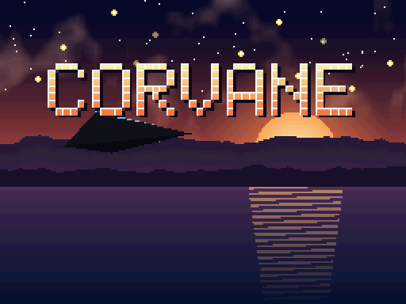
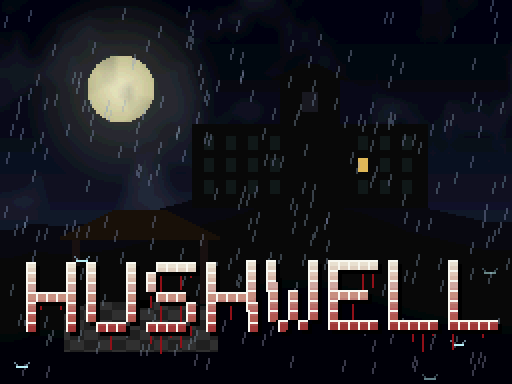
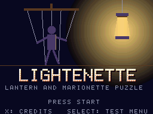
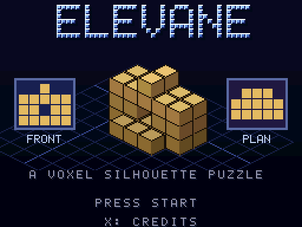
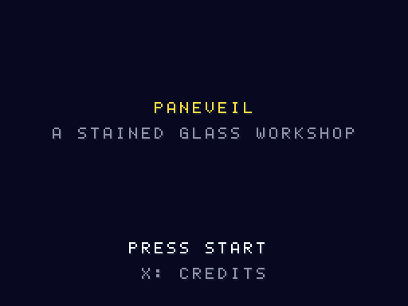
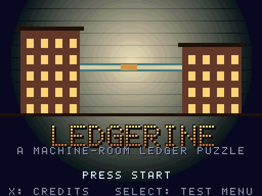
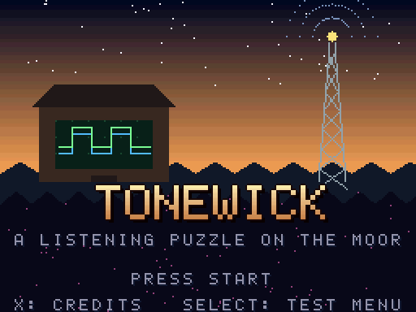
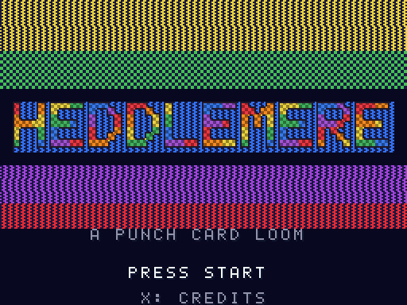
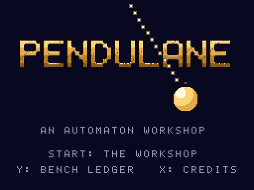
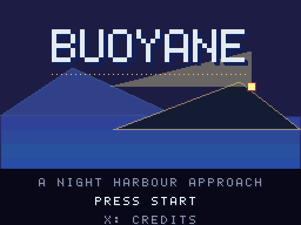

<div align="center">

<h1 align="center">
  <picture>
    <source media="(prefers-color-scheme: dark)" srcset="assets/logo/cleancart-lockup-dark.svg">
    
  </picture>
</h1>

**라이선스가 깨끗한 닌텐도 DS 홈브루**

[](#플레이)
[](https://blocksds.skylyrac.net/)
[](AGENTS.md)
[](#빌드)
[](https://github.com/devgyurak/cleancart.nds/commits/main)

[English](README.md)

</div>

[BlocksDS](https://blocksds.skylyrac.net/)로 만든 닌텐도 DS 오리지널 홈브루 게임 모음입니다.
라이선스를 깨끗하게 유지합니다. 코드는 직접 작성하고, 에셋은 이 저장소의 코드로
생성하며, ROM에 들어가는 서드파티 런타임 라이브러리는 모두 고지합니다.

## 목적

에뮬레이터 개발자가 개발하고 검증할 때 쓰도록 만든 홈브루 게임 모음입니다.

- **스스로 판정하는 완성된 게임.** 각 ROM은 끝까지 플레이할 수 있는 게임이면서, 하드웨어가 어떻게
  동작했는지도 보고합니다(결과 블록, `expected.json`, `judge.py`). 실기와 다른 동작은 느낌이 아니라
  실패한 항목으로 드러납니다.
- **CI에서 그대로 사용.** `judge.py`가 종료 코드를 돌려주고, 렌더러별 known 프로필이 새로 생긴
  차이와 이미 알려진 차이를 구분해 줍니다. 판정하는 모든 항목에는 L1 기능부터 L4 연구까지 난이도 레벨이 있고, 게임마다 목표 레벨이 하나 있습니다
  ([docs/LEVELS-KO.md](docs/LEVELS-KO.md)): L1 Corvane·Hushwell·Paneveil, L2 Lightenette·Ledgerine·Tonewick·Buoyane, L3 Elevane·Heddlemere·Pendulane, L4 [연구용 probe 모음](probes/)(게임이 아님).
- **콘솔에서 확인함.** 모든 게임을 DS Lite에서 돌렸습니다. 콘솔이 GBATEK과 달랐던 것, GBATEK이 맞고 에뮬레이터가
  달랐던 것은 [docs/HW-FINDINGS-KO.md](docs/HW-FINDINGS-KO.md)에 모았습니다.
  범위(2026-11-23, `expected.json` 10개에서 센 값): 판정 항목 376개 중 GBATEK 근거 260개, ROM 자체 논리 80개,
  DS Lite 실측값(`hw:dslite-ntr`) 17개, 서드파티 이슈 보고 3개, 미확정 16개(참고용, 그중 12개가 Elevane)입니다.
  플래시카트에서는 해당 없는 `env` 항목 22개가 따로 있습니다(Hushwell 16, Tonewick 3, Pendulane 3).
  콘솔은 DS Lite(NTR) 1대와 R4 Plus(Wood) 카드 1종, 에뮬레이터는 melonDS 1.1과 DeSmuME(py-desmume 0.0.9)입니다.
  다른 기종의 결과나 기대값에 대한 이의는 *Bug report or question* 이슈로 받습니다([CONTRIBUTING-KO.md](CONTRIBUTING-KO.md)).
- **라이선스가 깨끗함.** ROM 안의 모든 것이 직접 작성한 코드, 이 저장소의 코드로 생성한 에셋,
  또는 고지한 서드파티 런타임 라이브러리입니다. 테스트 스위트에서 뺄 것이 없습니다.

Claude Code와 함께 만들었습니다. 기대값의 근거는 GBATEK 또는 DS Lite 실기 런이며, 모델이 정한 값이 아닙니다.

## 에뮬레이터 테스트로 쓰기

1. [Releases](https://github.com/devgyurak/cleancart.nds/releases)에서 `<game>-v<x.y.z>-judge.zip`을 받습니다. 한 버전의 리허설 ROM, `expected.json`, `judge.py`가 들어 있습니다.
2. 리허설 ROM을 헤드리스로 정해진 프레임 수만큼 실행하고, 메인 RAM(`0x0237F000`)의 결과 블록을 덤프합니다.
3. `judge.py`로 채점합니다. 게이팅 항목이 모두 OK면 종료 코드 0, 실패한 항목이 있으면 1, 쓸 만한 결과가 없으면 2입니다.
4. `--profile NAME`을 주면 실패한 항목이 그 에뮬레이터의 known 차이와 정확히 같을 때만 0으로 끝납니다.

```sh
tools/melonds/mds.sh run games/lightenette/lightenette-rehearsal.nds 1800 out/mds/reh "" 1799 > reh.log
python3 games/lightenette/tools/judge.py --profile melonds-1.1-software reh.log
```

위는 Lightenette의 실행입니다. ROM 이름, 프레임 수, 블록 크기는 게임마다 다르므로 각 게임의
"에뮬레이터 테스트로 쓰기" 절을 따르세요(예: [Lightenette](games/lightenette/README-KO.md#에뮬레이터-테스트로-쓰기), [Pendulane](games/pendulane/README-KO.md#에뮬레이터-테스트로-쓰기)).
Heddlemere의 리허설은 [README](games/heddlemere/README-KO.md)에 있습니다.

## 게임

| 게임 | 설명과 시험하는 것 | 판정 | 레벨 | 문서 |
|---|---|---|---|---|
| [Corvane](games/corvane/)<br> | 다섯 전선을 돌파하는 3D 호버 슈팅. 위 화면은 3D 전장, 아래 화면은 레이더와 터치 락온.<br>시험(L1, 그래픽·시스템): 2D 엔진, 3D 표시 제어·상태(지오메트리·텍스처는 Paneveil 담당), DMA, 타이머, 인터럽트, IPC, BIOS·수학, 디스플레이 캡처. | 자동, 데모 49개 전부(`judge.py`, `expected.json`) | <!-- cell:corvane -->L1 목표 93 · 전제 조건 0<!-- /cell --> | [README](games/corvane/README-KO.md) · [QA 체크리스트](games/corvane/docs/QA-KO.md) · [실기 QA](games/corvane/docs/HW-QA-KO.md) · [에셋](games/corvane/ASSETS-KO.md) |
| [Hushwell](games/hushwell/)<br> | 우물 위에 지은 요양원의 1인칭 서바이벌 호러. 위 화면은 손전등 시점, 아래 화면은 손으로 그린 지도와 녹음기, 그리고 소리로 사냥하는 그것.<br>시험(L1, 소리·입출력): ARM7 사운드 채널, PSG 파형 녹음, 사운드 캡처·스트리밍, 키·터치 입력, 카트·세이브 칩, RTC, 펌웨어 설정, 덮개. | 자동: 데모 ROM 66개 중 소리·입출력 19개(나머지는 Corvane 영역)와 QA 실행(`judge.py`, `expected.json`) | <!-- cell:hushwell -->L1 목표 41 · 전제 조건 4<!-- /cell --> | [README](games/hushwell/README-KO.md) · [QA 체크리스트](games/hushwell/docs/QA-KO.md) · [실기 QA](games/hushwell/docs/HW-QA-KO.md) · [에셋](games/hushwell/ASSETS-KO.md) |
| [Lightenette](games/lightenette/)<br> | 5막으로 된 등불과 마리오네트 퍼즐 액션. ROM이 자기 화면의 픽셀 수를 세어 스스로 판정합니다.<br>시험: 디스플레이 캡처, 반투명 OBJ 블렌딩, 마스터 밝기, 3D 텍스처 좌표, 에지 마킹, 선 폴리곤. | 자동(`judge.py`, `expected.json`) | <!-- cell:lightenette -->L2 목표 19 · 전제 조건 18<!-- /cell --> | [README](games/lightenette/README-KO.md) · [QA 체크리스트](games/lightenette/docs/QA-KO.md) · [실기 QA](games/lightenette/docs/HW-QA-KO.md) · [에셋](games/lightenette/ASSETS-KO.md) |
| [Elevane](games/elevane/)<br> | 다섯 장(주문서 40개)의 복셀 실루엣 퍼즐. 두 화면 모두 디스플레이 캡처로 3D이며, 리허설 ROM으로 스스로 판정합니다.<br>시험: 양쪽 화면의 3D 디스플레이 캡처, HBlank DMA 합성, 뒷면(rear plane), 지오메트리·폴리곤 한계. | 자동(`judge.py`, `expected.json`) | <!-- cell:elevane -->L3 목표 3 · 전제 조건 17<!-- /cell --> | [README](games/elevane/README-KO.md) · [QA 점검표](games/elevane/docs/QA-KO.md) · [실기 QA](games/elevane/docs/HW-QA-KO.md) · [에셋](games/elevane/ASSETS-KO.md) |
| [Paneveil](games/paneveil/)<br> | 다섯 장(창 주문서 30개)의 스테인드글라스 공방 퍼즐. 주문서대로 창의 유리·문양·장미창을 맞춘 뒤 가마에 굽습니다. 리허설 ROM으로 스스로 판정합니다.<br>시험(L1, 3D 지오메트리·텍스처): 행렬 스택, 행렬 load/multiply, 지오메트리 명령, 폴리곤 속성, 텍스처 속성·좌표. | 자동(`judge.py`, `expected.json`) | <!-- cell:paneveil -->L1 목표 30 · 전제 조건 1<!-- /cell --> | [README](games/paneveil/README-KO.md) · [QA 점검표](games/paneveil/docs/QA-KO.md) · [실기 QA](games/paneveil/docs/HW-QA-KO.md) · [에셋](games/paneveil/ASSETS-KO.md) |
| [Ledgerine](games/ledgerine/)<br> | 방 여섯 개의 기계실 장부 퍼즐. 압착기, 기송관, 시계벽, 벨트, 금고, 규칙서의 다이얼을 맞추고 레버를 당기면 실제 하드웨어 장치가 돌아가 그 결과가 장부에 적힙니다. 리허설 ROM으로 스스로 판정합니다.<br>시험(L2, 시스템 경계): 수학 장치, IPC FIFO, 타이머, DMA, WRAM·VRAM 제어, BIOS의 예외·경계값·에러 경로. | 자동(`judge.py`, `expected.json`) | <!-- cell:ledgerine -->L2 목표 31 · 전제 조건 11<!-- /cell --> | [README](games/ledgerine/README-KO.md) · [QA 점검표](games/ledgerine/docs/QA-KO.md) · [실기 QA](games/ledgerine/docs/HW-QA-KO.md) · [에셋](games/ledgerine/ASSETS-KO.md) |
| [Tonewick](games/tonewick/)<br> | 네 지역의 청음 퍼즐(신호선 12개): 오실로스코프로 감청소의 끊긴 신호선을 고칩니다. 신호선 하나는 사운드 블록의 레지스터 필드 하나이고, ROM은 캡처 유닛으로 자기 소리를 직접 듣습니다. 리허설 ROM으로 스스로를 판정합니다.<br>검사 (L2, 소리·입출력 경계): 사운드 채널과 캡처 유닛의 경계값·문서화된 버그, 그리고 RTC, 전원관리, 세이브 칩, 펌웨어 사용자 설정. | 자동 (`judge.py`, `expected.json`) | <!-- cell:tonewick -->L2 목표 17 · 전제 조건 10<!-- /cell --> | [README](games/tonewick/README-KO.md) · [QA 점검표](games/tonewick/docs/QA-KO.md) · [실기 QA](games/tonewick/docs/HW-QA-KO.md) · [에셋](games/tonewick/ASSETS-KO.md) |
| [Heddlemere](games/heddlemere/)<br> | 다섯 장(주문서 40개)의 펀치카드 베틀 퍼즐: 네 줄짜리 태피스트리의 카드를 뚫습니다. 천은 라인별 래스터 쓰기로 짜이고, 베틀은 지오메트리 명령을 돌리며 그 사이클 비용이 모터 예산을 정합니다. 리허설 ROM으로 스스로를 판정합니다.<br>검사 (L3, 3D 엔진과 스캔라인 타이밍): 라인·프레임 길이, HBlank·VBlank 플래그, VCOUNT 쓰기, 지오메트리 명령 사이클 비용, FIFO 정지와 절반 비움 IRQ, 폴리곤 RAM 교체 라인, 텍스처 조용한 라인. | 자동 (`judge.py`, `expected.json`) | <!-- cell:heddlemere -->L3 목표 15 · 전제 조건 11<!-- /cell --> | [README](games/heddlemere/README-KO.md) · [QA 점검표](games/heddlemere/docs/QA-KO.md) · [실기 QA](games/heddlemere/docs/HW-QA-KO.md) · [에셋](games/heddlemere/ASSETS-KO.md) |
| [Pendulane](games/pendulane/)<br> | 자동인형 공방 퍼즐: 장치의 역 순서를 골라, 실제로 잰 실행 시간이 진자의 흔들림에 정확히 떨어지게 합니다. 리허설 ROM으로 스스로를 판정합니다.<br>검사 (L3, CPU·버스·사운드 타이밍): 하드웨어 나눗셈·제곱근 busy 시간, 펌웨어 SPI 바이트 시간, ARM7 메모리 타이밍, 슬롯 1 카트리지 gap, 사운드 채널 busy·시작 타이밍. | 자동 (`judge.py`, `expected.json`) | <!-- cell:pendulane -->L3 목표 16 · 전제 조건 8<!-- /cell --> | [README](games/pendulane/README-KO.md) · [QA 점검표](games/pendulane/docs/QA-KO.md) · [실기 QA](games/pendulane/docs/HW-QA-KO.md) · [에셋](games/pendulane/ASSETS-KO.md) |
| [Buoyane](games/buoyane/)<br> | 밤 항구 접근 게임: 작은 배를 몰며 불빛이 어떻게 보이는지 읽어 항구로 들어갑니다. 리허설 ROM과 확인 ROM 다섯 개로 스스로를 판정합니다.<br>검사 (L2, 3D 렌더링 가장자리): 폴리곤 규칙(1-dot 폴리곤, 깊이 Equal, far plane, 속성 래치), 텍스처 블렌딩(highlight, decal, 와이어프레임), fog·edge·안티앨리어싱 후처리. | 자동 (`judge.py`, `expected.json`) | <!-- cell:buoyane -->L2 목표 20 · 전제 조건 11<!-- /cell --> | [README](games/buoyane/README-KO.md) · [QA 점검표](games/buoyane/docs/QA-KO.md) · [실기 QA](games/buoyane/docs/HW-QA-KO.md) · [에셋](games/buoyane/ASSETS-KO.md) |

게임마다 폴더가 따로 있고, 빌드·문서·라이선스 파일도 각 폴더 안에 있습니다.

### 연구용 probe

[`probes/`](probes/)는 게임이 아니라, 실기에서 확인된 적 없는 동작(폴리곤 RAM 개수, `BOX_TEST`/`VEC_TEST` 결과,
같은 화면 2패스 캡처, 메인 메모리 디스플레이 FIFO, 줄당 OBJ 예산 등)을 에뮬레이터가 어떻게 처리하는지 보고하는
데모 ROM 모음(L4)입니다. 합격·불합격 판정은 없습니다. `probes/tools/judge.py`가 에뮬레이터별 값을 기록하고,
프로필이 달라지면 알려 줍니다. [README](probes/README-KO.md) · [QA 표](probes/docs/QA-KO.md) · [에셋](probes/ASSETS-KO.md)

## 레벨별 게임

게임마다 목표 레벨이 하나 있습니다. 목표 항목이 판정을 정하고, 낮은 항목은 전제 조건입니다(목표 레벨보다 높은 항목은 그 레벨을 맡은 게임의 몫이며, 자리를 못 정한 항목은 남기지 않습니다)([docs/LEVELS-KO.md](docs/LEVELS-KO.md)).
이 목록은 `scripts/mklevels.py`가 각 게임의 `expected.json`에서 생성합니다. 항목 설명은 `expected.json`의 영어 그대로입니다.

<!-- levels:begin -->
<details><summary><b>L1 기능</b> · Corvane, Hushwell, Paneveil (164 개)</summary>

#### Corvane · graphics and system

목표 93 · 전제 조건 0

- `sys-ipc-sync` · The value the ARM7 wrote to IPCSYNC (0xA, ARM7 ready) is what the ARM9 reads · [expected.json](games/corvane/expected.json)
- `sys-ipc-packets` · The ARM7 input packet arrives once per frame: 120 packets in 120 frames (1 off allowed) · [expected.json](games/corvane/expected.json)
- `sys-ipc-keyxy` · EXTKEYIN with nothing pressed: X and Y released, pen up, hinge open (bits 0,1,3,6,7 = 1,1,1,1,0) · [expected.json](games/corvane/expected.json)
- `sys-ipc-ping` · FIFO ping round trip takes one or two frames (our protocol, no hardware value) _(참고용)_ · [expected.json](games/corvane/expected.json)
- `sys-wram-errors` · The 32 KB shared WRAM pattern reads back without errors after the ARM9 takes it · [expected.json](games/corvane/expected.json)
- `sys-wram-crc` · GetCRC16 of the 32 KB pattern (CRC-16/MODBUS, checked independently in Python) · [expected.json](games/corvane/expected.json)
- `sys-wram-back` · WRAMCNT reads 3 after the ARM9 hands the WRAM back to the ARM7 · [expected.json](games/corvane/expected.json)
- `sys-irq-vblank` · One VBlank IRQ per frame: 120 in 120 frames · [expected.json](games/corvane/expected.json)
- `sys-irq-hblank-visible` · HBlank IRQs in 120 frames: at least 192 lines x 119 and at most 263 x 120 (DISPSTAT; a GBA-style count of about 23040 still passes) · [expected.json](games/corvane/expected.json)
- `sys-irq-vcount` · The VCOUNT IRQ at line 96 fires once per frame (1 off allowed) · [expected.json](games/corvane/expected.json)
- `sys-irq-timer` · A 10 Hz timer IRQ fires 19 or 20 times in 119 to 120 frames (frame = 560190 bus cycles, 33.513982 MHz) · [expected.json](games/corvane/expected.json)
- `sys-timer-beats` · An 8 Hz timer IRQ fires 15 or 16 times in 119 to 120 frames (frame = 560190 bus cycles) · [expected.json](games/corvane/expected.json)
- `sys-dma-now-errors` · 4 KB RAM to RAM DMA copy has no errors · [expected.json](games/corvane/expected.json)
- `sys-dma-fill-errors` · DMA fill of 32 KB VRAM and 4 KB RAM has no errors · [expected.json](games/corvane/expected.json)
- `sys-dma-gfx-polys-any` · The DMA-fed display list cube leaves 1 to 3 polygons (back faces are culled, a convex cube shows at most three) · [expected.json](games/corvane/expected.json)
- `sys-bios-lz77` · LZ77 decompression into VRAM equals the one into WRAM · [expected.json](games/corvane/expected.json)
- `sys-bios-fastset` · CpuFastSet copies the CpuSet fill value 0x12345678 · [expected.json](games/corvane/expected.json)
- `sys-bios-div` · BIOS Div 1000 / 7 = 142 · [expected.json](games/corvane/expected.json)
- `sys-bios-crc` · GetCRC16 of the decompressed logo · [expected.json](games/corvane/expected.json)
- `sys-math-div` · Hardware division equals software division for four operand pairs (incl. negative) · [expected.json](games/corvane/expected.json)
- `sys-math-len` · Vector length of (3,4,0) is 5 in 20.12 fixed point · [expected.json](games/corvane/expected.json)
- `sys-math-atan2` · atan2(1,1) is 45 degrees = 4096 (our table-free routine) · [expected.json](games/corvane/expected.json)
- `2d-engines-powercnt` · POWERCNT reads back as the demo set it (0x820F) · [expected.json](games/corvane/expected.json)
- `2d-engines-dispcnt` · DISPCNT of engine A reads back · [expected.json](games/corvane/expected.json)
- `2d-engines-dispcnt-sub` · DISPCNT of engine B reads back · [expected.json](games/corvane/expected.json)
- `2d-text-bg3cnt-sub` · BG3CNT of engine B (HUD, 8bpp bit set) reads back · [expected.json](games/corvane/expected.json)
- `2d-text-bg0cnt-sub` · BG0CNT of engine B (console, 4bpp) reads back · [expected.json](games/corvane/expected.json)
- `2d-bitmap-dispcnt` · DISPCNT with the 1024x512 large bitmap mode reads back · [expected.json](games/corvane/expected.json)
- `2d-bitmap-bg2cnt` · BG2CNT of the large bitmap reads back · [expected.json](games/corvane/expected.json)
- `2d-bitmap-phase` · The demo reached its second phase (nebula scroll) · [expected.json](games/corvane/expected.json)
- `2d-obj-map2d-dispcnt` · DISPCNT of engine B with 2D OBJ mapping reads back · [expected.json](games/corvane/expected.json)
- `2d-extpal-dispcnt` · DISPCNT with the extended palette bits reads back · [expected.json](games/corvane/expected.json)
- `2d-window-winin` · WININ reads back · [expected.json](games/corvane/expected.json)
- `2d-window-winout` · WINOUT reads back · [expected.json](games/corvane/expected.json)
- `2d-window-winout-sub` · WINOUT of engine B reads back · [expected.json](games/corvane/expected.json)
- `2d-blend-bldcnt` · BLDCNT reads back · [expected.json](games/corvane/expected.json)
- `2d-blend-bldalpha` · BLDALPHA reads back · [expected.json](games/corvane/expected.json)
- `2d-brightness-main` · MASTER_BRIGHT of engine A reads back (fade to white) · [expected.json](games/corvane/expected.json)
- `2d-brightness-sub` · MASTER_BRIGHT of engine B reads back (fade to black) · [expected.json](games/corvane/expected.json)
- `2d-capture-done` · The capture enable bit (bit 31 of DISPCAPCNT) has cleared by itself: the one-frame capture finished · [expected.json](games/corvane/expected.json)
- `2d-capture-cnt` · DISPCAPCNT reads back with the written source, size and write offset · [expected.json](games/corvane/expected.json)
- `3d-toon-control` · DISP3DCNT reads back with toon/highlight shading (bits 12-13, the RAM overflow flags, are not compared) · [expected.json](games/corvane/expected.json)
- `3d-edge-control` · DISP3DCNT reads back with edge marking (bits 12-13, the RAM overflow flags, are not compared) · [expected.json](games/corvane/expected.json)
- `3d-fog-control` · DISP3DCNT reads back with alpha-only fog (bits 12-13, the RAM overflow flags, are not compared) · [expected.json](games/corvane/expected.json)
- `3d-aa-control` · DISP3DCNT reads back with anti-aliasing (bits 12-13, the RAM overflow flags, are not compared) · [expected.json](games/corvane/expected.json)
- `3d-depth-control` · DISP3DCNT reads back with Z-buffering with a bitmap rear plane (bits 12-13, the RAM overflow flags, are not compared) · [expected.json](games/corvane/expected.json)
- `3d-compose-bg0cnt` · BG0CNT (3D layer behind the sea) reads back · [expected.json](games/corvane/expected.json)
- `3d-compose-bg2cnt` · BG2CNT (sea in front of the 3D layer) reads back · [expected.json](games/corvane/expected.json)
- `3d-tex-a3i5-poly` · A fully visible A3I5 textured quad is one polygon in polygon RAM · [expected.json](games/corvane/expected.json)
- `3d-tex-a5i3-poly` · A fully visible A5I3 textured quad is one polygon in polygon RAM · [expected.json](games/corvane/expected.json)
- `3d-tex-pal4-poly` · A fully visible 4-colour textured quad is one polygon in polygon RAM · [expected.json](games/corvane/expected.json)
- `3d-tex-pal16-poly` · A fully visible 16-colour textured quad is one polygon in polygon RAM · [expected.json](games/corvane/expected.json)
- `3d-tex-pal256-poly` · A fully visible 256-colour textured quad is one polygon in polygon RAM · [expected.json](games/corvane/expected.json)
- `3d-tex-4x4-poly` · A fully visible 4x4 compressed textured quad is one polygon in polygon RAM · [expected.json](games/corvane/expected.json)
- `3d-tex-direct-poly` · A fully visible direct colour textured quad is one polygon in polygon RAM · [expected.json](games/corvane/expected.json)
- `3d-fifo-polys-some` · The FIFO-fed scene stores polygons in polygon RAM: 1 to 2048 (RAM_COUNT range) (a zero count reads n/a; the item fails only above the RAM limit) · [expected.json](games/corvane/expected.json)
- `3d-fifo-verts-some` · The FIFO-fed scene stores vertices in vertex RAM: 1 to 6144 (RAM_COUNT range) (a zero count reads n/a; the item fails only above the RAM limit) · [expected.json](games/corvane/expected.json)
- `3d-clip-polys-some` · The clipping scene leaves polygons in polygon RAM: 1 to 2048 (a zero count reads n/a; the item fails only above the RAM limit) · [expected.json](games/corvane/expected.json)
- `3d-light-polys-some` · The lighting scene leaves polygons in polygon RAM: 1 to 2048 (a zero count reads n/a; the item fails only above the RAM limit) · [expected.json](games/corvane/expected.json)
- `3d-matrix-polys-some` · The matrix-stack scene leaves polygons in polygon RAM: 1 to 2048 (a zero count reads n/a; the item fails only above the RAM limit) · [expected.json](games/corvane/expected.json)
- `3d-poly-polys-some` · The polygon-attribute scene leaves polygons in polygon RAM: 1 to 2048 (a zero count reads n/a; the item fails only above the RAM limit) · [expected.json](games/corvane/expected.json)
- `3d-test-inside-some` · BOX_TEST reports the box inside the view volume on some but not all frames (1 to 119 of 120) · [expected.json](games/corvane/expected.json)
- `3d-test-pos-w-near` · POS_TEST w is about 5.1 in 1.19.12 fixed point (20400 to 21400; the ROM matrix gives 5.1 x 4096) · [expected.json](games/corvane/expected.json)
- `3d-test-vec-x-near` · VEC_TEST x is about 0.6 in the 4.12 result format (2330 to 2580) · [expected.json](games/corvane/expected.json)
- `3d-test-vec-z-near` · VEC_TEST z is about -0.79: sign-extended 4.12 value in -3260 to -3180 (the transformed vector; an untransformed one would differ) · [expected.json](games/corvane/expected.json)
- `io-qalog-verdict` · The QA result block (QARN) reports verdict 1 (PASS); the block of the auto QA run of corvane.nds has the same layout and is graded with --demo io-qalog · [expected.json](games/corvane/expected.json)
- `acc-stage-edge` · Edge marking draws outlines · [expected.json](games/corvane/expected.json)
- `acc-stage-lantern-visible` · The lantern pixel differs from the backdrop pixel outside it (the lantern is drawn) · [expected.json](games/corvane/expected.json)
- `acc-stage-darken` · Brightness decrease darkens the 3D backdrop outside the lantern: the pixel differs from the undarkened one and both captures finished · [expected.json](games/corvane/expected.json)
- `sys-dma-hblank-captured` · The one-frame display capture of the probe finished (DISPCAPCNT bit 31 cleared) · [expected.json](games/corvane/expected.json)
- `sys-dma-hblank-samples` · The probe compared this many pixels (so it cannot pass by checking nothing) · [expected.json](games/corvane/expected.json)
- `2d-affine-captured` · The one-frame display capture of the probe finished (DISPCAPCNT bit 31 cleared) · [expected.json](games/corvane/expected.json)
- `2d-affine-samples` · The probe compared this many pixels (so it cannot pass by checking nothing) · [expected.json](games/corvane/expected.json)
- `2d-affine-opaque` · Most sampled texels are not colour 0 (the probe tests real picture data) · [expected.json](games/corvane/expected.json)
- `2d-mosaic-captured` · The one-frame display capture of the probe finished (DISPCAPCNT bit 31 cleared) · [expected.json](games/corvane/expected.json)
- `2d-mosaic-samples` · The probe compared this many pixels (so it cannot pass by checking nothing) · [expected.json](games/corvane/expected.json)
- `2d-mosaic-steps` · The text under the mosaic changes between blocks often (the probe tests a real picture) · [expected.json](games/corvane/expected.json)
- `2d-obj-normal-captured` · The one-frame display capture of the probe finished (DISPCAPCNT bit 31 cleared) · [expected.json](games/corvane/expected.json)
- `2d-obj-normal-pixels` · A plain and an h-flipped 8x8 sprite show exactly their tile texels · [expected.json](games/corvane/expected.json)
- `2d-obj-normal-samples` · The probe compared this many pixels (so it cannot pass by checking nothing) · [expected.json](games/corvane/expected.json)
- `2d-obj-affine-captured` · The one-frame display capture of the probe finished (DISPCAPCNT bit 31 cleared) · [expected.json](games/corvane/expected.json)
- `2d-obj-affine-pixels` · An affine sprite with the identity matrix, plain and double-size, shows exactly its tile texels · [expected.json](games/corvane/expected.json)
- `2d-obj-affine-samples` · The probe compared this many pixels (so it cannot pass by checking nothing) · [expected.json](games/corvane/expected.json)
- `2d-obj-bitmap-captured` · The one-frame display capture of the probe finished (DISPCAPCNT bit 31 cleared) · [expected.json](games/corvane/expected.json)
- `2d-obj-bitmap-samples` · The probe compared this many pixels (so it cannot pass by checking nothing) · [expected.json](games/corvane/expected.json)
- `2d-obj-line-captured` · The one-frame display capture of the probe finished (DISPCAPCNT bit 31 cleared) · [expected.json](games/corvane/expected.json)
- `2d-vram-alias` · A VRAM bank keeps the data written through LCDC when it is remapped to its engine address (16 mappings, 32 words each) · [expected.json](games/corvane/expected.json)
- `2d-vram-samples` · The probe compared 16 x 32 words · [expected.json](games/corvane/expected.json)
- `sys-dma-disp-captured` · The one-frame display capture of the probe finished (DISPCAPCNT bit 31 cleared) · [expected.json](games/corvane/expected.json)
- `sys-dma-disp-samples` · The probe compared this many pixels (so it cannot pass by checking nothing) · [expected.json](games/corvane/expected.json)
- `2d-display-captured` · The one-frame display capture of the probe finished (DISPCAPCNT bit 31 cleared) · [expected.json](games/corvane/expected.json)
- `2d-display-samples` · The probe compared this many pixels (so it cannot pass by checking nothing) · [expected.json](games/corvane/expected.json)
- `2d-display-vram` · Sanity check: the frame the VRAM display mode showed is still in bank A (read back through LCDC, 768 samples); it does not judge the display itself · [expected.json](games/corvane/expected.json)

#### Hushwell · sound and I/O

목표 41 · 전제 조건 4

- `sys-dma-cart-found` · probe.bin is found through FNT/FAT in the cart image · [expected.json](games/hushwell/expected.json)
- `sys-dma-cart-dma` · Raw cart DMA read of probe.bin gives the expected CRC16 · [expected.json](games/hushwell/expected.json)
- `sys-dma-cart-nitro` · NitroFS read of probe.bin gives the expected CRC16 · [expected.json](games/hushwell/expected.json)
- `sys-keys-held` · No key is held in a headless run · [expected.json](games/hushwell/expected.json)
- `sys-keys-keyxy` · EXTKEYIN with nothing pressed (X, Y, pen released, hinge open) · [expected.json](games/hushwell/expected.json)
- `sys-keys-irqs` · Number of key IRQs during the run (the scripted harness presses a key once; no hardware value) _(참고용)_ · [expected.json](games/hushwell/expected.json)
- `io-cart-ok` · Chapter 3 loads from NitroFS · [expected.json](games/hushwell/expected.json)
- `io-cart-ready` · Raw cart DMA is available · [expected.json](games/hushwell/expected.json)
- `io-save-eeprom-write` · Save write and verify succeed · [expected.json](games/hushwell/expected.json)
- `io-save-eeprom-reload` · Save reload succeeds · [expected.json](games/hushwell/expected.json)
- `io-save-eeprom-seq` · The save counter advanced by one · [expected.json](games/hushwell/expected.json)
- `io-save-flash-write` · Save write and verify succeed · [expected.json](games/hushwell/expected.json)
- `io-save-flash-reload` · Save reload succeeds · [expected.json](games/hushwell/expected.json)
- `io-save-flash-seq` · The save counter advanced by one · [expected.json](games/hushwell/expected.json)
- `io-save-fram-write` · Save write and verify succeed · [expected.json](games/hushwell/expected.json)
- `io-save-fram-reload` · Save reload succeeds · [expected.json](games/hushwell/expected.json)
- `io-save-fram-seq` · The save counter advanced by one · [expected.json](games/hushwell/expected.json)
- `io-firmware-colour` · Favourite colour from the firmware user settings is 0-15 · [expected.json](games/hushwell/expected.json)
- `io-firmware-name` · Name length from the firmware user settings is 0-10 · [expected.json](games/hushwell/expected.json)
- `io-rtc-month` · RTC month is 1-12 · [expected.json](games/hushwell/expected.json)
- `io-rtc-day` · RTC day is 1-31 · [expected.json](games/hushwell/expected.json)
- `io-rtc-hour` · RTC hour is 0-23 · [expected.json](games/hushwell/expected.json)
- `io-touch-up` · The pen is up at the checkpoint (the scripted touch ended) · [expected.json](games/hushwell/expected.json)
- `io-touch-x` · The last pen x is 120 (scripted touch at 120,100; one pixel of calibration error allowed) · [expected.json](games/hushwell/expected.json)
- `io-touch-y` · The last pen y is 100 (one pixel of calibration error allowed) · [expected.json](games/hushwell/expected.json)
- `io-power-lid` · The lid is open · [expected.json](games/hushwell/expected.json)
- `qa-verdict` · The auto QA run of hushwell.nds (hold L+R+X+Y on the title) reaches the credits with RESULT PASS: the QARN block reports verdict 1 · [expected.json](games/hushwell/expected.json)
- `snd-mix-voices` · Song and effects together use 8 to 16 channels (SOUNDCNT Start/Busy) at the busiest frame · [expected.json](games/hushwell/expected.json)
- `snd-pcm-oneshot` · A PCM8 one-shot is playing at frame 5 (a channel is busy) · [expected.json](games/hushwell/expected.json)
- `snd-pcm-loops` · The PCM8 and PCM16 loops started at frames 60 and 80 are still busy at the checkpoint · [expected.json](games/hushwell/expected.json)
- `snd-adpcm-oneshot` · The ADPCM jingle is playing at frame 5 (a channel is busy) · [expected.json](games/hushwell/expected.json)
- `snd-adpcm-loop` · The ADPCM hum loop started at frame 90 is still busy at the checkpoint · [expected.json](games/hushwell/expected.json)
- `snd-psg-noise` · The noise channel 14 started at frame 100 is busy at frame 105 · [expected.json](games/hushwell/expected.json)
- `snd-psg-stop` · Stopping channels 8-15 clears their Start/Busy bits · [expected.json](games/hushwell/expected.json)
- `snd-capture-busy` · Both sound capture units run in repeat mode (Start/Busy of capture 0 and 1) · [expected.json](games/hushwell/expected.json)
- `snd-stream-busy` · The streaming channel is still busy at the checkpoint · [expected.json](games/hushwell/expected.json)
- `snd-wave-freq` · A PSG square wave at 440 Hz (timer-derived) changes level about 220 times in 0.25 s of the left mixer record (+-5 %) · [expected.json](games/hushwell/expected.json)
- `snd-wave-octave` · The wave an octave lower (220 Hz) changes level half as often: the ratio x100 is 190 to 210 · [expected.json](games/hushwell/expected.json)
- `snd-wave-volume` · Volume 50 gives half the swing of volume 100 in the record (ratio x100 within 170 to 230) · [expected.json](games/hushwell/expected.json)
- `snd-wave-pan-left` · Pan 0 (hard left) puts an audible wave into the left mixer (peak-to-peak 16 to 255) · [expected.json](games/hushwell/expected.json)
- `snd-wave-pan-right` · Pan 126 (hard right) leaves the left mixer all but silent: a swing under 5 % of the audible pan-0 swing (about 200), so at most 9 (the exact GBATEK rounding is an L2 item in Lightenette) · [expected.json](games/hushwell/expected.json)

#### Paneveil · 3D geometry and texturing

목표 30 · 전제 조건 1

- `play-windows` · The rehearsal baked the first window of every chapter that has windows (5 windows) · [expected.json](games/paneveil/expected.json)
- `mtx-push-level` · Three pushes leave the position stack at level 3 (GXSTAT bits 8-12) · [expected.json](games/paneveil/expected.json)
- `mtx-pop-restores` · MTX_POP returns the matrix that was pushed: 0 of 16 CLIPMTX_RESULT words differ · [expected.json](games/paneveil/expected.json)
- `mtx-pop-n-level` · MTX_POP with N = 2 from level 3 leaves level 1 · [expected.json](games/paneveil/expected.json)
- `mtx-pop-n-matrix` · MTX_POP with N = 2 loads the second pushed matrix: 0 words differ · [expected.json](games/paneveil/expected.json)
- `mtx-store-level-kept` · MTX_STORE leaves the stack pointer alone (level stays 2) · [expected.json](games/paneveil/expected.json)
- `mtx-restore-matrix` · MTX_RESTORE brings the stored matrix back: 0 words differ · [expected.json](games/paneveil/expected.json)
- `mtx-proj-push-level` · The projection stack has one level: a push reads 1 in GXSTAT bit 13 · [expected.json](games/paneveil/expected.json)
- `mtx-proj-pop-level` · The projection pop reads 0 in GXSTAT bit 13 · [expected.json](games/paneveil/expected.json)
- `mtx-proj-pop-matrix` · The projection pop returns the pushed matrix: 0 words differ · [expected.json](games/paneveil/expected.json)
- `mtx-load-mult-clip` · Load and multiply (4x4, 4x3, 3x3, translate): CLIPMTX_RESULT equals the model, 0 of 16 words differ · [expected.json](games/paneveil/expected.json)
- `mtx-vec-mult` · Mode 2 multiplications: VECMTX_RESULT equals the model, 0 of 9 words differ · [expected.json](games/paneveil/expected.json)
- `gx-packed-fifo` · The mixed sequence sent as packed GXFIFO words leaves the model result (0 of 25 words differ) · [expected.json](games/paneveil/expected.json)
- `gx-direct-ports` · The same sequence through the direct command ports leaves the model result (0 of 25 words differ) · [expected.json](games/paneveil/expected.json)
- `gx-vtx-formats` · Six quads, each in another vertex format (VTX_16, VTX_10, XY, XZ, YZ, DIFF), all land where they belong (6 of 6 samples) · [expected.json](games/paneveil/expected.json)
- `poly-cull-default` · Default culling shows front faces only: 4 front quads drawn, 4 back quads hidden (8 of 8 samples) · [expected.json](games/paneveil/expected.json)
- `poly-back-render` · The back render bit shows back faces, the cleared front bit hides front faces (4 of 4 samples) · [expected.json](games/paneveil/expected.json)
- `poly-alpha-half` · Alpha 16 over an opaque quad mixes about half and half: 12 to 16 of 16 samples within 3 levels · [expected.json](games/paneveil/expected.json)
- `poly-wire-hollow` · Alpha 0 (wireframe) leaves the inside transparent: the quad behind shows (4 of 4 samples) · [expected.json](games/paneveil/expected.json)
- `poly-wire-edges` · Alpha 0 draws the edges: edge-coloured pixels in the bands across the quads top edges (1 to 64 of 28) · [expected.json](games/paneveil/expected.json)
- `poly-depth-equal` · Depth test Equal draws a coplanar polygon over the first (4 of 4 samples) · [expected.json](games/paneveil/expected.json)
- `poly-depth-less` · Depth test Less hides a coplanar polygon (4 of 4 samples) · [expected.json](games/paneveil/expected.json)
- `tex-repeat` · Repeat S and repeat T show the texture again (8 of 8 texel samples) · [expected.json](games/paneveil/expected.json)
- `tex-flip` · Flip S and flip T mirror every second repeat (8 of 8 texel samples) · [expected.json](games/paneveil/expected.json)
- `tex-clamp` · Without repeat the edge texels are stretched (4 of 4 texel samples) · [expected.json](games/paneveil/expected.json)
- `tex-colour0-hidden` · Colour 0 made transparent shows what lies behind (4 of 4 samples) · [expected.json](games/paneveil/expected.json)
- `tex-colour0-shown` · Colour 0 displayed shows palette entry 0 (4 of 4 samples) · [expected.json](games/paneveil/expected.json)
- `tex-pltt-base` · PLTT_BASE picks the palette set (4 of 4 texel samples) · [expected.json](games/paneveil/expected.json)
- `tex-coord-mode1` · Transformation mode 1 applies the texture matrix: a swap of S and T transposes the texture (4 of 4 samples) · [expected.json](games/paneveil/expected.json)
- `qa-verdict` · The QA run ended with PASS (QARN verdict 1) · [expected.json](games/paneveil/expected.json)

</details>

<details><summary><b>L2 경계</b> · Buoyane, Ledgerine, Lightenette, Tonewick (87 개)</summary>

#### Buoyane · 3D rendering edges: polygon rules, texture blending and the fog/edge/anti-aliasing post-pass

목표 20 · 전제 조건 11

- `dot-mixed-w-first-colour` · A 1-dot polygon with vertices on both sides of DISP_1DOT_DEPTH is drawn, in the colour of its first vertex (forward order red, reverse order green) · [expected.json](games/buoyane/expected.json)
- `dot-only-zero-size` · A far 1x0 polygon is drawn; a 0x0 polygon at the same distance is hidden · [expected.json](games/buoyane/expected.json)
- `dot-depth-extremes` · DISP_1DOT_DEPTH 0 hides a W 1 dot; 7FFF shows dots at W 1, 64 and 1000 · [expected.json](games/buoyane/expected.json)
- `aa-translucent-dot-kept` · With anti-aliasing on, a translucent (alpha 30) 1-dot polygon is still drawn · [expected.json](games/buoyane/expected.json)
- `aa-opaque-dot-hidden` · With anti-aliasing on, an opaque 1-dot polygon is hidden (the same dot is drawn without it) · [expected.json](games/buoyane/expected.json)
- `fog-translucent-and` · Fog on a translucent pixel needs both the polygon fog bit and the fog flag of the pixel behind it (case without: no fog; case with: fog) · [expected.json](games/buoyane/expected.json)
- `fog-rear-plane-bit` · CLEAR_COLOR bit 15 set: the rear plane is fogged; clear: it is not · [expected.json](games/buoyane/expected.json)
- `edge-front-only` · Edge marking colours only the edge of the polygon in front (the one with the smaller depth) · [expected.json](games/buoyane/expected.json)
- `edge-aa-translucent` · With anti-aliasing a marked edge is neither the edge colour nor the face colour (qualitative) · [expected.json](games/buoyane/expected.json)
- `aa-marked-line-complete` · With anti-aliasing and edge marking a real one-pixel line (own polygon ID) has no gap: 192 of 192 pixels · [expected.json](games/buoyane/expected.json)
- `zeq-tolerance-flat` · Depth test Equal draws nothing for steps of -2 and +2 (raw z 2 and 6 against a base at 4, beyond +-200h) from the base plane · [expected.json](games/buoyane/expected.json)
- `zeq-slope-band-width` · Equal band on a sloping face is 42..54 pixels wide (the +-200h window; right x minus left x) · [expected.json](games/buoyane/expected.json)
- `zeq-no-base-empty` · An Equal polygon with no base polygon draws nothing · [expected.json](games/buoyane/expected.json)
- `far-plane-hide` · POLYGON_ATTR bit 12 clear hides a polygon that reaches past the far plane; set draws it clipped · [expected.json](games/buoyane/expected.json)
- `attr-latch-begin` · POLYGON_ATTR sent between Begin and End has no effect until the next Begin · [expected.json](games/buoyane/expected.json)
- `alpha-test-max-hides` · ALPHA_TEST_REF 1F hides an opaque (alpha 31) polygon · [expected.json](games/buoyane/expected.json)
- `highlight-clamp` · Highlight shading saturates at 63 (Rt 63 + Rs 33): the captured colour is white, not wrapped · [expected.json](games/buoyane/expected.json)
- `decal-alpha0-vertex` · A decal texel with alpha 0 shows the vertex colour · [expected.json](games/buoyane/expected.json)
- `wire-texture-alpha` · GBATEK says At<31 makes the wireframe translucent; a DS Lite draws it opaque: white wire pixels, none blended · [expected.json](games/buoyane/expected.json)
- `blend-bypass-clear-alpha0` · A translucent polygon over a rear plane of alpha 0 keeps its own colour (no blend) · [expected.json](games/buoyane/expected.json)

#### Ledgerine · system edges

목표 31 · 전제 조건 11

- `math-div0` · Division by zero: remainder = numerator, quotient = -1 (+1 for a negative numerator), mode 0 inverts the upper result word, the DIV0 flag is set (modes 0 and 2) · [expected.json](games/ledgerine/expected.json)
- `math-div0-flag-upper` · Mode 0 with denominator 0000000100000000h: the DIV0 flag stays clear (it follows the whole 64-bit denominator) · [expected.json](games/ledgerine/expected.json)
- `math-overflow-min32` · -MAX / -1 in mode 0 stays -MAX (reads 0000000080000000h) and sets no DIV0 · [expected.json](games/ledgerine/expected.json)
- `math-overflow-min64` · -MAX / -1 in mode 2 stays -MAX (8000000000000000h) and sets no DIV0 (own ROM: it hangs DeSmuME) · [expected.json](games/ledgerine/expected.json)
- `math-mode3` · The reserved divider mode 3 divides like mode 1 · [expected.json](games/ledgerine/expected.json)
- `math-sqrt-edges` · SQRT(2^64-1) = FFFFFFFFh in 64-bit mode; mode 0 ignores the upper half of PARAM · [expected.json](games/ledgerine/expected.json)
- `ipc-empty-last` · An empty FIFO read returns the last word received and sets the error bit · [expected.json](games/ledgerine/expected.json)
- `ipc-error-ack` · Writing 1 to IPCFIFOCNT bit 14 clears the error · [expected.json](games/ledgerine/expected.json)
- `ipc-empty-cleared` · An empty read after the remote side cleared its send FIFO does not return 0 (GBATEK says 0; a DS Lite returns a non-zero word) · [expected.json](games/ledgerine/expected.json)
- `ipc-empty-cleared-word` · The empty read after the remote side cleared its send FIFO returns A15 (7A00000Fh), the last word of the first burst: not 0 (GBATEK) and not B or C (DS Lite) · [expected.json](games/ledgerine/expected.json)
- `ipc-send-full` · The send FIFO is full after 16 words; the 17th write sets the error and is dropped (the other CPU counts 16) · [expected.json](games/ledgerine/expected.json)
- `ipc-disabled` · FIFO disabled: a write is ignored without error, reads show the oldest word without taking it · [expected.json](games/ledgerine/expected.json)
- `ipc-irq-edge` · The receive IRQ is edge-triggered: enabling it with a word waiting raises IF bit 18 once, the acknowledge sticks · [expected.json](games/ledgerine/expected.json)
- `timer-cascade-prescaler` · A count-up timer ignores its prescaler bits: it counts exactly the overflows of the timer before it · [expected.json](games/ledgerine/expected.json)
- `timer-start32-reload` · One 32-bit write of reload and start loads the new reload (counter in R..R+2 straight after) · [expected.json](games/ledgerine/expected.json)
- `timer-reload-deferred` · A reload written while the timer runs waits for the next overflow; writing the control register again with start still 1 does not reload · [expected.json](games/ledgerine/expected.json)
- `timer-frozen-read` · A stopped timer reads its frozen counter (equal a frame apart) · [expected.json](games/ledgerine/expected.json)
- `dma-repeat-src-advance` · A VBlank repeat DMA does not reload SAD: frame k copies the k-th piece of the source · [expected.json](games/ledgerine/expected.json)
- `dma-repeat-dst` · Repeat reloads DAD only in Increment/Reload mode; mode 0 continues where the last repeat stopped · [expected.json](games/ledgerine/expected.json)
- `dma-regs-unchanged` · After a transfer SAD, DAD and CNT_L read their initial values and the enable bit is off · [expected.json](games/ledgerine/expected.json)
- `dma-itcm-runs` · The CPU keeps running ITCM code while a long DMA runs (DMA plus an ITCM loop half its length takes about the DMA alone) · [expected.json](games/ledgerine/expected.json)
- `wram-half-swap` · WRAMCNT 1 / 2 give the ARM9 the second / first 16 KB, mirrored over all of 03xxxxxxh · [expected.json](games/ledgerine/expected.json)
- `wram-arm7-mirror` · With 0 KB of shared WRAM for the ARM7, 03000000h mirrors the ARM7 WRAM and WRAMSTAT reads 0 · [expected.json](games/ledgerine/expected.json)
- `vram-byte-write` · ARM9 byte writes (STRB) to LCDC VRAM, palette and OAM are ignored · [expected.json](games/ledgerine/expected.json)
- `vram-fg-offset` · Bank G as main BG VRAM with OFS 2 / 3 shows at 06010000h / 06014000h · [expected.json](games/ledgerine/expected.json)
- `vram-arm7-bytes` · Bank C given to the ARM7 with OFS 1 takes the ARM7 byte stores; VRAMSTAT bit 0 reads 1 whatever the offset · [expected.json](games/ledgerine/expected.json)
- `bios-fastset-any-count` · NDS CpuFastSet writes exactly 5 and exactly 13 words (no rounding up to 8) · [expected.json](games/ledgerine/expected.json)
- `bios-lz77-disp0` · LZ77 (SWI 11h): a block with displacement field 0 repeats the last byte · [expected.json](games/ledgerine/expected.json)
- `bios-bitunpack-zero` · BitUnPack: the Zero Data Flag adds the offset to zero units, without it zeroes stay zero · [expected.json](games/ledgerine/expected.json)
- `bios-rl-max` · RLUnComp: a 130-byte run and a 128-byte literal · [expected.json](games/ledgerine/expected.json)
- `bios-arm7-guard` · ARM7 CpuSet from a source in the BIOS area writes nothing · [expected.json](games/ledgerine/expected.json)

#### Lightenette · display edge cases

목표 19 · 전제 조건 18

- `seam-uv` · Reversed-UV cut line: rows 0 and 1 show no cut line, row 2 (the uncompensated reverse) shows one (qualitative reading of the hardware report in melonDS #2008; the exact count is not a hardware value) · [expected.json](games/lightenette/expected.json)
- `line-polygon` · Line polygons draw pixels (melonDS #2549); the count differs per emulator (705/710/834/338) · [expected.json](games/lightenette/expected.json)
- `lantern-blend-equal` · Translucent lantern OBJ looks the same with BLDCNT none / alpha / darken (melonDS #2503) · [expected.json](games/lightenette/expected.json)
- `act2-seam` · Act 2 doll cut lines: rows 0 and 1 show no cut line, row 2 (the uncompensated reverse) shows one (qualitative reading of the hardware report in melonDS #2008; the exact count is not a hardware value) · [expected.json](games/lightenette/expected.json)
- `act3-lantern-equal` · Act 3 translucent lantern OBJ over the darkened 3D stage looks the same with BLDCNT none / alpha / darken (melonDS #2503) · [expected.json](games/lightenette/expected.json)
- `act4-hline` · Act 4 horizontal line-polygon thread draws pixels (melonDS #2549); the count differs per emulator · [expected.json](games/lightenette/expected.json)
- `act4-dline` · Act 4 diagonal line-polygon thread draws pixels (melonDS #2549); the count differs per emulator · [expected.json](games/lightenette/expected.json)
- `act5-seam` · Act 5 doll cut lines: rows 0 and 1 show no cut line, row 2 (the uncompensated reverse) shows one (qualitative reading of the hardware report in melonDS #2008; the exact count is not a hardware value) · [expected.json](games/lightenette/expected.json)
- `act5-line-polygon` · Act 5 strings (line polygons) draw pixels (melonDS #2549); the count differs per emulator · [expected.json](games/lightenette/expected.json)
- `act5-lantern-equal` · Act 5 translucent lantern OBJ over the darkened 3D stage looks the same with BLDCNT none / alpha / darken (melonDS #2503) · [expected.json](games/lightenette/expected.json)
- `sys-irq-hblank` · HBlank IRQs in 120 frames: at most one per line, 263 lines per frame (31560); the demo starts mid-frame, so 119 frames of lines at least (31297) · [expected.json](games/lightenette/expected.json)
- `sys-math-sqrt64` · 64-bit hardware square root of 10^12 is 10^6 · [expected.json](games/lightenette/expected.json)
- `3d-limits-ram` · RAM_COUNT is not clamped at 2048 when polygon RAM overflows: it keeps counting the submitted polygons (2049..2980) · [expected.json](games/lightenette/expected.json)
- `3d-limits-overflow` · Frames in which 600-2980 submitted triangles overflowed polygon RAM · [expected.json](games/lightenette/expected.json)
- `acc-dual-over` · The whole city in one pass overflows polygon RAM · [expected.json](games/lightenette/expected.json)
- `acc-dual-halves` · Both halves of the blended two-pass picture have pixels · [expected.json](games/lightenette/expected.json)
- `2d-affine-pixels` · Captured pixels of a rotated affine BG match the GBATEK affine mapping of the map and tile data in VRAM (192 samples) · [expected.json](games/lightenette/expected.json)
- `2d-obj-bitmap-pixels` · A bitmap sprite shows the texels of its 16bpp picture where bit 15 is set (blend effect off; alpha field 15 assumed opaque, which GBATEK does not spell out) · [expected.json](games/lightenette/expected.json)
- `snd-wave-pan-right-exact` · Pan 126 (hard right) leaves the left mixer a swing of exactly 3: GBATEK reads two ways (fraction MSB as two's complement gives +1 / -2, as magnitude +1 / -1), the console reads the first, while the pan 0 reference is audible (swing above 16) · [expected.json](games/lightenette/expected.json)

#### Tonewick · sound and I/O edges

목표 17 · 전제 조건 10

- `snd-duty7-low` · PSG duty 7 is 0.0 % HIGH: the output stays LOW (about -7FFFh), not silent (the captured mean is below -16384; 12.5 % HIGH would read about -24575 + 32768 = 8193, so 0 to 4095 only) · [expected.json](games/tonewick/expected.json)
- `snd-voldiv16` · Volume divider 3 divides by 16, not by 8 (the swing ratio of divider 0 to divider 3 is 16.0, x10 = 150 to 170) · [expected.json](games/tonewick/expected.json)
- `snd-vol127-full` · Volume register 127 counts as 128 (N = 0..126, 128): the level at 127 is exactly twice the level at 64 (ratio x1000 = 1995 to 2005) · [expected.json](games/tonewick/expected.json)
- `snd-short-busy` · A one-shot channel with PNT+LEN of 3 words (below the 4-word minimum) keeps the busy bit set after the sound should have ended (a 4-word one-shot clears it) · [expected.json](games/tonewick/expected.json)
- `snd-short-silent` · ... and, looped, a 3-word sample keeps the tape level on the console (GBATEK's "no sound" is not a zero level; the captured peak is 16384, accepted 16320..16448) · [expected.json](games/tonewick/expected.json)
- `snd-hold-level` · With the hold bit a one-shot sound keeps its last sample after it ended (90 to 110 % of the looped level) · [expected.json](games/tonewick/expected.json)
- `snd-noise-lfsr` · The noise channel follows the GBATEK shift register (X = X SHR 1, carry: LOW and XOR 6000h, else HIGH; accepted from any offset of the 32767-step sequence): at least 240 captured bits match the model · [expected.json](games/tonewick/expected.json)
- `snd-adpcm-loop-reload` · An ADPCM loop started in the data part (word 9, not the header) repeats exactly: index and PCM16 value are reloaded to the values that appeared at the loop start (the drift between two passes is at most 3 %) · [expected.json](games/tonewick/expected.json)
- `cap-len-zero` · A capture length of 0 is read as 1 word: exactly one word of a sentinel buffer changes · [expected.json](games/tonewick/expected.json)
- `cap-src-channel` · Capture 0 with source bit 1 (and add off) records channel 0 alone: with channel 0 and channel 1 both playing 2000h it captures 2000h, not the mixer sum 4000h (+32768 = 40960 +-0.4 %) · [expected.json](games/tonewick/expected.json)
- `cap-add-wrap` · Capture 0 with source bit 1 and add on is not clipped but ANDed with FFFFh: 7000h + 7000h reads -2000h (+32768 = 24576) · [expected.json](games/tonewick/expected.json)
- `cap-both-negative` · Capture 0 with source bit 1 and add off records -8000h when channel 0 and channel 1 are both negative (+32768 = 0) · [expected.json](games/tonewick/expected.json)
- `rtc-ampm-24h` · In 24 hour mode the RTC hour register carries the AM/PM flag (read only, set for hours 12 to 23): every one of 8 raw reads is consistent. n/a before noon, when the flag is 0 either way · [expected.json](games/tonewick/expected.json)
- `pm-reg-mirror` · Power management registers 4 to 7Fh mirror 0..3 on the original DS, and 5, 6, 7 mirror 4 and 8..7Fh mirror 0..7 on the DS Lite (rule by firmware byte 1Dh; n/a for any other model) · [expected.json](games/tonewick/expected.json)
- `save-wel-reset` · ... and reset after the WRITE ran · [expected.json](games/tonewick/expected.json)
- `save-status-fixed` · Status register bits 4 to 6 of an 8 KB to 64 KB EEPROM are always 0 · [expected.json](games/tonewick/expected.json)
- `fw-user-newest` · The newest copy (the one whose update counter is one above the other, modulo 80h) is the copy the loader left at 027FFC80h (saved by the ARM7 before its own start-up replaces it) · [expected.json](games/tonewick/expected.json)

</details>

<details><summary><b>L3 타이밍</b> · Elevane, Heddlemere, Pendulane (34 개)</summary>

#### Elevane · display timing and compositing

목표 3 · 전제 조건 17

- `sys-dma-hblank-pixels` · Captured backdrop of line y equals entry y of the HBlank DMA table (22 lines) · [expected.json](games/elevane/expected.json)
- `hdma-holes-zero` · Rehearsal preset 1 (HBlank DMA fills the sub BG bitmap one line per scanline; melonDS#2618): no transparent or black hole in any frame · [expected.json](games/elevane/expected.json)
- `acc-split-hdma-holes` · No frame has holes in the HBlank-DMA composite (melonDS#2618; the demo form of hdma-holes-zero) · [expected.json](games/elevane/expected.json)

#### Heddlemere · 3D engine and scanline timing

목표 15 · 전제 조건 11

- `line-cycles` · A scanline is 355 dots x 6 = 2130 cycles (x16 fixed point, mean over 2000 lines) · [expected.json](games/heddlemere/expected.json)
- `frame-cycles` · A frame is 263 lines = 560190 cycles (mean over 32 frames) · [expected.json](games/heddlemere/expected.json)
- `hblank-low-arm9` · The HBlank flag is low for 1606 cycles of a line on the ARM9 (x16, polling phases averaged); a DS Lite reads 25710; melonDS 1584 · [expected.json](games/heddlemere/expected.json)
- `hblank-low-arm7` · The HBlank flag is low for the same span on the ARM7 core as on the ARM9: a DS Lite reads 25712 (1607 cycles x16, accepted 25680..25744), not GBATEK's 1613 "for whatever reason" · [expected.json](games/heddlemere/expected.json)
- `gx-identity-slope` · MTX_IDENTITY costs 19 cycles (slope of two run lengths, x16) · [expected.json](games/heddlemere/expected.json)
- `gx-pushpop-slope` · MTX_PUSH 17 + MTX_POP 36 = 53 cycles per pair (x16) · [expected.json](games/heddlemere/expected.json)
- `gx-trans-cycles` · MTX_TRANS costs 35 cycles on a DS Lite (560 x16, accepted 556..564), not GBATEK's 22; melonDS charges 35 too · [expected.json](games/heddlemere/expected.json)
- `gx-trans-mode2-extra` · MTX_TRANS in matrix mode 2 costs 30 cycles more than in mode 1 (x16) · [expected.json](games/heddlemere/expected.json)
- `gx-scale-mode2-extra` · MTX_SCALE costs no extra cycles in matrix mode 2 (x16, signed, within 0.5 cycle) · [expected.json](games/heddlemere/expected.json)
- `gx-box-cycles` · BOX_TEST costs about 126 cycles on a DS Lite (2020 x16 measured, accepted 2012..2028): not GBATEK's 103, not melonDS's 257; cause undocumented · [expected.json](games/heddlemere/expected.json)
- `gx-full-stall-rate` · With the geometry FIFO full a write waits for an entry to leave: one IDENTITY (19 cycles) per write (x16) · [expected.json](games/heddlemere/expected.json)
- `gx-halfirq-slope` · The "less than half full" IRQ flag (IF bit 21) rises one IDENTITY (19 cycles) later per entry of fill (x16) · [expected.json](games/heddlemere/expected.json)
- `swap-tail` · From the VBlank until the engine is idle after a bare SWAP_BUFFERS: GBATEK gives 392 cycles (x16); a DS Lite reads 391 (6256), melonDS 326.5 · [expected.json](games/heddlemere/expected.json)
- `swap-ramcount-line` · Polygon RAM holds the 64 polygons at the HBlank of line 191 and 0 at line 192: the swap happens at line 192 (RAM_COUNT) · [expected.json](games/heddlemere/expected.json)
- `tex-quiet-lines` · A texture palette rewritten in lines 192..213 (inside the 3D VBlank, lines 191..213) shows in the render: 0 of 192 captured lines still carry the old colour · [expected.json](games/heddlemere/expected.json)

#### Pendulane · CPU, bus and sound timing

목표 16 · 전제 조건 8

- `math-div32-vs-sqrt` · DIV mode 0 busy minus SQRT busy, ARM9 cycles = half bus cycles (18 - 13 clocks = 10) · [expected.json](games/pendulane/expected.json)
- `math-div64-vs-div32` · DIV mode 1 (64/32) busy minus mode 0 (32/32), half bus cycles (34 - 18 clocks = 32) · [expected.json](games/pendulane/expected.json)
- `math-div6464-eq-div6432` · DIV mode 2 (64/64) busy minus mode 1 (64/32), half bus cycles (34 - 34 clocks = 0) · [expected.json](games/pendulane/expected.json)
- `cart-gap1-clk5` · Slot-1 command B8 (no data block): +0x100 gap1 clock pulses at CLK = bus / 5 lengthen the transfer by 1280 bus cycles · [expected.json](games/pendulane/expected.json)
- `cart-gap1-clk8` · The same at CLK = bus / 8: 2048 bus cycles · [expected.json](games/pendulane/expected.json)
- `snd-pcm-busy` · A 16-sample PCM16 one-shot: Busy clears 18 samples after the start (3 start delay + 16 - 1; Busy drops at the start of the last sample) · [expected.json](games/pendulane/expected.json)
- `snd-adpcm-busy` · A 32-sample ADPCM one-shot: Busy clears 42 samples after the start (11 start delay + 32 - 1) · [expected.json](games/pendulane/expected.json)
- `snd-onset-pcm-psg` · The first sound of PCM16 comes 2 samples after the first sound of PSG (3 - 1), from two captures of the left mixer · [expected.json](games/pendulane/expected.json)
- `snd-onset-adpcm-pcm` · The first sound of ADPCM comes 8 samples after the first sound of PCM16 (11 - 3: the header word is 8 slots) · [expected.json](games/pendulane/expected.json)
- `snd-hold-restart` · Restarting a Hold channel: the old value plays one more sample, then 2 zero samples, then the new data ((1 << 8) | 2 = 258) · [expected.json](games/pendulane/expected.json)
- `snd-rate-slope` · Busy-clear time of 32 extra samples minus 32 x 16384 bus cycles (hardware granularity unknown; informational until measured; the value differs between boot paths on both emulators) _(참고용)_ · [expected.json](games/pendulane/expected.json)
- `spi-512k-minus-4m` · Firmware SPI byte time at 512 kHz minus at 4 MHz, ARM7 cycles (8 bits x (64 - 8) = 448; a 4 MHz bit is 8 cycles) · [expected.json](games/pendulane/expected.json)
- `mem7-main-seq` · ARM7 main RAM sequential 32-bit access is 2 cycles: LDM of 12 words minus LDM of 4 words, 64 times (8 x 2 x 64 = 1024) · [expected.json](games/pendulane/expected.json)
- `mem7-main-nonseq` · ARM7 main RAM non-sequential 32-bit access: main RAM N32 effective 7 against WRAM 1: 6×64 = 384 (LDR from main RAM minus LDR from WRAM, 64 times; 376..392); GBATEK's table 10 is not the instruction cost · [expected.json](games/pendulane/expected.json)
- `mem7-code-main-seq` · ARM7 code fetched from main RAM sequentially: 128 nops minus 64 nops, about 14 cycles over 64 words more than GBATEK's 2 per word (64 x 2 = 128; measured 142, accepted 139..145); cause undocumented · [expected.json](games/pendulane/expected.json)
- `mem7-vram-seq` · ARM7 VRAM (bank C mapped to the ARM7) sequential 32-bit access is 2 cycles: LDM of 12 words minus LDM of 4 words, 64 times (1024) · [expected.json](games/pendulane/expected.json)

</details>

<details><summary><b>L4 연구</b> · Probes (45 개)</summary>

#### Probes · research probes

목표 45 · 전제 조건 0

- `sys-dma-gfx-polys` · A cube drawn from a DMA-fed display list shows 2 polygons at the checkpoint _(참고용)_ · [expected.json](probes/expected.json)
- `3d-fifo-polys` · ship over terrain: polygons in polygon RAM _(참고용)_ · [expected.json](probes/expected.json)
- `3d-fifo-verts` · ship over terrain: vertices in vertex RAM _(참고용)_ · [expected.json](probes/expected.json)
- `3d-clip-polys` · near-plane clipping view: polygons _(참고용)_ · [expected.json](probes/expected.json)
- `3d-light-polys` · lit station: polygons _(참고용)_ · [expected.json](probes/expected.json)
- `3d-matrix-polys` · hierarchical boss: polygons _(참고용)_ · [expected.json](probes/expected.json)
- `3d-poly-polys` · floor, culled cubes, airship, shadow: polygons _(참고용)_ · [expected.json](probes/expected.json)
- `3d-test-inside` · BOX_TEST says INSIDE in 102 of 120 frames (cube path across the view) _(참고용)_ · [expected.json](probes/expected.json)
- `3d-test-pos-w` · POS_TEST w result of the last frame _(참고용)_ · [expected.json](probes/expected.json)
- `3d-test-vec-x` · VEC_TEST x result of the last frame _(참고용)_ · [expected.json](probes/expected.json)
- `3d-test-vec-z` · VEC_TEST z result of the last frame (the emulators differ by one here) _(참고용)_ · [expected.json](probes/expected.json)
- `acc-stage-cut-exact` · The third row's cut line is exactly 18 pixels (an emulator measurement, not a hardware value) (third row only; see seam-uv-exact for the whole value) _(참고용)_ · [expected.json](probes/expected.json)
- `acc-dual-both` · Front view in bank D and plan view in bank C both have content and never carry each other's clear colour (the same behaviour is the L2 prerequisite group dual-front / dual-plan / dual-cross-zero in Elevane) _(참고용)_ · [expected.json](probes/expected.json)
- `acc-split-hdma-holes` · No frame has holes in the HBlank-DMA composite (melonDS#2618). Elevane judges the same scheme as the L3 targets hdma-holes-zero and acc-split-hdma-holes; here it is recorded for every emulator _(참고용)_ · [expected.json](probes/expected.json)
- `2d-obj-line-budget` · 120 sprites of 16 pixels on one line (1920 cycles of OBJ work): the highest sprite group still drawn (0..3; 3 = the last group, sprites 90-119, is drawn). GBATEK's 1210 is the GBA figure and a DS line is longer; every emulator draws all four groups. A plain record: the expected value is what the emulators gave, not a hardware value _(참고용)_ · [expected.json](probes/expected.json)
- `sys-dma-disp-pixels` · The main-memory display FIFO delivers the frame in main memory (capture source B, 768 samples); what a capture sees while the display reads the same FIFO is not documented (DeSmuME fails even with bit 15 ignored) _(참고용)_ · [expected.json](probes/expected.json)
- `2d-display-pixels` · The main-memory display FIFO delivers the frame in main memory (capture source B, 768 samples); what a capture sees while the display reads the same FIFO is not documented (DeSmuME fails even with bit 15 ignored) _(참고용)_ · [expected.json](probes/expected.json)
- `seam-uv-exact` · Reversed-UV cut lines of the three card rows are exactly 0/0/18 pixels (stands for Lightenette seam-uv-exact: the same acc-stage measurement with the whole packed value compared; an emulator measurement, not a hardware value) _(참고용)_ · [expected.json](probes/expected.json)
- `rear-plane-latency` · Capture routing latency of the same-screen rear-plane scheme, measured before the rear plane is set up (the Corvane acc-split-rear measurement); the same behaviour is the L2 prerequisite acc-split-rear-latency in Elevane. The rear-plane pixels are rear-plane / rear-plane-full (l4-acc-rear-plane) _(참고용)_ · [expected.json](probes/expected.json)
- `rear-plane` · Same-screen two-pass view with the capture as the 3D rear plane, set up before the first pass: the captured pass holds opaque pixels (stands for Elevane preset 2 `rear-plane`, retired from Elevane) _(참고용)_ · [expected.json](probes/expected.json)
- `rear-plane-full` · The captured pass is fully opaque: 4096 of 4096 samples, both halves, because the previous pass came back as the rear plane (half means one side is missing; stands for Elevane preset 2 `rear-plane-full`, retired from Elevane) _(참고용)_ · [expected.json](probes/expected.json)
- `vcw-212-lines` · A VCOUNT write of 202 while VCOUNT reads 212 repeats 10 or 11 lines of the frame (the Heddlemere gating item vcount-write-lines asks for the same window; the apply line itself is undocumented) _(참고용)_ · [expected.json](probes/expected.json)
- `vcw-212-residual` · Cycles left over after those whole lines: signed mean over 8 frames, x16 (the poll delay is dithered like Heddlemere's judge); 0xFFFF when no whole line was added. Heddlemere no longer judges this _(참고용)_ · [expected.json](probes/expected.json)
- `vcw-205-lines` · The same write of 202 at VCOUNT 205: the lines between the two points, inclusive (model: 4) _(참고용)_ · [expected.json](probes/expected.json)
- `vcw-212-210-lines` · A write of 210 at VCOUNT 212 (model: 3 lines) _(참고용)_ · [expected.json](probes/expected.json)
- `vcw-outside-lines` · A write of 50 at VCOUNT 100, outside the 202..212 range GBATEK allows: ignored (0 lines) or applied (51 lines, the model without a range) _(참고용)_ · [expected.json](probes/expected.json)
- `tex-late-192` · A texture palette rewritten at line 192 (after the swap at the VBlank): lines of the captured next frame (one column, 192) that do not show the new colour (the old one, or black while the bank was in LCDC mode) (quiet lines 191..213: 0) _(참고용)_ · [expected.json](probes/expected.json)
- `tex-late-200` · A texture palette rewritten at line 200 (after the swap at the VBlank): lines of the captured next frame (one column, 192) that do not show the new colour (the old one, or black while the bank was in LCDC mode) (quiet lines 191..213: 0) _(참고용)_ · [expected.json](probes/expected.json)
- `tex-late-213` · A texture palette rewritten at line 213 (after the swap at the VBlank): lines of the captured next frame (one column, 192) that do not show the new colour (the old one, or black while the bank was in LCDC mode) (quiet lines 191..213: 0) _(참고용)_ · [expected.json](probes/expected.json)
- `tex-late-214` · A texture palette rewritten at line 214 (after the swap at the VBlank): lines of the captured next frame (one column, 192) that do not show the new colour (the old one, or black while the bank was in LCDC mode) (3D rendering starts at line 214; no document says where a late write is lost, so this is only recorded) _(참고용)_ · [expected.json](probes/expected.json)
- `tex-late-215` · A texture palette rewritten at line 215 (after the swap at the VBlank): lines of the captured next frame (one column, 192) that do not show the new colour (the old one, or black while the bank was in LCDC mode) (3D rendering starts at line 214; no document says where a late write is lost, so this is only recorded) _(참고용)_ · [expected.json](probes/expected.json)
- `tex-late-216` · A texture palette rewritten at line 216 (after the swap at the VBlank): lines of the captured next frame (one column, 192) that do not show the new colour (the old one, or black while the bank was in LCDC mode) (3D rendering starts at line 214; no document says where a late write is lost, so this is only recorded) _(참고용)_ · [expected.json](probes/expected.json)
- `tex-late-230` · A texture palette rewritten at line 230 (after the swap at the VBlank): lines of the captured next frame (one column, 192) that do not show the new colour (the old one, or black while the bank was in LCDC mode) (3D rendering starts at line 214; no document says where a late write is lost, so this is only recorded) _(참고용)_ · [expected.json](probes/expected.json)
- `tex-late-250` · A texture palette rewritten at line 250 (after the swap at the VBlank): lines of the captured next frame (one column, 192) that do not show the new colour (the old one, or black while the bank was in LCDC mode) (3D rendering starts at line 214; no document says where a late write is lost, so this is only recorded) _(참고용)_ · [expected.json](probes/expected.json)
- `fog-boundary-start` · Fog density table: of two quads at OFFSET + 0.25 and + 0.75 steps, how many are unfogged (GBATEK puts the first boundary at OFFSET + STEP: 2; melonDS shifts its table by one entry and agrees) _(참고용)_ · [expected.json](probes/expected.json)
- `fog-shift-11` · FOG_SHIFT 11 (table step 0): bit 0 the quad before the offset is unfogged, bits 1 and 2 the quads after it are fully fogged (GBATEK: only the densities 0 and 31 apply) _(참고용)_ · [expected.json](probes/expected.json)
- `edge-screen-border` · Edge marking at the screen border: the pixels at x 0 and x 255 of a polygon that touches both, edge colour 1 (yellow) expected on both (GBATEK: "seem to be" marked from the rear-plane polygon ID) _(참고용)_ · [expected.json](probes/expected.json)
- `poly-right-edge-pixel` · The same full-width polygon without edge marking: does it cover the pixel at x 255 (1 = yes; GBATEK "Polygon Size": the right vertical edge may be left out) _(참고용)_ · [expected.json](probes/expected.json)
- `dot-queued-cutoff` · A far 1-dot queued behind 24 matrix multiplies while DISP_1DOT_DEPTH is raised to 7FFF: 1 = drawn _(참고용)_ · [expected.json](probes/expected.json)
- `aa-line-pixels` · Pixels of an anti-aliased 1-pixel line, x 32..224: opaque | translucent (alpha 30) << 16 (GBATEK gives no count) _(참고용)_ · [expected.json](probes/expected.json)
- `zeq-step-boundary` · Depth Equal one step (raw z 3 and 5 against a base at 4) from the base: pixels drawn at -1 | +1 << 16, of 1024 each (the +-200h window: is the boundary inside?) _(참고용)_ · [expected.json](probes/expected.json)
- `zeq-slope-band-left` · Depth Equal on a slope: first pixel of the band at y 124, a z 3..9 slope drawn Equal over a flat base at z 6 (x 32..224; the +-200h window gives about 48 pixels; the depth model in GBATEK puts the left end at 101..107). Observed in Buoyane (hardware runs 1 and 2, DS Lite): 109; melonDS soft: 105 _(참고용)_ · [expected.json](probes/expected.json)
- `zeq-slope-band-right` · Depth Equal on a slope: last pixel of the same band (the model puts the right end at 149..155). Observed in Buoyane (hardware runs 1 and 2, DS Lite): 159; melonDS soft: 152 _(참고용)_ · [expected.json](probes/expected.json)
- `zeq-slope-decal-holes` · Depth Equal on a slope: pixels of a decal slope (z 589..2615) drawn Equal over a floor slope (z 300..3000) that are not drawn, of 168 x 40 (the model: none). Observed in Buoyane (hardware runs 1 and 2, DS Lite): 960; melonDS soft: 0 _(참고용)_ · [expected.json](probes/expected.json)
- `fog-alpha-glitch` · Fog on the alpha only (FOG alpha-only bit), a BG0 blend onto a backdrop: bit 0 = a fog face in front of FOG_OFFSET looks like a same-frame alpha 31 face without fog (the "glitch" GBATEK mentions loosely: 1). Observed in Buoyane (hardware runs 1 and 2, DS Lite): 0, no glitch in that scene; melonDS: 0 _(참고용)_ · [expected.json](probes/expected.json)

</details>
<!-- levels:end -->

## 빌드

[Docker](https://www.docker.com/)만 있으면 됩니다. 각 게임은 다이제스트로 고정한
BlocksDS 이미지 안에서 빌드되므로, 로컬 툴체인 없이 누가 빌드해도 같은 ROM이 나옵니다.

```sh
cd games/corvane     # 또는: cd games/hushwell …
./build.sh            # → corvane.nds (hushwell.nds)
./build.sh demos      # 기능별 데모 ROM (corvane-<데모>.nds)
```

세이브 칩 변형, 데모 하나만 빌드하기, 조작법은 각 게임의 README를 보세요.

## 브랜치와 릴리스

`develop`과 `main`은 풀 리퀘스트로만 바뀝니다.

```
<접두사>/<요약>  ──PR──▶  develop  ──릴리스 PR──▶  main  ──태그 <게임>-v<x.y.z>──▶  Releases
```

작업은 `develop`에서 딴 브랜치에서 하고, 제목이 커밋 접두사(`ADD:`, `FIX:` …)로 시작하는
PR로 `develop`에 머지합니다. 새 게임이나 게임의 새 버전은 `develop` → `main` PR(머지 커밋)로
내보낸 뒤 main에 태그를 붙여 릴리스합니다. PR은 메인테이너만 올립니다
([CODEOWNERS](.github/CODEOWNERS)). 대신 보낼 수 있는 것은 [CONTRIBUTING-KO.md](CONTRIBUTING-KO.md)를 보세요.

`<게임>-v<버전>` 형식의 태그를 푸시하면 GitHub Actions
([`release.yml`](.github/workflows/release.yml))가 해당 게임을 빌드해
[Releases](https://github.com/devgyurak/cleancart.nds/releases) 페이지에 ROM을 올립니다.

```sh
git tag corvane-v0.1.0 origin/main
git push origin corvane-v0.1.0
```

| 릴리스 파일 | 내용 |
|---|---|
| `corvane-v0.1.0.zip` | `corvane.nds`, 세이브 칩 변형, `SHA256SUMS`, 라이선스 원문과 고지 |
| `corvane-v0.1.0-demos.zip` | 기능 데모 ROM 전부, `SHA256SUMS`, 라이선스 원문과 고지 |
| `corvane-v0.1.0-judge.zip` | 에뮬레이터 테스트 키트: 리허설 ROM 등 판정용 ROM, `expected.json`, `judge.py`, 라이선스 원문과 고지(Corvane 것은 ROM이 없고, `expected.json`과 `judge.py`가 `-demos.zip`의 데모를 채점) |
| `SHA256SUMS` | zip 파일들의 체크섬 |

버전에 접미사가 붙으면(`corvane-v0.2.0-rc.1`) 프리릴리스가 됩니다. 같은 파일이
**Actions** 탭의 실행 페이지에도 워크플로 아티팩트로 남습니다(기본 90일). 재현 가능한
빌드라서 같은 커밋을 `./build.sh release`로 빌드하면 SHA-256이 같은 ROM이 나옵니다.

## 플레이

`.nds` 파일을 [melonDS](https://melonds.kuribo64.net/)로 열면 됩니다. BIOS 파일은 필요 없습니다.
macOS에서 키가 먹지 않으면 melonDS의 키보드 매핑이 비어 있을 수 있습니다.
[AGENTS.md](AGENTS.md#controls-and-key-mapping)의 키 표와 `tools/melonds/set_keys.py`를 참고하세요.

## 저장소 구성

```
games/corvane/    게임 하나: 소스, build.sh, Dockerfile, 문서, 라이선스
games/hushwell/   게임 하나(corvane 템플릿으로 시작)
games/lightenette/ 게임 하나(corvane 템플릿으로 시작)
games/elevane/    게임 하나(lightenette에서 시작)
games/paneveil/   게임 하나(elevane에서 시작)
games/ledgerine/  게임 하나(lightenette에서 시작)
games/tonewick/   게임 하나(ledgerine에서 시작)
games/heddlemere/ 게임 하나(paneveil에서 시작)
tools/emu/        스모크 테스트용 헤드리스 DeSmuME 하네스 (Docker)
tools/melonds/    melonDS 키 매핑·입력 확인 도구 (macOS), 헤드리스 melonDS 실행기
scripts/          유지보수 스크립트 (에이전트 설정 동기화, 로고 생성)
assets/logo/      저장소 로고 (scripts/mklogo.py가 생성, 브랜딩용이며 ROM 에셋 아님)
docs/             저장소 공통 문서 (난이도 레벨)
.github/          워크플로(릴리스, PR 검사), ruleset, PR·이슈 템플릿
AGENTS.md         코딩 에이전트용 프로젝트 규칙 (Claude Code는 CLAUDE.md로 읽음)
LICENSE           games/ 밖의 모든 것에 적용되는 Apache-2.0
CONTRIBUTING-KO.md 받는 기여의 범위 (이슈만)
```

## 라이선스

| 범위 | 라이선스 |
|---|---|
| `games/` 밖의 모든 것(도구, 스크립트, 문서, 로고, `.github/`) | Apache License 2.0, [LICENSE](LICENSE) |
| [corvane](games/corvane/LICENSE), [hushwell](games/hushwell/LICENSE), [lightenette](games/lightenette/LICENSE), [elevane](games/elevane/LICENSE), [paneveil](games/paneveil/LICENSE), [ledgerine](games/ledgerine/LICENSE) | Apache License 2.0, 각 게임 폴더의 `LICENSE` |

ROM에 들어가는 서드파티 구성 요소는 각 게임의 `THIRD_PARTY_NOTICES`에 있습니다. ROM은 커밋하지
않으니 소스에서 빌드해 주세요.

---

Nintendo와 제휴하거나 Nintendo의 승인을 받은 프로젝트가 아닙니다. Nintendo DS는 Nintendo의 상표입니다.
