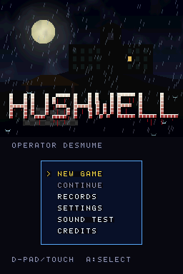
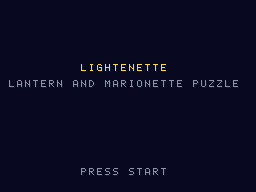
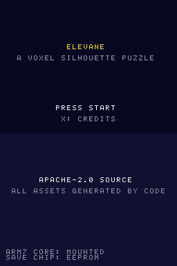

<div align="center">

<h1 align="center">
  <picture>
    <source media="(prefers-color-scheme: dark)" srcset="docs/logo/cleancart-lockup-dark.svg">
    
  </picture>
</h1>

**라이선스가 깨끗한 닌텐도 DS 홈브루**

[](#플레이)
[](https://blocksds.skylyrac.net/)
[](AGENTS.md)
[](#빌드)
[](https://github.com/devgyurak/cleancart.nds/commits/main)

[English](README.md)

</div>

[BlocksDS](https://blocksds.skylyrac.net/)로 만든 닌텐도 DS 오리지널 홈브루 게임 모음입니다.
라이선스를 깨끗하게 유지합니다. 코드는 직접 작성하고, 에셋은 이 저장소의 코드로
생성하며, ROM에 들어가는 서드파티 런타임 라이브러리는 모두 고지합니다.

## 게임

| 게임 | 설명 | 문서 |
|---|---|---|
| [Corvane](corvane/)<br> | 다섯 전선을 돌파하는 3D 호버 슈팅. 위 화면은 3D 전장, 아래 화면은 레이더와 터치 락온 | [README](corvane/README-KO.md) · [QA 체크리스트](corvane/docs/QA-KO.md) · [에셋](corvane/ASSETS-KO.md) |
| [Hushwell](hushwell/)<br> | 우물 위에 지은 요양원의 1인칭 서바이벌 호러. 위 화면은 손전등 시점, 아래 화면은 손으로 그린 지도와 녹음기, 그리고 소리로 사냥하는 그것 | [README](hushwell/README-KO.md) · [QA 체크리스트](hushwell/docs/QA-KO.md) · [에셋](hushwell/ASSETS-KO.md) |
| [Lightenette](lightenette/)<br> | 5막으로 된 등불과 마리오네트 퍼즐 액션. ROM이 자기 화면의 픽셀 수를 세어 에뮬레이터 정확도 항목을 스스로 판정하며, 릴리스에는 다른 에뮬레이터의 CI용으로 리허설 ROM과 `expected.json`, `judge.py`가 함께 올라갑니다. | [README](lightenette/README-KO.md) · [QA 체크리스트](lightenette/docs/QA-KO.md) · [에셋](lightenette/ASSETS-KO.md) |
| [Elevane](elevane/)<br> | 다섯 장(주문서 40개)의 복셀 실루엣 퍼즐: 정면도와 평면도 실루엣을 만드는 블록 구조물을 쌓습니다. 두 화면 모두 디스플레이 캡처로 3D입니다. 스스로 판정도 합니다: 리허설 ROM이 게임을 플레이하며 캡처 경로가 동작했는지 보고하고, 릴리스에 `expected.json`, `judge.py`와 함께 들어가 다른 에뮬레이터의 CI가 쓸 수 있습니다. | [README](elevane/README-KO.md) · [QA 점검표](elevane/docs/QA-KO.md) · [실기 QA](elevane/docs/HW-QA-KO.md) · [에셋](elevane/ASSETS-KO.md) |

게임마다 폴더가 따로 있고, 빌드·문서·라이선스 파일도 각 폴더 안에 있습니다.

## 빌드

[Docker](https://www.docker.com/)만 있으면 됩니다. 각 게임은 다이제스트로 고정한
BlocksDS 이미지 안에서 빌드되므로, 로컬 툴체인 없이 누가 빌드해도 같은 ROM이 나옵니다.

```sh
cd corvane            # 또는: cd hushwell, cd lightenette, cd elevane
./build.sh            # → corvane.nds (hushwell.nds)
./build.sh demos      # 기능별 데모 ROM (corvane-<데모>.nds)
```

세이브 칩 변형, 데모 하나만 빌드하기, 조작법은 각 게임의 README를 보세요.

## 브랜치와 릴리스

`develop`과 `main`은 풀 리퀘스트로만 바뀝니다.

```
<접두사>/<요약>  ──PR──▶  develop  ──릴리스 PR──▶  main  ──태그 <게임>-v<x.y.z>──▶  Releases
```

작업은 `develop`에서 딴 브랜치에서 하고, 제목이 커밋 접두사(`ADD:`, `FIX:` …)로 시작하는
PR로 `develop`에 머지합니다. 새 게임이나 게임의 새 버전은 `develop` → `main` PR(머지 커밋)로
내보낸 뒤 main에 태그를 붙여 릴리스합니다. 기여자의 PR은 메인테이너의 승인
([CODEOWNERS](.github/CODEOWNERS)) 후 머지됩니다.

`<게임>-v<버전>` 형식의 태그를 푸시하면 GitHub Actions
([`release.yml`](.github/workflows/release.yml))가 해당 게임을 빌드해
[Releases](https://github.com/devgyurak/cleancart.nds/releases) 페이지에 ROM을 올립니다.

```sh
git tag corvane-v0.1.0 origin/main
git push origin corvane-v0.1.0
```

| 릴리스 파일 | 내용 |
|---|---|
| `corvane-v0.1.0.zip` | `corvane.nds`, 세이브 칩 변형, `SHA256SUMS`, 라이선스 원문과 고지 |
| `corvane-v0.1.0-demos.zip` | 기능 데모 ROM 전부, `SHA256SUMS`, 라이선스 원문과 고지 |
| `SHA256SUMS` | zip 파일들의 체크섬 |

버전에 접미사가 붙으면(`corvane-v0.2.0-rc.1`) 프리릴리스가 됩니다. 같은 파일이
**Actions** 탭의 실행 페이지에도 워크플로 아티팩트로 남습니다(기본 90일). 재현 가능한
빌드라서 같은 커밋을 `./build.sh release`로 빌드하면 SHA-256이 같은 ROM이 나옵니다.

## 플레이

`.nds` 파일을 [melonDS](https://melonds.kuribo64.net/)로 열면 됩니다. BIOS 파일은 필요 없습니다.
macOS에서 키가 먹지 않으면 melonDS의 키보드 매핑이 비어 있을 수 있습니다.
[AGENTS.md](AGENTS.md#controls-and-key-mapping)의 키 표와 `tools/melonds/set_keys.py`를 참고하세요.

## 저장소 구성

```
corvane/          게임 하나: 소스, build.sh, Dockerfile, 문서, 라이선스
hushwell/         게임 하나(corvane 템플릿으로 시작)
lightenette/      게임 하나(corvane 템플릿으로 시작)
elevane/          게임 하나(lightenette에서 시작)
tools/emu/        스모크 테스트용 헤드리스 DeSmuME 하네스 (Docker)
tools/melonds/    melonDS 키 매핑·입력 확인 도구 (macOS), 헤드리스 melonDS 실행기
scripts/          유지보수 스크립트 (에이전트 설정 동기화, 로고 생성)
docs/logo/        저장소 로고 (scripts/mklogo.py가 생성)
.github/          워크플로(릴리스, PR 검사), ruleset, PR 템플릿
AGENTS.md         코딩 에이전트용 프로젝트 규칙 (Claude Code는 CLAUDE.md로 읽음)
```

## 라이선스

라이선스는 게임마다 각 폴더에 적혀 있습니다. Corvane, Hushwell, Lightenette, Elevane은 Apache License 2.0
([corvane](corvane/LICENSE), [hushwell](hushwell/LICENSE), [lightenette](lightenette/LICENSE), [elevane](elevane/LICENSE))이며, ROM에 들어가는 서드파티
구성 요소는 각 게임의 `THIRD_PARTY_NOTICES`에 있습니다. ROM은 커밋하지 않으니
소스에서 빌드해 주세요.
