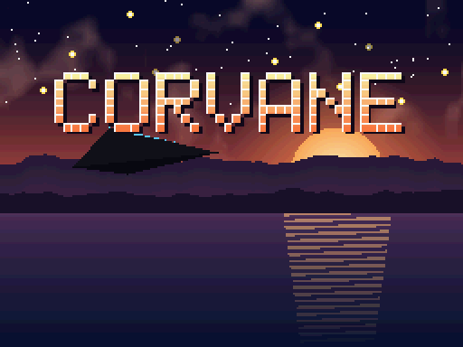
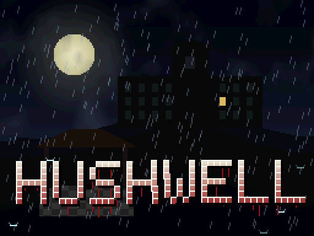
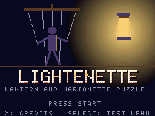
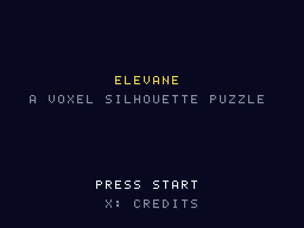

<div align="center">

<h1 align="center">
  <picture>
    <source media="(prefers-color-scheme: dark)" srcset="assets/logo/cleancart-lockup-dark.svg">
    
  </picture>
</h1>

**라이선스가 깨끗한 닌텐도 DS 홈브루**

[](#플레이)
[](https://blocksds.skylyrac.net/)
[](AGENTS.md)
[](#빌드)
[](https://github.com/devgyurak/cleancart.nds/commits/main)

[English](README.md)

</div>

[BlocksDS](https://blocksds.skylyrac.net/)로 만든 닌텐도 DS 오리지널 홈브루 게임 모음입니다.
라이선스를 깨끗하게 유지합니다. 코드는 직접 작성하고, 에셋은 이 저장소의 코드로
생성하며, ROM에 들어가는 서드파티 런타임 라이브러리는 모두 고지합니다.

## 목적

에뮬레이터 개발자가 개발하고 검증할 때 쓰도록 만든 홈브루 게임 모음입니다.

- **스스로 판정하는 완성된 게임.** 각 ROM은 끝까지 플레이할 수 있는 게임이면서, 하드웨어가 어떻게
  동작했는지도 보고합니다(결과 블록, `expected.json`, `judge.py`). 실기와 다른 동작은 느낌이 아니라
  실패한 항목으로 드러납니다.
- **CI에서 그대로 사용.** `judge.py`가 종료 코드를 돌려주고, 렌더러별 known 프로필이 새로 생긴
  차이와 이미 알려진 차이를 구분해 줍니다. 판정하는 모든 항목에는 L1 기능부터 L4 연구까지 난이도 레벨이 있고, 게임마다 목표 레벨이 하나 있습니다
  ([docs/LEVELS-KO.md](docs/LEVELS-KO.md)): L1 Corvane·Hushwell, L2 Lightenette, L3 Elevane, L4 probe 모음(준비 중).
- **라이선스가 깨끗함.** ROM 안의 모든 것이 직접 작성한 코드, 이 저장소의 코드로 생성한 에셋,
  또는 고지한 서드파티 런타임 라이브러리입니다. 테스트 스위트에서 뺄 것이 없습니다.

## 게임

| 게임 | 설명과 시험하는 것 | 판정 | 레벨 | 문서 |
|---|---|---|---|---|
| [Corvane](games/corvane/)<br> | 다섯 전선을 돌파하는 3D 호버 슈팅. 위 화면은 3D 전장, 아래 화면은 레이더와 터치 락온.<br>시험: 2D 엔진, 3D 엔진, ARM7 사운드, DMA·타이머·IPC·인터럽트, 카트·세이브·RTC·터치·전원 입출력. | 자동, 데모 75개 전부(`judge.py`, `expected.json`) | <!-- cell:corvane -->L1 목표 73 · 전제 조건 0 · 옮길 예정 86<!-- /cell --> | [README](games/corvane/README-KO.md) · [QA 체크리스트](games/corvane/docs/QA-KO.md) · [에셋](games/corvane/ASSETS-KO.md) |
| [Hushwell](games/hushwell/)<br> | 우물 위에 지은 요양원의 1인칭 서바이벌 호러. 위 화면은 손전등 시점, 아래 화면은 손으로 그린 지도와 녹음기, 그리고 소리로 사냥하는 그것.<br>시험: 2D 엔진, 3D 엔진(조명·안개·텍스처), ARM7 사운드, DMA·타이머·IPC·인터럽트, 카트·세이브·RTC·터치·전원 입출력. | 자동, 데모 65개 전부와 QA 실행(`judge.py`, `expected.json`) | <!-- cell:hushwell -->L1 목표 19 · 전제 조건 2 · 옮길 예정 116<!-- /cell --> | [README](games/hushwell/README-KO.md) · [QA 체크리스트](games/hushwell/docs/QA-KO.md) · [에셋](games/hushwell/ASSETS-KO.md) |
| [Lightenette](games/lightenette/)<br> | 5막으로 된 등불과 마리오네트 퍼즐 액션. ROM이 자기 화면의 픽셀 수를 세어 스스로 판정합니다.<br>시험: 디스플레이 캡처, 반투명 OBJ 블렌딩, 마스터 밝기, 3D 텍스처 좌표, 에지 마킹, 선 폴리곤. | 자동(`judge.py`, `expected.json`) | <!-- cell:lightenette -->L2 목표 11 · 전제 조건 13 · 옮길 예정 3<!-- /cell --> | [README](games/lightenette/README-KO.md) · [QA 체크리스트](games/lightenette/docs/QA-KO.md) · [에셋](games/lightenette/ASSETS-KO.md) |
| [Elevane](games/elevane/)<br> | 다섯 장(주문서 40개)의 복셀 실루엣 퍼즐. 두 화면 모두 디스플레이 캡처로 3D이며, 리허설 ROM으로 스스로 판정합니다.<br>시험: 양쪽 화면의 3D 디스플레이 캡처, HBlank DMA 합성, 뒷면(rear plane), 지오메트리·폴리곤 한계. | 자동(`judge.py`, `expected.json`) | <!-- cell:elevane -->L3 목표 3 · 전제 조건 5 · 옮길 예정 6<!-- /cell --> | [README](games/elevane/README-KO.md) · [QA 점검표](games/elevane/docs/QA-KO.md) · [실기 QA](games/elevane/docs/HW-QA-KO.md) · [에셋](games/elevane/ASSETS-KO.md) |

게임마다 폴더가 따로 있고, 빌드·문서·라이선스 파일도 각 폴더 안에 있습니다.

## 레벨별 게임

게임마다 목표 레벨이 하나 있습니다. 목표 항목이 판정을 정하고, 낮은 항목은 전제 조건이며, 높은 항목은 그 레벨을 맡은 게임으로 옮기기 전까지 `relocate`로 표시합니다([docs/LEVELS-KO.md](docs/LEVELS-KO.md)).
이 목록은 `scripts/mklevels.py`가 각 게임의 `expected.json`에서 생성합니다. 항목 설명은 `expected.json`의 영어 그대로입니다.

<!-- levels:begin -->
<details><summary><b>L1 기능</b> · Corvane, Hushwell (92 개)</summary>

#### Corvane · graphics and system

목표 73 · 전제 조건 0 · 옮길 예정 86

- `sys-ipc-sync` · The value the ARM7 wrote to IPCSYNC (0xA, ARM7 ready) is what the ARM9 reads · [expected.json](games/corvane/expected.json)
- `sys-ipc-keyxy` · EXTKEYIN with nothing pressed: X and Y released, pen up, hinge open (bits 0,1,3,6,7 = 1,1,1,1,0) · [expected.json](games/corvane/expected.json)
- `sys-wram-errors` · The 32 KB shared WRAM pattern reads back without errors after the ARM9 takes it · [expected.json](games/corvane/expected.json)
- `sys-wram-crc` · GetCRC16 of the 32 KB pattern (CRC-16/MODBUS, checked independently in Python) · [expected.json](games/corvane/expected.json)
- `sys-wram-back` · WRAMCNT reads 3 after the ARM9 hands the WRAM back to the ARM7 · [expected.json](games/corvane/expected.json)
- `sys-irq-vblank` · One VBlank IRQ per frame: 120 in 120 frames · [expected.json](games/corvane/expected.json)
- `sys-dma-now-errors` · 4 KB RAM to RAM DMA copy has no errors · [expected.json](games/corvane/expected.json)
- `sys-dma-fill-errors` · DMA fill of 32 KB VRAM and 4 KB RAM has no errors · [expected.json](games/corvane/expected.json)
- `sys-dma-cart-found` · probe.bin is found through FNT/FAT in the cart image · [expected.json](games/corvane/expected.json)
- `sys-bios-lz77` · LZ77 decompression into VRAM equals the one into WRAM · [expected.json](games/corvane/expected.json)
- `sys-bios-fastset` · CpuFastSet copies the CpuSet fill value 0x12345678 · [expected.json](games/corvane/expected.json)
- `sys-bios-div` · BIOS Div 1000 / 7 = 142 · [expected.json](games/corvane/expected.json)
- `sys-bios-crc` · GetCRC16 of the decompressed logo · [expected.json](games/corvane/expected.json)
- `sys-math-div` · Hardware division equals software division for four operand pairs (incl. negative) · [expected.json](games/corvane/expected.json)
- `sys-math-len` · Vector length of (3,4,0) is 5 in 20.12 fixed point · [expected.json](games/corvane/expected.json)
- `sys-math-atan2` · atan2(1,1) is 45 degrees = 4096 (our table-free routine) · [expected.json](games/corvane/expected.json)
- `2d-engines-powercnt` · POWERCNT reads back as the demo set it (0x820F) · [expected.json](games/corvane/expected.json)
- `2d-engines-dispcnt` · DISPCNT of engine A reads back · [expected.json](games/corvane/expected.json)
- `2d-engines-dispcnt-sub` · DISPCNT of engine B reads back · [expected.json](games/corvane/expected.json)
- `2d-text-bg3cnt-sub` · BG3CNT of engine B (HUD, 8bpp bit set) reads back · [expected.json](games/corvane/expected.json)
- `2d-text-bg0cnt-sub` · BG0CNT of engine B (console, 4bpp) reads back · [expected.json](games/corvane/expected.json)
- `2d-bitmap-dispcnt` · DISPCNT with the 1024x512 large bitmap mode reads back · [expected.json](games/corvane/expected.json)
- `2d-bitmap-bg2cnt` · BG2CNT of the large bitmap reads back · [expected.json](games/corvane/expected.json)
- `2d-bitmap-phase` · The demo reached its second phase (nebula scroll) · [expected.json](games/corvane/expected.json)
- `2d-obj-map2d-dispcnt` · DISPCNT of engine B with 2D OBJ mapping reads back · [expected.json](games/corvane/expected.json)
- `2d-extpal-dispcnt` · DISPCNT with the extended palette bits reads back · [expected.json](games/corvane/expected.json)
- `2d-window-winin` · WININ reads back · [expected.json](games/corvane/expected.json)
- `2d-window-winout` · WINOUT reads back · [expected.json](games/corvane/expected.json)
- `2d-window-winout-sub` · WINOUT of engine B reads back · [expected.json](games/corvane/expected.json)
- `2d-blend-bldcnt` · BLDCNT reads back · [expected.json](games/corvane/expected.json)
- `2d-blend-bldalpha` · BLDALPHA reads back · [expected.json](games/corvane/expected.json)
- `2d-brightness-main` · MASTER_BRIGHT of engine A reads back (fade to white) · [expected.json](games/corvane/expected.json)
- `2d-brightness-sub` · MASTER_BRIGHT of engine B reads back (fade to black) · [expected.json](games/corvane/expected.json)
- `2d-capture-done` · The capture enable bit (bit 31 of DISPCAPCNT) has cleared by itself: the one-frame capture finished · [expected.json](games/corvane/expected.json)
- `2d-capture-cnt` · DISPCAPCNT reads back with the written source, size and write offset · [expected.json](games/corvane/expected.json)
- `3d-toon-control` · DISP3DCNT reads back with toon/highlight shading (bits 12-13, the RAM overflow flags, are not compared) · [expected.json](games/corvane/expected.json)
- `3d-edge-control` · DISP3DCNT reads back with edge marking (bits 12-13, the RAM overflow flags, are not compared) · [expected.json](games/corvane/expected.json)
- `3d-fog-control` · DISP3DCNT reads back with alpha-only fog (bits 12-13, the RAM overflow flags, are not compared) · [expected.json](games/corvane/expected.json)
- `3d-aa-control` · DISP3DCNT reads back with anti-aliasing (bits 12-13, the RAM overflow flags, are not compared) · [expected.json](games/corvane/expected.json)
- `3d-depth-control` · DISP3DCNT reads back with Z-buffering with a bitmap rear plane (bits 12-13, the RAM overflow flags, are not compared) · [expected.json](games/corvane/expected.json)
- `3d-compose-bg0cnt` · BG0CNT (3D layer behind the sea) reads back · [expected.json](games/corvane/expected.json)
- `3d-compose-bg2cnt` · BG2CNT (sea in front of the 3D layer) reads back · [expected.json](games/corvane/expected.json)
- `3d-tex-a3i5-poly` · A fully visible A3I5 textured quad is one polygon in polygon RAM · [expected.json](games/corvane/expected.json)
- `3d-tex-a5i3-poly` · A fully visible A5I3 textured quad is one polygon in polygon RAM · [expected.json](games/corvane/expected.json)
- `3d-tex-pal4-poly` · A fully visible 4-colour textured quad is one polygon in polygon RAM · [expected.json](games/corvane/expected.json)
- `3d-tex-pal16-poly` · A fully visible 16-colour textured quad is one polygon in polygon RAM · [expected.json](games/corvane/expected.json)
- `3d-tex-pal256-poly` · A fully visible 256-colour textured quad is one polygon in polygon RAM · [expected.json](games/corvane/expected.json)
- `3d-tex-4x4-poly` · A fully visible 4x4 compressed textured quad is one polygon in polygon RAM · [expected.json](games/corvane/expected.json)
- `3d-tex-direct-poly` · A fully visible direct colour textured quad is one polygon in polygon RAM · [expected.json](games/corvane/expected.json)
- `io-qalog-verdict` · The QA result block (QARN) reports verdict 1 (PASS); the block of the auto QA run of corvane.nds has the same layout and is graded with --demo io-qalog · [expected.json](games/corvane/expected.json)
- `sys-dma-hblank-captured` · The one-frame display capture of the probe finished (DISPCAPCNT bit 31 cleared) · [expected.json](games/corvane/expected.json)
- `sys-dma-hblank-samples` · The probe compared this many pixels (so it cannot pass by checking nothing) · [expected.json](games/corvane/expected.json)
- `2d-affine-captured` · The one-frame display capture of the probe finished (DISPCAPCNT bit 31 cleared) · [expected.json](games/corvane/expected.json)
- `2d-affine-samples` · The probe compared this many pixels (so it cannot pass by checking nothing) · [expected.json](games/corvane/expected.json)
- `2d-affine-opaque` · Most sampled texels are not colour 0 (the probe tests real picture data) · [expected.json](games/corvane/expected.json)
- `2d-mosaic-captured` · The one-frame display capture of the probe finished (DISPCAPCNT bit 31 cleared) · [expected.json](games/corvane/expected.json)
- `2d-mosaic-samples` · The probe compared this many pixels (so it cannot pass by checking nothing) · [expected.json](games/corvane/expected.json)
- `2d-mosaic-steps` · The text under the mosaic changes between blocks often (the probe tests a real picture) · [expected.json](games/corvane/expected.json)
- `2d-obj-normal-captured` · The one-frame display capture of the probe finished (DISPCAPCNT bit 31 cleared) · [expected.json](games/corvane/expected.json)
- `2d-obj-normal-pixels` · A plain and an h-flipped 8x8 sprite show exactly their tile texels · [expected.json](games/corvane/expected.json)
- `2d-obj-normal-samples` · The probe compared this many pixels (so it cannot pass by checking nothing) · [expected.json](games/corvane/expected.json)
- `2d-obj-affine-captured` · The one-frame display capture of the probe finished (DISPCAPCNT bit 31 cleared) · [expected.json](games/corvane/expected.json)
- `2d-obj-affine-samples` · The probe compared this many pixels (so it cannot pass by checking nothing) · [expected.json](games/corvane/expected.json)
- `2d-obj-bitmap-captured` · The one-frame display capture of the probe finished (DISPCAPCNT bit 31 cleared) · [expected.json](games/corvane/expected.json)
- `2d-obj-bitmap-samples` · The probe compared this many pixels (so it cannot pass by checking nothing) · [expected.json](games/corvane/expected.json)
- `2d-obj-line-captured` · The one-frame display capture of the probe finished (DISPCAPCNT bit 31 cleared) · [expected.json](games/corvane/expected.json)
- `2d-vram-alias` · A VRAM bank keeps the data written through LCDC when it is remapped to its engine address (16 mappings, 32 words each) · [expected.json](games/corvane/expected.json)
- `2d-vram-samples` · The probe compared 16 x 32 words · [expected.json](games/corvane/expected.json)
- `sys-dma-disp-captured` · The one-frame display capture of the probe finished (DISPCAPCNT bit 31 cleared) · [expected.json](games/corvane/expected.json)
- `sys-dma-disp-samples` · The probe compared this many pixels (so it cannot pass by checking nothing) · [expected.json](games/corvane/expected.json)
- `2d-display-captured` · The one-frame display capture of the probe finished (DISPCAPCNT bit 31 cleared) · [expected.json](games/corvane/expected.json)
- `2d-display-samples` · The probe compared this many pixels (so it cannot pass by checking nothing) · [expected.json](games/corvane/expected.json)
- `2d-display-vram` · Sanity check: the frame the VRAM display mode showed is still in bank A (read back through LCDC, 768 samples); it does not judge the display itself · [expected.json](games/corvane/expected.json)

#### Hushwell · sound and I/O

목표 19 · 전제 조건 2 · 옮길 예정 116

- `sys-keys-held` · No key is held in a headless run · [expected.json](games/hushwell/expected.json)
- `sys-keys-keyxy` · EXTKEYIN with nothing pressed (X, Y, pen released, hinge open) · [expected.json](games/hushwell/expected.json)
- `io-cart-ok` · Chapter 3 loads from NitroFS · [expected.json](games/hushwell/expected.json)
- `io-firmware-colour` · Favourite colour from the firmware user settings is 0-15 · [expected.json](games/hushwell/expected.json)
- `io-firmware-name` · Name length from the firmware user settings is 0-10 · [expected.json](games/hushwell/expected.json)
- `io-rtc-month` · RTC month is 1-12 · [expected.json](games/hushwell/expected.json)
- `io-rtc-day` · RTC day is 1-31 · [expected.json](games/hushwell/expected.json)
- `io-rtc-hour` · RTC hour is 0-23 · [expected.json](games/hushwell/expected.json)
- `io-touch-up` · The pen is up at the checkpoint (the scripted touch ended) · [expected.json](games/hushwell/expected.json)
- `io-power-lid` · The lid is open · [expected.json](games/hushwell/expected.json)
- `qa-verdict` · The auto QA run of hushwell.nds (hold L+R+X+Y on the title) reaches the credits with RESULT PASS: the QARN block reports verdict 1 · [expected.json](games/hushwell/expected.json)
- `snd-mix-voices` · Song and effects together use 8 to 16 channels (SOUNDCNT Start/Busy) at the busiest frame · [expected.json](games/hushwell/expected.json)
- `snd-pcm-oneshot` · A PCM8 one-shot is playing at frame 5 (a channel is busy) · [expected.json](games/hushwell/expected.json)
- `snd-pcm-loops` · The PCM8 and PCM16 loops started at frames 60 and 80 are still busy at the checkpoint · [expected.json](games/hushwell/expected.json)
- `snd-adpcm-oneshot` · The ADPCM jingle is playing at frame 5 (a channel is busy) · [expected.json](games/hushwell/expected.json)
- `snd-adpcm-loop` · The ADPCM hum loop started at frame 90 is still busy at the checkpoint · [expected.json](games/hushwell/expected.json)
- `snd-psg-noise` · The noise channel 14 started at frame 100 is busy at frame 105 · [expected.json](games/hushwell/expected.json)
- `snd-psg-stop` · Stopping channels 8-15 clears their Start/Busy bits · [expected.json](games/hushwell/expected.json)
- `snd-stream-busy` · The streaming channel is still busy at the checkpoint · [expected.json](games/hushwell/expected.json)

</details>

<details><summary><b>L2 경계</b> · Lightenette (11 개)</summary>

#### Lightenette · display edge cases

목표 11 · 전제 조건 13 · 옮길 예정 3

- `seam-uv` · Reversed-UV cut line: rows 0 and 1 show no cut line, row 2 (the uncompensated reverse) shows one (qualitative reading of the hardware report in melonDS #2008; the exact count is not a hardware value) · [expected.json](games/lightenette/expected.json)
- `line-polygon` · Line polygons draw pixels (melonDS #2549); the count differs per emulator (705/710/834/338) _(참고용)_ · [expected.json](games/lightenette/expected.json)
- `lantern-blend-equal` · Translucent lantern OBJ looks the same with BLDCNT none / alpha / darken (melonDS #2503) · [expected.json](games/lightenette/expected.json)
- `act2-seam` · Act 2 doll cut lines: rows 0 and 1 show no cut line, row 2 (the uncompensated reverse) shows one (qualitative reading of the hardware report in melonDS #2008; the exact count is not a hardware value) · [expected.json](games/lightenette/expected.json)
- `act3-lantern-equal` · Act 3 translucent lantern OBJ over the darkened 3D stage looks the same with BLDCNT none / alpha / darken (melonDS #2503) · [expected.json](games/lightenette/expected.json)
- `act4-hline` · Act 4 horizontal line-polygon thread draws pixels (melonDS #2549); the count differs per emulator _(참고용)_ · [expected.json](games/lightenette/expected.json)
- `act4-dline` · Act 4 diagonal line-polygon thread draws pixels (melonDS #2549); the count differs per emulator _(참고용)_ · [expected.json](games/lightenette/expected.json)
- `act5-seam` · Act 5 doll cut lines: rows 0 and 1 show no cut line, row 2 (the uncompensated reverse) shows one (qualitative reading of the hardware report in melonDS #2008; the exact count is not a hardware value) · [expected.json](games/lightenette/expected.json)
- `act5-edge-3-colours` · Act 5 plinths get all three edge-marking colours (melonDS #2549) · [expected.json](games/lightenette/expected.json)
- `act5-line-polygon` · Act 5 strings (line polygons) draw pixels (melonDS #2549); the count differs per emulator _(참고용)_ · [expected.json](games/lightenette/expected.json)
- `act5-lantern-equal` · Act 5 translucent lantern OBJ over the darkened 3D stage looks the same with BLDCNT none / alpha / darken (melonDS #2503) · [expected.json](games/lightenette/expected.json)

</details>

<details><summary><b>L3 타이밍</b> · Elevane (3 개)</summary>

#### Elevane · display timing and compositing

목표 3 · 전제 조건 5 · 옮길 예정 6

- `dual-front` · Top screen: the front view reached bank D (clear-colour pixels, and no plan clear colour in it) _(참고용)_ · [expected.json](games/elevane/expected.json)
- `dual-plan` · Bottom screen: the plan view reached bank C _(참고용)_ · [expected.json](games/elevane/expected.json)
- `dual-cross-zero` · The two captures never carry each other's clear colour (plan clear in D, front clear in C) _(참고용)_ · [expected.json](games/elevane/expected.json)

</details>

<details><summary><b>L4 연구</b> · 게임 없음 (0 개)</summary>

_준비 중_

</details>
<!-- levels:end -->

## 빌드

[Docker](https://www.docker.com/)만 있으면 됩니다. 각 게임은 다이제스트로 고정한
BlocksDS 이미지 안에서 빌드되므로, 로컬 툴체인 없이 누가 빌드해도 같은 ROM이 나옵니다.

```sh
cd games/corvane     # 또는: cd games/hushwell …
./build.sh            # → corvane.nds (hushwell.nds)
./build.sh demos      # 기능별 데모 ROM (corvane-<데모>.nds)
```

세이브 칩 변형, 데모 하나만 빌드하기, 조작법은 각 게임의 README를 보세요.

## 브랜치와 릴리스

`develop`과 `main`은 풀 리퀘스트로만 바뀝니다.

```
<접두사>/<요약>  ──PR──▶  develop  ──릴리스 PR──▶  main  ──태그 <게임>-v<x.y.z>──▶  Releases
```

작업은 `develop`에서 딴 브랜치에서 하고, 제목이 커밋 접두사(`ADD:`, `FIX:` …)로 시작하는
PR로 `develop`에 머지합니다. 새 게임이나 게임의 새 버전은 `develop` → `main` PR(머지 커밋)로
내보낸 뒤 main에 태그를 붙여 릴리스합니다. PR은 메인테이너만 올립니다
([CODEOWNERS](.github/CODEOWNERS)). 대신 보낼 수 있는 것은 [CONTRIBUTING-KO.md](CONTRIBUTING-KO.md)를 보세요.

`<게임>-v<버전>` 형식의 태그를 푸시하면 GitHub Actions
([`release.yml`](.github/workflows/release.yml))가 해당 게임을 빌드해
[Releases](https://github.com/devgyurak/cleancart.nds/releases) 페이지에 ROM을 올립니다.

```sh
git tag corvane-v0.1.0 origin/main
git push origin corvane-v0.1.0
```

| 릴리스 파일 | 내용 |
|---|---|
| `corvane-v0.1.0.zip` | `corvane.nds`, 세이브 칩 변형, `SHA256SUMS`, 라이선스 원문과 고지 |
| `corvane-v0.1.0-demos.zip` | 기능 데모 ROM 전부, `SHA256SUMS`, 라이선스 원문과 고지 |
| `SHA256SUMS` | zip 파일들의 체크섬 |

버전에 접미사가 붙으면(`corvane-v0.2.0-rc.1`) 프리릴리스가 됩니다. 같은 파일이
**Actions** 탭의 실행 페이지에도 워크플로 아티팩트로 남습니다(기본 90일). 재현 가능한
빌드라서 같은 커밋을 `./build.sh release`로 빌드하면 SHA-256이 같은 ROM이 나옵니다.

## 플레이

`.nds` 파일을 [melonDS](https://melonds.kuribo64.net/)로 열면 됩니다. BIOS 파일은 필요 없습니다.
macOS에서 키가 먹지 않으면 melonDS의 키보드 매핑이 비어 있을 수 있습니다.
[AGENTS.md](AGENTS.md#controls-and-key-mapping)의 키 표와 `tools/melonds/set_keys.py`를 참고하세요.

## 저장소 구성

```
games/corvane/    게임 하나: 소스, build.sh, Dockerfile, 문서, 라이선스
games/hushwell/   게임 하나(corvane 템플릿으로 시작)
games/lightenette/ 게임 하나(corvane 템플릿으로 시작)
games/elevane/    게임 하나(lightenette에서 시작)
tools/emu/        스모크 테스트용 헤드리스 DeSmuME 하네스 (Docker)
tools/melonds/    melonDS 키 매핑·입력 확인 도구 (macOS), 헤드리스 melonDS 실행기
scripts/          유지보수 스크립트 (에이전트 설정 동기화, 로고 생성)
assets/logo/      저장소 로고 (scripts/mklogo.py가 생성, 브랜딩용이며 ROM 에셋 아님)
docs/             저장소 공통 문서 (난이도 레벨)
.github/          워크플로(릴리스, PR 검사), ruleset, PR·이슈 템플릿
AGENTS.md         코딩 에이전트용 프로젝트 규칙 (Claude Code는 CLAUDE.md로 읽음)
LICENSE           games/ 밖의 모든 것에 적용되는 Apache-2.0
CONTRIBUTING-KO.md 받는 기여의 범위 (이슈만)
```

## 라이선스

| 범위 | 라이선스 |
|---|---|
| `games/` 밖의 모든 것(도구, 스크립트, 문서, 로고, `.github/`) | Apache License 2.0, [LICENSE](LICENSE) |
| [corvane](games/corvane/LICENSE), [hushwell](games/hushwell/LICENSE), [lightenette](games/lightenette/LICENSE), [elevane](games/elevane/LICENSE) | Apache License 2.0, 각 게임 폴더의 `LICENSE` |

ROM에 들어가는 서드파티 구성 요소는 각 게임의 `THIRD_PARTY_NOTICES`에 있습니다. ROM은 커밋하지
않으니 소스에서 빌드해 주세요.

---

Nintendo와 제휴하거나 Nintendo의 승인을 받은 프로젝트가 아닙니다. Nintendo DS는 Nintendo의 상표입니다.
