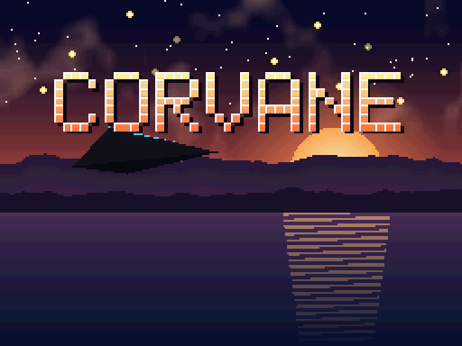
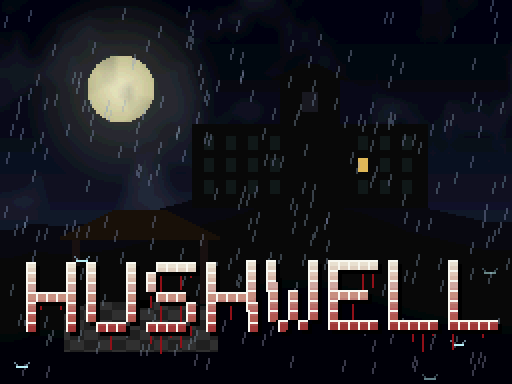
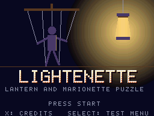
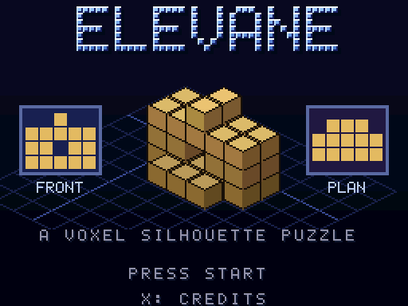
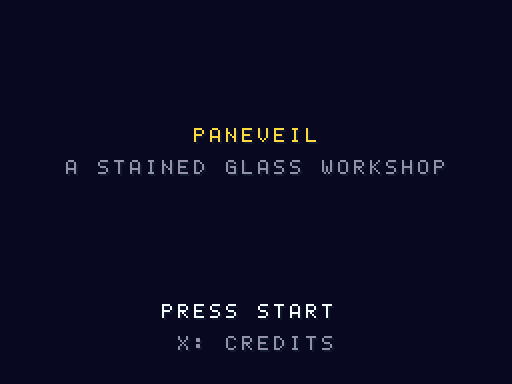
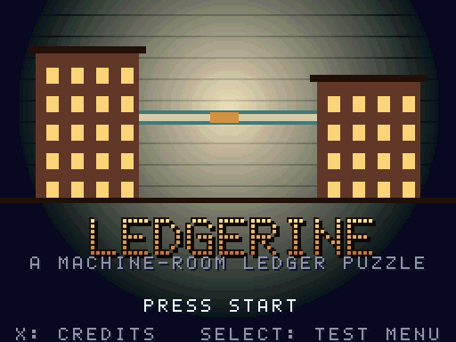
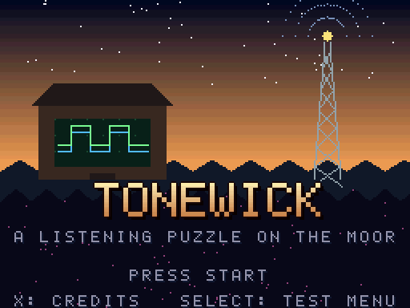

<div align="center">

<h1 align="center">
  <picture>
    <source media="(prefers-color-scheme: dark)" srcset="assets/logo/cleancart-lockup-dark.svg">
    
  </picture>
</h1>

**Licence-clean Nintendo DS homebrew**

[](#play)
[](https://blocksds.skylyrac.net/)
[](AGENTS.md)
[](#build)
[](https://github.com/devgyurak/cleancart.nds/commits/main)

[한국어](README-KO.md)

</div>

Original Nintendo DS homebrew games built with [BlocksDS](https://blocksds.skylyrac.net/),
kept licence-clean: our own code, assets generated from code in this repository,
and clearly noticed third-party runtime libraries.

## Purpose

A collection of homebrew games for emulator developers to develop against and verify with.

- **Complete games that judge themselves.** Each ROM is a game you can play to the end. It also
  reports what the hardware did (a result block, `expected.json`, `judge.py`), so a behaviour that
  differs from hardware shows up as a failed item, not as a feeling.
- **Usable in CI.** `judge.py` returns an exit code, and known per-renderer profiles tell a new
  difference from a known one. Every judged item carries a difficulty level, L1 Function to L4 Research, and every game has one target level
  ([docs/LEVELS.md](docs/LEVELS.md)): L1 Corvane, Hushwell and Paneveil, L2 Lightenette, Ledgerine and Tonewick, L3 Elevane and Heddlemere, L4 the [research probes](probes/) (not a game).
- **Licence-clean.** Everything in a ROM is our own code, assets generated by code in this repository,
  or a clearly noticed third-party runtime library. Nothing needs to be excluded from a test suite.

## Games

| Game | Description and what it tests | Judging | Levels | Docs |
|---|---|---|---|---|
| [Corvane](games/corvane/)<br> | 3D hover shooter across five fronts: 3D battlefield on the top screen, radar and touch lock-on on the bottom screen.<br>Tests (L1, graphics and system): 2D engines, 3D display control and status (geometry and texturing are Paneveil's), DMA, timers, interrupts, IPC, BIOS and maths, display capture. | automatic for all 49 demos (`judge.py`, `expected.json`) | <!-- cell:corvane -->L1 target 93 · prerequisite 0<!-- /cell --> | [README](games/corvane/README.md) · [QA checklist](games/corvane/docs/QA.md) · [Assets](games/corvane/ASSETS.md) |
| [Hushwell](games/hushwell/)<br> | First-person survival horror in a sanatorium built over a well: a flashlight on the top screen, a hand-drawn map and a tape recorder on the bottom screen, and something that hunts by sound.<br>Tests (L1, sound and I/O): ARM7 sound channels, PSG wave record, sound capture and streaming, key and touch input, cart and save chips, RTC, firmware settings, lid. | automatic: 19 of its 66 demo ROMs (the sound and I/O ones, the others are Corvane's area) and the QA run (`judge.py`, `expected.json`) | <!-- cell:hushwell -->L1 target 41 · prerequisite 4<!-- /cell --> | [README](games/hushwell/README.md) · [QA checklist](games/hushwell/docs/QA.md) · [Assets](games/hushwell/ASSETS.md) |
| [Lightenette](games/lightenette/)<br> | Lantern-and-marionette puzzle action in five acts that also judges itself: the ROM counts pixels of its own display.<br>Tests: Display capture, semi-transparent OBJ blending, master brightness, 3D texture coordinates, edge marking, line polygons. | automatic (`judge.py`, `expected.json`) | <!-- cell:lightenette -->L2 target 19 · prerequisite 18<!-- /cell --> | [README](games/lightenette/README.md) · [QA checklist](games/lightenette/docs/QA.md) · [Assets](games/lightenette/ASSETS.md) |
| [Elevane](games/elevane/)<br> | Voxel silhouette puzzle in five chapters (40 orders): both screens in 3D through display capture. It also judges itself with a rehearsal ROM.<br>Tests: Display capture of 3D on both screens, HBlank-DMA compositing, the rear plane, geometry/polygon limits. | automatic (`judge.py`, `expected.json`) | <!-- cell:elevane -->L3 target 3 · prerequisite 17<!-- /cell --> | [README](games/elevane/README.md) · [QA checklist](games/elevane/docs/QA.md) · [Hardware QA](games/elevane/docs/HW-QA.md) · [Assets](games/elevane/ASSETS.md) |
| [Paneveil](games/paneveil/)<br> | Stained-glass workshop puzzle in five chapters (30 window orders): set the glass, pattern and rosette of a window to the order and fire it in the kiln. It judges itself with a rehearsal ROM.<br>Tests (L1, 3D geometry and texturing): matrix stack, matrix load/multiply, geometry commands, polygon attributes, texture attributes and coordinates. | automatic (`judge.py`, `expected.json`) | <!-- cell:paneveil -->L1 target 30 · prerequisite 1<!-- /cell --> | [README](games/paneveil/README.md) · [QA checklist](games/paneveil/docs/QA.md) · [Hardware QA](games/paneveil/docs/HW-QA.md) · [Assets](games/paneveil/ASSETS.md) |
| [Ledgerine](games/ledgerine/)<br> | Machine-room ledger puzzle in six rooms: set the dials of the press, the tube, the clock wall, the belt, the vault and the rule book and pull the lever; the real hardware device runs and its answer is written into the ledger. It judges itself with a rehearsal ROM.<br>Tests (L2, system edges): the exceptions, boundary values and error paths of the maths unit, IPC FIFO, timers, DMA, WRAM and VRAM control and BIOS. | automatic (`judge.py`, `expected.json`) | <!-- cell:ledgerine -->L2 target 30 · prerequisite 11<!-- /cell --> | [README](games/ledgerine/README.md) · [QA checklist](games/ledgerine/docs/QA.md) · [Assets](games/ledgerine/ASSETS.md) |
| [Tonewick](games/tonewick/)<br> | Listening puzzle in four districts (twelve signal lines): mend the broken signal lines of a moor listening post with an oscilloscope. Each line is a register field of the sound block, and the ROM listens to its own sound with the capture units. It judges itself with a rehearsal ROM.<br>Tests (L2, sound and I/O edges): the boundary values and documented bugs of the sound channels and capture units, plus the RTC, power management, save chip and firmware user settings. | automatic (`judge.py`, `expected.json`) | <!-- cell:tonewick -->L2 target 17 · prerequisite 10<!-- /cell --> | [README](games/tonewick/README.md) · [QA checklist](games/tonewick/docs/QA.md) · [Hardware QA](games/tonewick/docs/HW-QA.md) · [Assets](games/tonewick/ASSETS.md) |
| [Heddlemere](games/heddlemere/) | Punch-card loom puzzle in five chapters (40 orders): punch the cards of a four-row tapestry; the cloth is woven by per-line raster writes and the loom runs geometry commands whose cycle costs set the motor budget. It judges itself with a rehearsal ROM.<br>Tests (L3, 3D engine and scanline timing): line and frame length, the HBlank and VBlank flags, VCOUNT writes, geometry command cycle costs, FIFO stall and half-empty IRQ, polygon RAM swap line, texture quiet lines. | automatic (`judge.py`, `expected.json`) | <!-- cell:heddlemere -->L3 target 18 · prerequisite 9<!-- /cell --> | [README](games/heddlemere/README.md) · [Assets](games/heddlemere/ASSETS.md) |

Each game lives in its own folder with its own build, docs and licence files.

### Research probes

[`probes/`](probes/) is not a game: it is a set of demo ROMs (L4) that report what an emulator does for behaviour
nobody has confirmed on hardware (polygon-RAM counts, `BOX_TEST`/`VEC_TEST` results, same-screen two-pass capture, the
main-memory display FIFO, the per-line OBJ budget, ...). Nothing is graded: `probes/tools/judge.py` records each emulator's
values and tells you when a profile changes. [README](probes/README.md) · [QA table](probes/docs/QA.md) · [Assets](probes/ASSETS.md)

## Games by level

Every game has one target level; its target items decide the verdict, lower items are prerequisites, higher ones are marked
`relocate` until they move to the game that owns that level ([docs/LEVELS.md](docs/LEVELS.md)). This list is
generated by `scripts/mklevels.py` from each game's `expected.json`.

<!-- levels:begin -->
<details><summary><b>L1 Function</b> · Corvane, Hushwell, Paneveil (164 target items)</summary>

#### Corvane · graphics and system

target 93 · prerequisite 0

- `sys-ipc-sync` · The value the ARM7 wrote to IPCSYNC (0xA, ARM7 ready) is what the ARM9 reads · [expected.json](games/corvane/expected.json)
- `sys-ipc-packets` · The ARM7 input packet arrives once per frame: 120 packets in 120 frames (1 off allowed) · [expected.json](games/corvane/expected.json)
- `sys-ipc-keyxy` · EXTKEYIN with nothing pressed: X and Y released, pen up, hinge open (bits 0,1,3,6,7 = 1,1,1,1,0) · [expected.json](games/corvane/expected.json)
- `sys-ipc-ping` · FIFO ping round trip takes one or two frames (our protocol, no hardware value) _(informational)_ · [expected.json](games/corvane/expected.json)
- `sys-wram-errors` · The 32 KB shared WRAM pattern reads back without errors after the ARM9 takes it · [expected.json](games/corvane/expected.json)
- `sys-wram-crc` · GetCRC16 of the 32 KB pattern (CRC-16/MODBUS, checked independently in Python) · [expected.json](games/corvane/expected.json)
- `sys-wram-back` · WRAMCNT reads 3 after the ARM9 hands the WRAM back to the ARM7 · [expected.json](games/corvane/expected.json)
- `sys-irq-vblank` · One VBlank IRQ per frame: 120 in 120 frames · [expected.json](games/corvane/expected.json)
- `sys-irq-hblank-visible` · HBlank IRQs in 120 frames: at least 192 lines x 119 and at most 263 x 120 (DISPSTAT; a GBA-style count of about 23040 still passes) · [expected.json](games/corvane/expected.json)
- `sys-irq-vcount` · The VCOUNT IRQ at line 96 fires once per frame (1 off allowed) · [expected.json](games/corvane/expected.json)
- `sys-irq-timer` · A 10 Hz timer IRQ fires 19 or 20 times in 119 to 120 frames (frame = 560190 bus cycles, 33.513982 MHz) · [expected.json](games/corvane/expected.json)
- `sys-timer-beats` · An 8 Hz timer IRQ fires 15 or 16 times in 119 to 120 frames (frame = 560190 bus cycles) · [expected.json](games/corvane/expected.json)
- `sys-dma-now-errors` · 4 KB RAM to RAM DMA copy has no errors · [expected.json](games/corvane/expected.json)
- `sys-dma-fill-errors` · DMA fill of 32 KB VRAM and 4 KB RAM has no errors · [expected.json](games/corvane/expected.json)
- `sys-dma-gfx-polys-any` · The DMA-fed display list cube leaves 1 to 3 polygons (back faces are culled, a convex cube shows at most three) · [expected.json](games/corvane/expected.json)
- `sys-bios-lz77` · LZ77 decompression into VRAM equals the one into WRAM · [expected.json](games/corvane/expected.json)
- `sys-bios-fastset` · CpuFastSet copies the CpuSet fill value 0x12345678 · [expected.json](games/corvane/expected.json)
- `sys-bios-div` · BIOS Div 1000 / 7 = 142 · [expected.json](games/corvane/expected.json)
- `sys-bios-crc` · GetCRC16 of the decompressed logo · [expected.json](games/corvane/expected.json)
- `sys-math-div` · Hardware division equals software division for four operand pairs (incl. negative) · [expected.json](games/corvane/expected.json)
- `sys-math-len` · Vector length of (3,4,0) is 5 in 20.12 fixed point · [expected.json](games/corvane/expected.json)
- `sys-math-atan2` · atan2(1,1) is 45 degrees = 4096 (our table-free routine) · [expected.json](games/corvane/expected.json)
- `2d-engines-powercnt` · POWERCNT reads back as the demo set it (0x820F) · [expected.json](games/corvane/expected.json)
- `2d-engines-dispcnt` · DISPCNT of engine A reads back · [expected.json](games/corvane/expected.json)
- `2d-engines-dispcnt-sub` · DISPCNT of engine B reads back · [expected.json](games/corvane/expected.json)
- `2d-text-bg3cnt-sub` · BG3CNT of engine B (HUD, 8bpp bit set) reads back · [expected.json](games/corvane/expected.json)
- `2d-text-bg0cnt-sub` · BG0CNT of engine B (console, 4bpp) reads back · [expected.json](games/corvane/expected.json)
- `2d-bitmap-dispcnt` · DISPCNT with the 1024x512 large bitmap mode reads back · [expected.json](games/corvane/expected.json)
- `2d-bitmap-bg2cnt` · BG2CNT of the large bitmap reads back · [expected.json](games/corvane/expected.json)
- `2d-bitmap-phase` · The demo reached its second phase (nebula scroll) · [expected.json](games/corvane/expected.json)
- `2d-obj-map2d-dispcnt` · DISPCNT of engine B with 2D OBJ mapping reads back · [expected.json](games/corvane/expected.json)
- `2d-extpal-dispcnt` · DISPCNT with the extended palette bits reads back · [expected.json](games/corvane/expected.json)
- `2d-window-winin` · WININ reads back · [expected.json](games/corvane/expected.json)
- `2d-window-winout` · WINOUT reads back · [expected.json](games/corvane/expected.json)
- `2d-window-winout-sub` · WINOUT of engine B reads back · [expected.json](games/corvane/expected.json)
- `2d-blend-bldcnt` · BLDCNT reads back · [expected.json](games/corvane/expected.json)
- `2d-blend-bldalpha` · BLDALPHA reads back · [expected.json](games/corvane/expected.json)
- `2d-brightness-main` · MASTER_BRIGHT of engine A reads back (fade to white) · [expected.json](games/corvane/expected.json)
- `2d-brightness-sub` · MASTER_BRIGHT of engine B reads back (fade to black) · [expected.json](games/corvane/expected.json)
- `2d-capture-done` · The capture enable bit (bit 31 of DISPCAPCNT) has cleared by itself: the one-frame capture finished · [expected.json](games/corvane/expected.json)
- `2d-capture-cnt` · DISPCAPCNT reads back with the written source, size and write offset · [expected.json](games/corvane/expected.json)
- `3d-toon-control` · DISP3DCNT reads back with toon/highlight shading (bits 12-13, the RAM overflow flags, are not compared) · [expected.json](games/corvane/expected.json)
- `3d-edge-control` · DISP3DCNT reads back with edge marking (bits 12-13, the RAM overflow flags, are not compared) · [expected.json](games/corvane/expected.json)
- `3d-fog-control` · DISP3DCNT reads back with alpha-only fog (bits 12-13, the RAM overflow flags, are not compared) · [expected.json](games/corvane/expected.json)
- `3d-aa-control` · DISP3DCNT reads back with anti-aliasing (bits 12-13, the RAM overflow flags, are not compared) · [expected.json](games/corvane/expected.json)
- `3d-depth-control` · DISP3DCNT reads back with Z-buffering with a bitmap rear plane (bits 12-13, the RAM overflow flags, are not compared) · [expected.json](games/corvane/expected.json)
- `3d-compose-bg0cnt` · BG0CNT (3D layer behind the sea) reads back · [expected.json](games/corvane/expected.json)
- `3d-compose-bg2cnt` · BG2CNT (sea in front of the 3D layer) reads back · [expected.json](games/corvane/expected.json)
- `3d-tex-a3i5-poly` · A fully visible A3I5 textured quad is one polygon in polygon RAM · [expected.json](games/corvane/expected.json)
- `3d-tex-a5i3-poly` · A fully visible A5I3 textured quad is one polygon in polygon RAM · [expected.json](games/corvane/expected.json)
- `3d-tex-pal4-poly` · A fully visible 4-colour textured quad is one polygon in polygon RAM · [expected.json](games/corvane/expected.json)
- `3d-tex-pal16-poly` · A fully visible 16-colour textured quad is one polygon in polygon RAM · [expected.json](games/corvane/expected.json)
- `3d-tex-pal256-poly` · A fully visible 256-colour textured quad is one polygon in polygon RAM · [expected.json](games/corvane/expected.json)
- `3d-tex-4x4-poly` · A fully visible 4x4 compressed textured quad is one polygon in polygon RAM · [expected.json](games/corvane/expected.json)
- `3d-tex-direct-poly` · A fully visible direct colour textured quad is one polygon in polygon RAM · [expected.json](games/corvane/expected.json)
- `3d-fifo-polys-some` · The FIFO-fed scene stores polygons in polygon RAM: 1 to 2048 (RAM_COUNT range) (a zero count reads n/a; the item fails only above the RAM limit) · [expected.json](games/corvane/expected.json)
- `3d-fifo-verts-some` · The FIFO-fed scene stores vertices in vertex RAM: 1 to 6144 (RAM_COUNT range) (a zero count reads n/a; the item fails only above the RAM limit) · [expected.json](games/corvane/expected.json)
- `3d-clip-polys-some` · The clipping scene leaves polygons in polygon RAM: 1 to 2048 (a zero count reads n/a; the item fails only above the RAM limit) · [expected.json](games/corvane/expected.json)
- `3d-light-polys-some` · The lighting scene leaves polygons in polygon RAM: 1 to 2048 (a zero count reads n/a; the item fails only above the RAM limit) · [expected.json](games/corvane/expected.json)
- `3d-matrix-polys-some` · The matrix-stack scene leaves polygons in polygon RAM: 1 to 2048 (a zero count reads n/a; the item fails only above the RAM limit) · [expected.json](games/corvane/expected.json)
- `3d-poly-polys-some` · The polygon-attribute scene leaves polygons in polygon RAM: 1 to 2048 (a zero count reads n/a; the item fails only above the RAM limit) · [expected.json](games/corvane/expected.json)
- `3d-test-inside-some` · BOX_TEST reports the box inside the view volume on some but not all frames (1 to 119 of 120) · [expected.json](games/corvane/expected.json)
- `3d-test-pos-w-near` · POS_TEST w is about 5.1 in 1.19.12 fixed point (20400 to 21400; the ROM matrix gives 5.1 x 4096) · [expected.json](games/corvane/expected.json)
- `3d-test-vec-x-near` · VEC_TEST x is about 0.6 in the 4.12 result format (2330 to 2580) · [expected.json](games/corvane/expected.json)
- `3d-test-vec-z-near` · VEC_TEST z is about -0.79: sign-extended 4.12 value in -3260 to -3180 (the transformed vector; an untransformed one would differ) · [expected.json](games/corvane/expected.json)
- `io-qalog-verdict` · The QA result block (QARN) reports verdict 1 (PASS); the block of the auto QA run of corvane.nds has the same layout and is graded with --demo io-qalog · [expected.json](games/corvane/expected.json)
- `acc-stage-edge` · Edge marking draws outlines · [expected.json](games/corvane/expected.json)
- `acc-stage-lantern-visible` · The lantern pixel differs from the backdrop pixel outside it (the lantern is drawn) · [expected.json](games/corvane/expected.json)
- `acc-stage-darken` · Brightness decrease darkens the 3D backdrop outside the lantern: the pixel differs from the undarkened one and both captures finished · [expected.json](games/corvane/expected.json)
- `sys-dma-hblank-captured` · The one-frame display capture of the probe finished (DISPCAPCNT bit 31 cleared) · [expected.json](games/corvane/expected.json)
- `sys-dma-hblank-samples` · The probe compared this many pixels (so it cannot pass by checking nothing) · [expected.json](games/corvane/expected.json)
- `2d-affine-captured` · The one-frame display capture of the probe finished (DISPCAPCNT bit 31 cleared) · [expected.json](games/corvane/expected.json)
- `2d-affine-samples` · The probe compared this many pixels (so it cannot pass by checking nothing) · [expected.json](games/corvane/expected.json)
- `2d-affine-opaque` · Most sampled texels are not colour 0 (the probe tests real picture data) · [expected.json](games/corvane/expected.json)
- `2d-mosaic-captured` · The one-frame display capture of the probe finished (DISPCAPCNT bit 31 cleared) · [expected.json](games/corvane/expected.json)
- `2d-mosaic-samples` · The probe compared this many pixels (so it cannot pass by checking nothing) · [expected.json](games/corvane/expected.json)
- `2d-mosaic-steps` · The text under the mosaic changes between blocks often (the probe tests a real picture) · [expected.json](games/corvane/expected.json)
- `2d-obj-normal-captured` · The one-frame display capture of the probe finished (DISPCAPCNT bit 31 cleared) · [expected.json](games/corvane/expected.json)
- `2d-obj-normal-pixels` · A plain and an h-flipped 8x8 sprite show exactly their tile texels · [expected.json](games/corvane/expected.json)
- `2d-obj-normal-samples` · The probe compared this many pixels (so it cannot pass by checking nothing) · [expected.json](games/corvane/expected.json)
- `2d-obj-affine-captured` · The one-frame display capture of the probe finished (DISPCAPCNT bit 31 cleared) · [expected.json](games/corvane/expected.json)
- `2d-obj-affine-pixels` · An affine sprite with the identity matrix, plain and double-size, shows exactly its tile texels · [expected.json](games/corvane/expected.json)
- `2d-obj-affine-samples` · The probe compared this many pixels (so it cannot pass by checking nothing) · [expected.json](games/corvane/expected.json)
- `2d-obj-bitmap-captured` · The one-frame display capture of the probe finished (DISPCAPCNT bit 31 cleared) · [expected.json](games/corvane/expected.json)
- `2d-obj-bitmap-samples` · The probe compared this many pixels (so it cannot pass by checking nothing) · [expected.json](games/corvane/expected.json)
- `2d-obj-line-captured` · The one-frame display capture of the probe finished (DISPCAPCNT bit 31 cleared) · [expected.json](games/corvane/expected.json)
- `2d-vram-alias` · A VRAM bank keeps the data written through LCDC when it is remapped to its engine address (16 mappings, 32 words each) · [expected.json](games/corvane/expected.json)
- `2d-vram-samples` · The probe compared 16 x 32 words · [expected.json](games/corvane/expected.json)
- `sys-dma-disp-captured` · The one-frame display capture of the probe finished (DISPCAPCNT bit 31 cleared) · [expected.json](games/corvane/expected.json)
- `sys-dma-disp-samples` · The probe compared this many pixels (so it cannot pass by checking nothing) · [expected.json](games/corvane/expected.json)
- `2d-display-captured` · The one-frame display capture of the probe finished (DISPCAPCNT bit 31 cleared) · [expected.json](games/corvane/expected.json)
- `2d-display-samples` · The probe compared this many pixels (so it cannot pass by checking nothing) · [expected.json](games/corvane/expected.json)
- `2d-display-vram` · Sanity check: the frame the VRAM display mode showed is still in bank A (read back through LCDC, 768 samples); it does not judge the display itself · [expected.json](games/corvane/expected.json)

#### Hushwell · sound and I/O

target 41 · prerequisite 4

- `sys-dma-cart-found` · probe.bin is found through FNT/FAT in the cart image · [expected.json](games/hushwell/expected.json)
- `sys-dma-cart-dma` · Raw cart DMA read of probe.bin gives the expected CRC16 · [expected.json](games/hushwell/expected.json)
- `sys-dma-cart-nitro` · NitroFS read of probe.bin gives the expected CRC16 · [expected.json](games/hushwell/expected.json)
- `sys-keys-held` · No key is held in a headless run · [expected.json](games/hushwell/expected.json)
- `sys-keys-keyxy` · EXTKEYIN with nothing pressed (X, Y, pen released, hinge open) · [expected.json](games/hushwell/expected.json)
- `sys-keys-irqs` · Number of key IRQs during the run (the scripted harness presses a key once; no hardware value) _(informational)_ · [expected.json](games/hushwell/expected.json)
- `io-cart-ok` · Chapter 3 loads from NitroFS · [expected.json](games/hushwell/expected.json)
- `io-cart-ready` · Raw cart DMA is available · [expected.json](games/hushwell/expected.json)
- `io-save-eeprom-write` · Save write and verify succeed · [expected.json](games/hushwell/expected.json)
- `io-save-eeprom-reload` · Save reload succeeds · [expected.json](games/hushwell/expected.json)
- `io-save-eeprom-seq` · The save counter advanced by one · [expected.json](games/hushwell/expected.json)
- `io-save-flash-write` · Save write and verify succeed · [expected.json](games/hushwell/expected.json)
- `io-save-flash-reload` · Save reload succeeds · [expected.json](games/hushwell/expected.json)
- `io-save-flash-seq` · The save counter advanced by one · [expected.json](games/hushwell/expected.json)
- `io-save-fram-write` · Save write and verify succeed · [expected.json](games/hushwell/expected.json)
- `io-save-fram-reload` · Save reload succeeds · [expected.json](games/hushwell/expected.json)
- `io-save-fram-seq` · The save counter advanced by one · [expected.json](games/hushwell/expected.json)
- `io-firmware-colour` · Favourite colour from the firmware user settings is 0-15 · [expected.json](games/hushwell/expected.json)
- `io-firmware-name` · Name length from the firmware user settings is 0-10 · [expected.json](games/hushwell/expected.json)
- `io-rtc-month` · RTC month is 1-12 · [expected.json](games/hushwell/expected.json)
- `io-rtc-day` · RTC day is 1-31 · [expected.json](games/hushwell/expected.json)
- `io-rtc-hour` · RTC hour is 0-23 · [expected.json](games/hushwell/expected.json)
- `io-touch-up` · The pen is up at the checkpoint (the scripted touch ended) · [expected.json](games/hushwell/expected.json)
- `io-touch-x` · The last pen x is 120 (scripted touch at 120,100; one pixel of calibration error allowed) · [expected.json](games/hushwell/expected.json)
- `io-touch-y` · The last pen y is 100 (one pixel of calibration error allowed) · [expected.json](games/hushwell/expected.json)
- `io-power-lid` · The lid is open · [expected.json](games/hushwell/expected.json)
- `qa-verdict` · The auto QA run of hushwell.nds (hold L+R+X+Y on the title) reaches the credits with RESULT PASS: the QARN block reports verdict 1 · [expected.json](games/hushwell/expected.json)
- `snd-mix-voices` · Song and effects together use 8 to 16 channels (SOUNDCNT Start/Busy) at the busiest frame · [expected.json](games/hushwell/expected.json)
- `snd-pcm-oneshot` · A PCM8 one-shot is playing at frame 5 (a channel is busy) · [expected.json](games/hushwell/expected.json)
- `snd-pcm-loops` · The PCM8 and PCM16 loops started at frames 60 and 80 are still busy at the checkpoint · [expected.json](games/hushwell/expected.json)
- `snd-adpcm-oneshot` · The ADPCM jingle is playing at frame 5 (a channel is busy) · [expected.json](games/hushwell/expected.json)
- `snd-adpcm-loop` · The ADPCM hum loop started at frame 90 is still busy at the checkpoint · [expected.json](games/hushwell/expected.json)
- `snd-psg-noise` · The noise channel 14 started at frame 100 is busy at frame 105 · [expected.json](games/hushwell/expected.json)
- `snd-psg-stop` · Stopping channels 8-15 clears their Start/Busy bits · [expected.json](games/hushwell/expected.json)
- `snd-capture-busy` · Both sound capture units run in repeat mode (Start/Busy of capture 0 and 1) · [expected.json](games/hushwell/expected.json)
- `snd-stream-busy` · The streaming channel is still busy at the checkpoint · [expected.json](games/hushwell/expected.json)
- `snd-wave-freq` · A PSG square wave at 440 Hz (timer-derived) changes level about 220 times in 0.25 s of the left mixer record (+-5 %) · [expected.json](games/hushwell/expected.json)
- `snd-wave-octave` · The wave an octave lower (220 Hz) changes level half as often: the ratio x100 is 190 to 210 · [expected.json](games/hushwell/expected.json)
- `snd-wave-volume` · Volume 50 gives half the swing of volume 100 in the record (ratio x100 within 170 to 230) · [expected.json](games/hushwell/expected.json)
- `snd-wave-pan-left` · Pan 0 (hard left) puts an audible wave into the left mixer (peak-to-peak 16 to 255) · [expected.json](games/hushwell/expected.json)
- `snd-wave-pan-right` · Pan 126 (hard right) leaves the left mixer all but silent: a swing under 5 % of the audible pan-0 swing (about 200), so at most 9 (the exact GBATEK rounding is an L2 item in Lightenette) · [expected.json](games/hushwell/expected.json)

#### Paneveil · 3D geometry and texturing

target 30 · prerequisite 1

- `play-windows` · The rehearsal baked the first window of every chapter that has windows (5 windows) · [expected.json](games/paneveil/expected.json)
- `mtx-push-level` · Three pushes leave the position stack at level 3 (GXSTAT bits 8-12) · [expected.json](games/paneveil/expected.json)
- `mtx-pop-restores` · MTX_POP returns the matrix that was pushed: 0 of 16 CLIPMTX_RESULT words differ · [expected.json](games/paneveil/expected.json)
- `mtx-pop-n-level` · MTX_POP with N = 2 from level 3 leaves level 1 · [expected.json](games/paneveil/expected.json)
- `mtx-pop-n-matrix` · MTX_POP with N = 2 loads the second pushed matrix: 0 words differ · [expected.json](games/paneveil/expected.json)
- `mtx-store-level-kept` · MTX_STORE leaves the stack pointer alone (level stays 2) · [expected.json](games/paneveil/expected.json)
- `mtx-restore-matrix` · MTX_RESTORE brings the stored matrix back: 0 words differ · [expected.json](games/paneveil/expected.json)
- `mtx-proj-push-level` · The projection stack has one level: a push reads 1 in GXSTAT bit 13 · [expected.json](games/paneveil/expected.json)
- `mtx-proj-pop-level` · The projection pop reads 0 in GXSTAT bit 13 · [expected.json](games/paneveil/expected.json)
- `mtx-proj-pop-matrix` · The projection pop returns the pushed matrix: 0 words differ · [expected.json](games/paneveil/expected.json)
- `mtx-load-mult-clip` · Load and multiply (4x4, 4x3, 3x3, translate): CLIPMTX_RESULT equals the model, 0 of 16 words differ · [expected.json](games/paneveil/expected.json)
- `mtx-vec-mult` · Mode 2 multiplications: VECMTX_RESULT equals the model, 0 of 9 words differ · [expected.json](games/paneveil/expected.json)
- `gx-packed-fifo` · The mixed sequence sent as packed GXFIFO words leaves the model result (0 of 25 words differ) · [expected.json](games/paneveil/expected.json)
- `gx-direct-ports` · The same sequence through the direct command ports leaves the model result (0 of 25 words differ) · [expected.json](games/paneveil/expected.json)
- `gx-vtx-formats` · Six quads, each in another vertex format (VTX_16, VTX_10, XY, XZ, YZ, DIFF), all land where they belong (6 of 6 samples) · [expected.json](games/paneveil/expected.json)
- `poly-cull-default` · Default culling shows front faces only: 4 front quads drawn, 4 back quads hidden (8 of 8 samples) · [expected.json](games/paneveil/expected.json)
- `poly-back-render` · The back render bit shows back faces, the cleared front bit hides front faces (4 of 4 samples) · [expected.json](games/paneveil/expected.json)
- `poly-alpha-half` · Alpha 16 over an opaque quad mixes about half and half: 12 to 16 of 16 samples within 3 levels · [expected.json](games/paneveil/expected.json)
- `poly-wire-hollow` · Alpha 0 (wireframe) leaves the inside transparent: the quad behind shows (4 of 4 samples) · [expected.json](games/paneveil/expected.json)
- `poly-wire-edges` · Alpha 0 draws the edges: edge-coloured pixels in the bands across the quads top edges (1 to 64 of 28) · [expected.json](games/paneveil/expected.json)
- `poly-depth-equal` · Depth test Equal draws a coplanar polygon over the first (4 of 4 samples) · [expected.json](games/paneveil/expected.json)
- `poly-depth-less` · Depth test Less hides a coplanar polygon (4 of 4 samples) · [expected.json](games/paneveil/expected.json)
- `tex-repeat` · Repeat S and repeat T show the texture again (8 of 8 texel samples) · [expected.json](games/paneveil/expected.json)
- `tex-flip` · Flip S and flip T mirror every second repeat (8 of 8 texel samples) · [expected.json](games/paneveil/expected.json)
- `tex-clamp` · Without repeat the edge texels are stretched (4 of 4 texel samples) · [expected.json](games/paneveil/expected.json)
- `tex-colour0-hidden` · Colour 0 made transparent shows what lies behind (4 of 4 samples) · [expected.json](games/paneveil/expected.json)
- `tex-colour0-shown` · Colour 0 displayed shows palette entry 0 (4 of 4 samples) · [expected.json](games/paneveil/expected.json)
- `tex-pltt-base` · PLTT_BASE picks the palette set (4 of 4 texel samples) · [expected.json](games/paneveil/expected.json)
- `tex-coord-mode1` · Transformation mode 1 applies the texture matrix: a swap of S and T transposes the texture (4 of 4 samples) · [expected.json](games/paneveil/expected.json)
- `qa-verdict` · The QA run ended with PASS (QARN verdict 1) · [expected.json](games/paneveil/expected.json)

</details>

<details><summary><b>L2 Edge</b> · Ledgerine, Lightenette, Tonewick (66 target items)</summary>

#### Ledgerine · system edges

target 30 · prerequisite 11

- `math-div0` · Division by zero: remainder = numerator, quotient = -1 (+1 for a negative numerator), mode 0 inverts the upper result word, the DIV0 flag is set (modes 0 and 2) · [expected.json](games/ledgerine/expected.json)
- `math-div0-flag-upper` · Mode 0 with denominator 0000000100000000h: the DIV0 flag stays clear (it follows the whole 64-bit denominator) · [expected.json](games/ledgerine/expected.json)
- `math-overflow-min32` · -MAX / -1 in mode 0 stays -MAX (reads 0000000080000000h) and sets no DIV0 · [expected.json](games/ledgerine/expected.json)
- `math-overflow-min64` · -MAX / -1 in mode 2 stays -MAX (8000000000000000h) and sets no DIV0 (own ROM: it hangs DeSmuME) · [expected.json](games/ledgerine/expected.json)
- `math-mode3` · The reserved divider mode 3 divides like mode 1 · [expected.json](games/ledgerine/expected.json)
- `math-sqrt-edges` · SQRT(2^64-1) = FFFFFFFFh in 64-bit mode; mode 0 ignores the upper half of PARAM · [expected.json](games/ledgerine/expected.json)
- `ipc-empty-last` · An empty FIFO read returns the last word received and sets the error bit · [expected.json](games/ledgerine/expected.json)
- `ipc-error-ack` · Writing 1 to IPCFIFOCNT bit 14 clears the error · [expected.json](games/ledgerine/expected.json)
- `ipc-empty-cleared` · An empty read after the remote side cleared its send FIFO returns 0 · [expected.json](games/ledgerine/expected.json)
- `ipc-send-full` · The send FIFO is full after 16 words; the 17th write sets the error and is dropped (the other CPU counts 16) · [expected.json](games/ledgerine/expected.json)
- `ipc-disabled` · FIFO disabled: a write is ignored without error, reads show the oldest word without taking it · [expected.json](games/ledgerine/expected.json)
- `ipc-irq-edge` · The receive IRQ is edge-triggered: enabling it with a word waiting raises IF bit 18 once, the acknowledge sticks · [expected.json](games/ledgerine/expected.json)
- `timer-cascade-prescaler` · A count-up timer ignores its prescaler bits: it counts exactly the overflows of the timer before it · [expected.json](games/ledgerine/expected.json)
- `timer-start32-reload` · One 32-bit write of reload and start loads the new reload (counter in R..R+2 straight after) · [expected.json](games/ledgerine/expected.json)
- `timer-reload-deferred` · A reload written while the timer runs waits for the next overflow; writing the control register again with start still 1 does not reload · [expected.json](games/ledgerine/expected.json)
- `timer-frozen-read` · A stopped timer reads its frozen counter (equal a frame apart) · [expected.json](games/ledgerine/expected.json)
- `dma-repeat-src-advance` · A VBlank repeat DMA does not reload SAD: frame k copies the k-th piece of the source · [expected.json](games/ledgerine/expected.json)
- `dma-repeat-dst` · Repeat reloads DAD only in Increment/Reload mode; mode 0 continues where the last repeat stopped · [expected.json](games/ledgerine/expected.json)
- `dma-regs-unchanged` · After a transfer SAD, DAD and CNT_L read their initial values and the enable bit is off · [expected.json](games/ledgerine/expected.json)
- `dma-itcm-runs` · The CPU keeps running ITCM code while a long DMA runs (DMA plus an ITCM loop half its length takes about the DMA alone) · [expected.json](games/ledgerine/expected.json)
- `wram-half-swap` · WRAMCNT 1 / 2 give the ARM9 the second / first 16 KB, mirrored over all of 03xxxxxxh · [expected.json](games/ledgerine/expected.json)
- `wram-arm7-mirror` · With 0 KB of shared WRAM for the ARM7, 03000000h mirrors the ARM7 WRAM and WRAMSTAT reads 0 · [expected.json](games/ledgerine/expected.json)
- `vram-byte-write` · ARM9 byte writes (STRB) to LCDC VRAM, palette and OAM are ignored · [expected.json](games/ledgerine/expected.json)
- `vram-fg-offset` · Bank G as main BG VRAM with OFS 2 / 3 shows at 06010000h / 06014000h · [expected.json](games/ledgerine/expected.json)
- `vram-arm7-bytes` · Bank C given to the ARM7 with OFS 1 takes the ARM7 byte stores; VRAMSTAT bit 0 reads 1 whatever the offset · [expected.json](games/ledgerine/expected.json)
- `bios-fastset-any-count` · NDS CpuFastSet writes exactly 5 and exactly 13 words (no rounding up to 8) · [expected.json](games/ledgerine/expected.json)
- `bios-lz77-disp0` · LZ77 (SWI 11h): a block with displacement field 0 repeats the last byte · [expected.json](games/ledgerine/expected.json)
- `bios-bitunpack-zero` · BitUnPack: the Zero Data Flag adds the offset to zero units, without it zeroes stay zero · [expected.json](games/ledgerine/expected.json)
- `bios-rl-max` · RLUnComp: a 130-byte run and a 128-byte literal · [expected.json](games/ledgerine/expected.json)
- `bios-arm7-guard` · ARM7 CpuSet from a source in the BIOS area writes nothing · [expected.json](games/ledgerine/expected.json)

#### Lightenette · display edge cases

target 19 · prerequisite 18

- `seam-uv` · Reversed-UV cut line: rows 0 and 1 show no cut line, row 2 (the uncompensated reverse) shows one (qualitative reading of the hardware report in melonDS #2008; the exact count is not a hardware value) · [expected.json](games/lightenette/expected.json)
- `line-polygon` · Line polygons draw pixels (melonDS #2549); the count differs per emulator (705/710/834/338) _(informational)_ · [expected.json](games/lightenette/expected.json)
- `lantern-blend-equal` · Translucent lantern OBJ looks the same with BLDCNT none / alpha / darken (melonDS #2503) · [expected.json](games/lightenette/expected.json)
- `act2-seam` · Act 2 doll cut lines: rows 0 and 1 show no cut line, row 2 (the uncompensated reverse) shows one (qualitative reading of the hardware report in melonDS #2008; the exact count is not a hardware value) · [expected.json](games/lightenette/expected.json)
- `act3-lantern-equal` · Act 3 translucent lantern OBJ over the darkened 3D stage looks the same with BLDCNT none / alpha / darken (melonDS #2503) · [expected.json](games/lightenette/expected.json)
- `act4-hline` · Act 4 horizontal line-polygon thread draws pixels (melonDS #2549); the count differs per emulator _(informational)_ · [expected.json](games/lightenette/expected.json)
- `act4-dline` · Act 4 diagonal line-polygon thread draws pixels (melonDS #2549); the count differs per emulator _(informational)_ · [expected.json](games/lightenette/expected.json)
- `act5-seam` · Act 5 doll cut lines: rows 0 and 1 show no cut line, row 2 (the uncompensated reverse) shows one (qualitative reading of the hardware report in melonDS #2008; the exact count is not a hardware value) · [expected.json](games/lightenette/expected.json)
- `act5-line-polygon` · Act 5 strings (line polygons) draw pixels (melonDS #2549); the count differs per emulator _(informational)_ · [expected.json](games/lightenette/expected.json)
- `act5-lantern-equal` · Act 5 translucent lantern OBJ over the darkened 3D stage looks the same with BLDCNT none / alpha / darken (melonDS #2503) · [expected.json](games/lightenette/expected.json)
- `sys-irq-hblank` · HBlank IRQs in 120 frames: at most one per line, 263 lines per frame (31560); the demo starts mid-frame, so 119 frames of lines at least (31297) · [expected.json](games/lightenette/expected.json)
- `sys-math-sqrt64` · 64-bit hardware square root of 10^12 is 10^6 · [expected.json](games/lightenette/expected.json)
- `3d-limits-ram` · Polygon RAM holds 2048 polygons: it is full at the end of the overload run · [expected.json](games/lightenette/expected.json)
- `3d-limits-overflow` · Frames in which 600-2980 submitted triangles overflowed polygon RAM _(informational)_ · [expected.json](games/lightenette/expected.json)
- `acc-dual-over` · The whole city in one pass overflows polygon RAM · [expected.json](games/lightenette/expected.json)
- `acc-dual-halves` · Both halves of the blended two-pass picture have pixels _(informational)_ · [expected.json](games/lightenette/expected.json)
- `2d-affine-pixels` · Captured pixels of a rotated affine BG match the GBATEK affine mapping of the map and tile data in VRAM (192 samples) · [expected.json](games/lightenette/expected.json)
- `2d-obj-bitmap-pixels` · A bitmap sprite shows the texels of its 16bpp picture where bit 15 is set (blend effect off; alpha field 15 assumed opaque, which GBATEK does not spell out) · [expected.json](games/lightenette/expected.json)
- `snd-wave-pan-right-exact` · Pan 126 (hard right) mixes the left side with 2/128 (GBATEK rounding): the left mixer swing is at most 2, while the pan 0 reference is audible (swing above 16) · [expected.json](games/lightenette/expected.json)

#### Tonewick · sound and I/O edges

target 17 · prerequisite 10

- `snd-duty7-low` · PSG duty 7 is 0.0 % HIGH: the output stays LOW (about -7FFFh), not silent (the captured mean is below -16384; 12.5 % HIGH would read about -24575 + 32768 = 8193, so 0 to 4095 only) · [expected.json](games/tonewick/expected.json)
- `snd-voldiv16` · Volume divider 3 divides by 16, not by 8 (the swing ratio of divider 0 to divider 3 is 16.0, x10 = 150 to 170) · [expected.json](games/tonewick/expected.json)
- `snd-vol127-full` · Volume register 127 counts as 128 (N = 0..126, 128): the level at 127 is exactly twice the level at 64 (ratio x1000 = 1995 to 2005) · [expected.json](games/tonewick/expected.json)
- `snd-short-busy` · A one-shot channel with PNT+LEN of 3 words (below the 4-word minimum) keeps the busy bit set after the sound should have ended (a 4-word one-shot clears it) · [expected.json](games/tonewick/expected.json)
- `snd-short-silent` · ... and, looped, makes no sound (the captured peak is at most 2) · [expected.json](games/tonewick/expected.json)
- `snd-hold-level` · With the hold bit a one-shot sound keeps its last sample after it ended (90 to 110 % of the looped level) · [expected.json](games/tonewick/expected.json)
- `snd-noise-lfsr` · The noise channel follows the GBATEK shift register (X = X SHR 1, carry: LOW and XOR 6000h, else HIGH; accepted from any offset of the 32767-step sequence): at least 240 captured bits match the model · [expected.json](games/tonewick/expected.json)
- `snd-adpcm-loop-reload` · An ADPCM loop started in the data part (word 9, not the header) repeats exactly: index and PCM16 value are reloaded to the values that appeared at the loop start (the drift between two passes is at most 3 %) · [expected.json](games/tonewick/expected.json)
- `cap-len-zero` · A capture length of 0 is read as 1 word: exactly one word of a sentinel buffer changes · [expected.json](games/tonewick/expected.json)
- `cap-src-channel` · Capture 0 with source bit 1 (and add off) records channel 0 alone: with channel 0 and channel 1 both playing 2000h it captures 2000h, not the mixer sum 4000h (+32768 = 40960 +-0.4 %) · [expected.json](games/tonewick/expected.json)
- `cap-add-wrap` · Capture 0 with source bit 1 and add on is not clipped but ANDed with FFFFh: 7000h + 7000h reads -2000h (+32768 = 24576) · [expected.json](games/tonewick/expected.json)
- `cap-both-negative` · Capture 0 with source bit 1 and add off records -8000h when channel 0 and channel 1 are both negative (+32768 = 0) · [expected.json](games/tonewick/expected.json)
- `rtc-ampm-24h` · In 24 hour mode the RTC hour register carries the AM/PM flag (read only, set for hours 12 to 23): every one of 8 raw reads is consistent. n/a before noon, when the flag is 0 either way · [expected.json](games/tonewick/expected.json)
- `pm-reg-mirror` · Power management registers 4 to 7Fh mirror 0..3 on the original DS, and 5, 6, 7 mirror 4 and 8..7Fh mirror 0..7 on the DS Lite (rule by firmware byte 1Dh; n/a for any other model) · [expected.json](games/tonewick/expected.json)
- `save-wel-reset` · ... and reset after the WRITE ran · [expected.json](games/tonewick/expected.json)
- `save-status-fixed` · Status register bits 4 to 6 of an 8 KB to 64 KB EEPROM are always 0 · [expected.json](games/tonewick/expected.json)
- `fw-user-newest` · The newest copy (the one whose update counter is one above the other, modulo 80h) is the copy the loader left at 027FFC80h (saved by the ARM7 before its own start-up replaces it) · [expected.json](games/tonewick/expected.json)

</details>

<details><summary><b>L3 Timing</b> · Elevane, Heddlemere (21 target items)</summary>

#### Elevane · display timing and compositing

target 3 · prerequisite 17

- `sys-dma-hblank-pixels` · Captured backdrop of line y equals entry y of the HBlank DMA table (22 lines) · [expected.json](games/elevane/expected.json)
- `hdma-holes-zero` · Rehearsal preset 1 (HBlank DMA fills the sub BG bitmap one line per scanline; melonDS#2618): no transparent or black hole in any frame · [expected.json](games/elevane/expected.json)
- `acc-split-hdma-holes` · No frame has holes in the HBlank-DMA composite (melonDS#2618; the demo form of hdma-holes-zero) · [expected.json](games/elevane/expected.json)

#### Heddlemere · 3D engine and scanline timing

target 18 · prerequisite 9

- `line-cycles` · A scanline is 355 dots x 6 = 2130 cycles (x16 fixed point, mean over 2000 lines) · [expected.json](games/heddlemere/expected.json)
- `frame-cycles` · A frame is 263 lines = 560190 cycles (mean over 32 frames) · [expected.json](games/heddlemere/expected.json)
- `hblank-low-arm9` · The HBlank flag is low for 1606 cycles of a line on the ARM9 (x16, polling phases averaged) · [expected.json](games/heddlemere/expected.json)
- `hblank-low-arm7` · The same on the ARM7 core: GBATEK gives 1613 "for whatever reason" (x16); informational until measured on hardware _(informational)_ · [expected.json](games/heddlemere/expected.json)
- `vblank-flag-lines` · The VBlank flag is set on lines 192..261 only: 70 lines, not on line 262 · [expected.json](games/heddlemere/expected.json)
- `vcount-write-lines` · A VCOUNT write at line 212 (value 202) repeats 10 or 11 lines · [expected.json](games/heddlemere/expected.json)
- `vcount-write-residual` · The frame grown by that write is a whole number of lines within 4 cycles · [expected.json](games/heddlemere/expected.json)
- `gx-identity-slope` · MTX_IDENTITY costs 19 cycles (slope of two run lengths, x16) · [expected.json](games/heddlemere/expected.json)
- `gx-pushpop-slope` · MTX_PUSH 17 + MTX_POP 36 = 53 cycles per pair (x16) · [expected.json](games/heddlemere/expected.json)
- `gx-trans-cycles` · MTX_TRANS costs 22 cycles in GBATEK (x16); melonDS charges 35 for every multiplication; informational until measured on hardware _(informational)_ · [expected.json](games/heddlemere/expected.json)
- `gx-trans-mode2-extra` · MTX_TRANS in matrix mode 2 costs 30 cycles more than in mode 1 (x16) · [expected.json](games/heddlemere/expected.json)
- `gx-scale-mode2-extra` · MTX_SCALE costs no extra cycles in matrix mode 2 (x16, signed, within 0.5 cycle) · [expected.json](games/heddlemere/expected.json)
- `gx-box-cycles` · BOX_TEST costs 103 cycles in GBATEK (x16); melonDS charges 254; informational until measured on hardware _(informational)_ · [expected.json](games/heddlemere/expected.json)
- `gx-full-stall-rate` · With the geometry FIFO full a write waits for an entry to leave: one IDENTITY (19 cycles) per write (x16) · [expected.json](games/heddlemere/expected.json)
- `gx-halfirq-slope` · The "less than half full" IRQ flag (IF bit 21) rises one IDENTITY (19 cycles) later per entry of fill (x16) · [expected.json](games/heddlemere/expected.json)
- `swap-tail` · From the VBlank until the engine is idle after a bare SWAP_BUFFERS: GBATEK gives 392 cycles (x16); melonDS 325; informational until measured on hardware _(informational)_ · [expected.json](games/heddlemere/expected.json)
- `swap-ramcount-line` · Polygon RAM holds the 64 polygons at the HBlank of line 191 and 0 at line 192: the swap happens at line 192 (RAM_COUNT) · [expected.json](games/heddlemere/expected.json)
- `tex-quiet-lines` · A texture palette rewritten in lines 192..213 (the 3D VBlank) shows in the render: 0 of 192 captured lines still carry the old colour · [expected.json](games/heddlemere/expected.json)

</details>

<details><summary><b>L4 Research</b> · Probes (21 target items)</summary>

#### Probes · research probes

target 21 · prerequisite 0

- `sys-dma-gfx-polys` · A cube drawn from a DMA-fed display list shows 2 polygons at the checkpoint _(informational)_ · [expected.json](probes/expected.json)
- `3d-fifo-polys` · ship over terrain: polygons in polygon RAM _(informational)_ · [expected.json](probes/expected.json)
- `3d-fifo-verts` · ship over terrain: vertices in vertex RAM _(informational)_ · [expected.json](probes/expected.json)
- `3d-clip-polys` · near-plane clipping view: polygons _(informational)_ · [expected.json](probes/expected.json)
- `3d-light-polys` · lit station: polygons _(informational)_ · [expected.json](probes/expected.json)
- `3d-matrix-polys` · hierarchical boss: polygons _(informational)_ · [expected.json](probes/expected.json)
- `3d-poly-polys` · floor, culled cubes, airship, shadow: polygons _(informational)_ · [expected.json](probes/expected.json)
- `3d-test-inside` · BOX_TEST says INSIDE in 102 of 120 frames (cube path across the view) _(informational)_ · [expected.json](probes/expected.json)
- `3d-test-pos-w` · POS_TEST w result of the last frame _(informational)_ · [expected.json](probes/expected.json)
- `3d-test-vec-x` · VEC_TEST x result of the last frame _(informational)_ · [expected.json](probes/expected.json)
- `3d-test-vec-z` · VEC_TEST z result of the last frame (the emulators differ by one here) _(informational)_ · [expected.json](probes/expected.json)
- `acc-stage-cut-exact` · The third row's cut line is exactly 18 pixels (an emulator measurement, not a hardware value) (third row only; see seam-uv-exact for the whole value) _(informational)_ · [expected.json](probes/expected.json)
- `acc-dual-both` · Front view in bank D and plan view in bank C both have content and never carry each other's clear colour (the same behaviour is the L2 prerequisite group dual-front / dual-plan / dual-cross-zero in Elevane) _(informational)_ · [expected.json](probes/expected.json)
- `acc-split-hdma-holes` · No frame has holes in the HBlank-DMA composite (melonDS#2618). Elevane judges the same scheme as the L3 targets hdma-holes-zero and acc-split-hdma-holes; here it is recorded for every emulator _(informational)_ · [expected.json](probes/expected.json)
- `2d-obj-line-budget` · 120 sprites of 16 pixels on one line (1920 cycles of OBJ work): the highest sprite group still drawn (0..3; 3 = the last group, sprites 90-119, is drawn). GBATEK's 1210 is the GBA figure and a DS line is longer; every emulator draws all four groups. A plain record: the expected value is what the emulators gave, not a hardware value _(informational)_ · [expected.json](probes/expected.json)
- `sys-dma-disp-pixels` · The main-memory display FIFO delivers the frame in main memory (capture source B, 768 samples); what a capture sees while the display reads the same FIFO is not documented (DeSmuME fails even with bit 15 ignored) _(informational)_ · [expected.json](probes/expected.json)
- `2d-display-pixels` · The main-memory display FIFO delivers the frame in main memory (capture source B, 768 samples); what a capture sees while the display reads the same FIFO is not documented (DeSmuME fails even with bit 15 ignored) _(informational)_ · [expected.json](probes/expected.json)
- `seam-uv-exact` · Reversed-UV cut lines of the three card rows are exactly 0/0/18 pixels (stands for Lightenette seam-uv-exact: the same acc-stage measurement with the whole packed value compared; an emulator measurement, not a hardware value) _(informational)_ · [expected.json](probes/expected.json)
- `rear-plane-latency` · Capture routing latency of the same-screen rear-plane scheme, measured before the rear plane is set up (the Corvane acc-split-rear measurement); the same behaviour is the L2 prerequisite acc-split-rear-latency in Elevane. The rear-plane pixels are rear-plane / rear-plane-full (l4-acc-rear-plane) _(informational)_ · [expected.json](probes/expected.json)
- `rear-plane` · Same-screen two-pass view with the capture as the 3D rear plane, set up before the first pass: the captured pass holds opaque pixels (stands for Elevane preset 2 `rear-plane`, retired from Elevane) _(informational)_ · [expected.json](probes/expected.json)
- `rear-plane-full` · The captured pass is fully opaque: 4096 of 4096 samples, both halves, because the previous pass came back as the rear plane (half means one side is missing; stands for Elevane preset 2 `rear-plane-full`, retired from Elevane) _(informational)_ · [expected.json](probes/expected.json)

</details>
<!-- levels:end -->

## Build

Requires [Docker](https://www.docker.com/). Every game builds inside a BlocksDS
image pinned by digest, so builds are reproducible and need no local toolchain.

```sh
cd games/corvane     # or: cd games/hushwell, …
./build.sh            # → corvane.nds (hushwell.nds)
./build.sh demos      # single-feature demo ROMs (corvane-<demo>.nds)
```

See the game's README for build options (save-chip variants, single demos) and controls.

## Branches and releases

`develop` and `main` only change through pull requests:

```
<prefix>/<summary>  ──PR──▶  develop  ──release PR──▶  main  ──tag <game>-v<x.y.z>──▶  Releases
```

Work happens on a branch off `develop` and is merged into `develop` by a PR whose
title starts with a commit prefix (`ADD:`, `FIX:`, …). A new game or a new game version
is released by a PR from `develop` into `main` (merge commit), followed by a tag on main.
Pull requests are opened by the maintainer only ([CODEOWNERS](.github/CODEOWNERS)); see
[CONTRIBUTING.md](CONTRIBUTING.md) for what to send instead.

Pushing a tag named `<game>-v<version>` builds that game on GitHub Actions
([`release.yml`](.github/workflows/release.yml)) and publishes the ROMs on the
[Releases](https://github.com/devgyurak/cleancart.nds/releases) page:

```sh
git tag corvane-v0.1.0 origin/main
git push origin corvane-v0.1.0
```

| Release file | Contents |
|---|---|
| `corvane-v0.1.0.zip` | `corvane.nds`, save-chip variants, `SHA256SUMS`, licence texts and notices |
| `corvane-v0.1.0-demos.zip` | every feature demo ROM, `SHA256SUMS`, licence texts and notices |
| `SHA256SUMS` | checksums of the zips |

A version with a suffix (`corvane-v0.2.0-rc.1`) becomes a pre-release. The same files are
also kept as workflow artifacts on the run's page under **Actions** (90 days by default).
The build is reproducible, so `./build.sh release` of the same commit gives ROMs with the
same SHA-256.

## Play

Open the `.nds` file in [melonDS](https://melonds.kuribo64.net/). No BIOS files are needed.
On macOS, if keys do nothing, the keyboard mapping in melonDS may be empty; see the
key table in [AGENTS.md](AGENTS.md#controls-and-key-mapping) and `tools/melonds/set_keys.py`.

## Repository layout

```
games/corvane/    a game: sources, build.sh, Dockerfile, docs, licences
games/hushwell/   a game (made from the corvane template)
games/lightenette/ a game (made from the corvane template)
games/elevane/    a game (made from lightenette)
games/paneveil/   a game (made from elevane)
games/ledgerine/  a game (made from lightenette)
games/tonewick/   a game (made from ledgerine)
games/heddlemere/ a game (made from paneveil)
tools/emu/        headless DeSmuME harness for smoke tests (Docker)
tools/melonds/    melonDS key mapping, input checks (macOS), headless melonDS runner
scripts/          maintenance scripts (agent config sync, logo generator)
assets/logo/      repository logo (generated by scripts/mklogo.py; branding, not ROM assets)
docs/             repository-wide docs (difficulty levels)
.github/          workflows (release, PR guard), rulesets, PR and issue templates
AGENTS.md         project conventions for coding agents (Claude Code reads it via CLAUDE.md)
LICENSE           Apache-2.0 for everything outside games/
CONTRIBUTING.md   what the project accepts (issues only)
```

## Licence

| Scope | Licence |
|---|---|
| Everything outside `games/` (tools, scripts, docs, logo, `.github/`) | Apache License 2.0, [LICENSE](LICENSE) |
| [corvane](games/corvane/LICENSE), [hushwell](games/hushwell/LICENSE), [lightenette](games/lightenette/LICENSE), [elevane](games/elevane/LICENSE), [paneveil](games/paneveil/LICENSE), [ledgerine](games/ledgerine/LICENSE) | Apache License 2.0, the `LICENSE` in each game's folder |

Third-party components in the ROMs are listed in each game's `THIRD_PARTY_NOTICES`. ROMs are not
committed; build them from source.

---

Not affiliated with or endorsed by Nintendo. Nintendo DS is a trademark of Nintendo.
