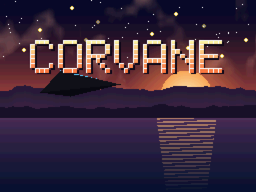
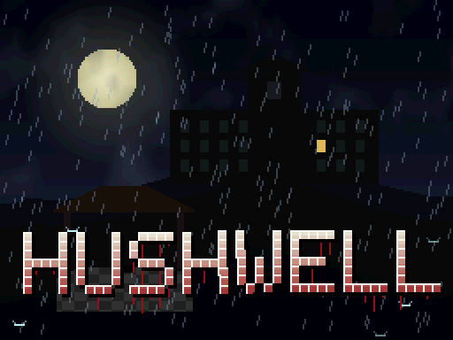
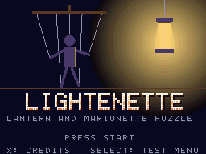
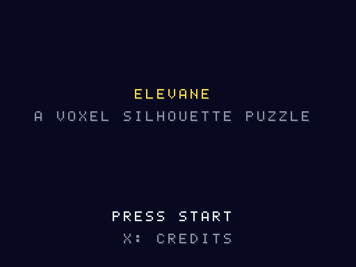

<div align="center">

<h1 align="center">
  <picture>
    <source media="(prefers-color-scheme: dark)" srcset="assets/logo/cleancart-lockup-dark.svg">
    
  </picture>
</h1>

**Licence-clean Nintendo DS homebrew**

[](#play)
[](https://blocksds.skylyrac.net/)
[](AGENTS.md)
[](#build)
[](https://github.com/devgyurak/cleancart.nds/commits/main)

[한국어](README-KO.md)

</div>

Original Nintendo DS homebrew games built with [BlocksDS](https://blocksds.skylyrac.net/),
kept licence-clean: our own code, assets generated from code in this repository,
and clearly noticed third-party runtime libraries.

## Purpose

A collection of homebrew games for emulator developers to develop against and verify with.

- **Complete games that judge themselves.** Each ROM is a game you can play to the end. It also
  reports what the hardware did (a result block, `expected.json`, `judge.py`), so a behaviour that
  differs from hardware shows up as a failed item, not as a feeling.
- **Usable in CI.** `judge.py` returns an exit code, and known per-renderer profiles tell a new
  difference from a known one. Every judged item carries a difficulty level, L1 Function to L4 Research
  ([docs/LEVELS.md](docs/LEVELS.md)).
- **Licence-clean.** Everything in a ROM is our own code, assets generated by code in this repository,
  or a clearly noticed third-party runtime library. Nothing needs to be excluded from a test suite.

## Games

| Game | Description | Docs |
|---|---|---|
| [Corvane](games/corvane/)<br> | 3D hover shooter across five fronts: 3D battlefield on the top screen, radar and touch lock-on on the bottom screen. | [README](games/corvane/README.md) · [QA checklist](games/corvane/docs/QA.md) · [Assets](games/corvane/ASSETS.md) |
| [Hushwell](games/hushwell/)<br> | First-person survival horror in a sanatorium built over a well: a flashlight on the top screen, a hand-drawn map and a tape recorder on the bottom screen, and something that hunts by sound. | [README](games/hushwell/README.md) · [QA checklist](games/hushwell/docs/QA.md) · [Assets](games/hushwell/ASSETS.md) |
| [Lightenette](games/lightenette/)<br> | Lantern-and-marionette puzzle action in five acts that also judges itself: the ROM counts pixels of its own display to test emulator accuracy cases, and a release ships the rehearsal ROMs with `expected.json` and `judge.py` for other emulators' CI. | [README](games/lightenette/README.md) · [QA checklist](games/lightenette/docs/QA.md) · [Assets](games/lightenette/ASSETS.md) |
| [Elevane](games/elevane/)<br> | Voxel silhouette puzzle in five chapters (40 orders): build the block structure that makes the front and the plan silhouette, both screens in 3D through display capture. It also judges itself: a rehearsal ROM plays the game and reports whether the capture paths worked, and a release ships it with `expected.json` and `judge.py` for other emulators' CI. | [README](games/elevane/README.md) · [QA checklist](games/elevane/docs/QA.md) · [Hardware QA](games/elevane/docs/HW-QA.md) · [Assets](games/elevane/ASSETS.md) |

Each game lives in its own folder with its own build, docs and licence files.

## Build

Requires [Docker](https://www.docker.com/). Every game builds inside a BlocksDS
image pinned by digest, so builds are reproducible and need no local toolchain.

```sh
cd games/corvane     # or: cd games/hushwell, …
./build.sh            # → corvane.nds (hushwell.nds)
./build.sh demos      # single-feature demo ROMs (corvane-<demo>.nds)
```

See the game's README for build options (save-chip variants, single demos) and controls.

## Branches and releases

`develop` and `main` only change through pull requests:

```
<prefix>/<summary>  ──PR──▶  develop  ──release PR──▶  main  ──tag <game>-v<x.y.z>──▶  Releases
```

Work happens on a branch off `develop` and is merged into `develop` by a PR whose
title starts with a commit prefix (`ADD:`, `FIX:`, …). A new game or a new game version
is released by a PR from `develop` into `main` (merge commit), followed by a tag on main.
Pull requests are opened by the maintainer only ([CODEOWNERS](.github/CODEOWNERS)); see
[CONTRIBUTING.md](CONTRIBUTING.md) for what to send instead.

Pushing a tag named `<game>-v<version>` builds that game on GitHub Actions
([`release.yml`](.github/workflows/release.yml)) and publishes the ROMs on the
[Releases](https://github.com/devgyurak/cleancart.nds/releases) page:

```sh
git tag corvane-v0.1.0 origin/main
git push origin corvane-v0.1.0
```

| Release file | Contents |
|---|---|
| `corvane-v0.1.0.zip` | `corvane.nds`, save-chip variants, `SHA256SUMS`, licence texts and notices |
| `corvane-v0.1.0-demos.zip` | every feature demo ROM, `SHA256SUMS`, licence texts and notices |
| `SHA256SUMS` | checksums of the zips |

A version with a suffix (`corvane-v0.2.0-rc.1`) becomes a pre-release. The same files are
also kept as workflow artifacts on the run's page under **Actions** (90 days by default).
The build is reproducible, so `./build.sh release` of the same commit gives ROMs with the
same SHA-256.

## Play

Open the `.nds` file in [melonDS](https://melonds.kuribo64.net/). No BIOS files are needed.
On macOS, if keys do nothing, the keyboard mapping in melonDS may be empty; see the
key table in [AGENTS.md](AGENTS.md#controls-and-key-mapping) and `tools/melonds/set_keys.py`.

## Repository layout

```
games/corvane/    a game: sources, build.sh, Dockerfile, docs, licences
games/hushwell/   a game (made from the corvane template)
games/lightenette/ a game (made from the corvane template)
games/elevane/    a game (made from lightenette)
tools/emu/        headless DeSmuME harness for smoke tests (Docker)
tools/melonds/    melonDS key mapping, input checks (macOS), headless melonDS runner
scripts/          maintenance scripts (agent config sync, logo generator)
assets/logo/      repository logo (generated by scripts/mklogo.py; branding, not ROM assets)
docs/             repository-wide docs (difficulty levels)
.github/          workflows (release, PR guard), rulesets, PR and issue templates
AGENTS.md         project conventions for coding agents (Claude Code reads it via CLAUDE.md)
LICENSE           Apache-2.0 for everything outside games/
CONTRIBUTING.md   what the project accepts (issues only)
```

## Licence

| Scope | Licence |
|---|---|
| Everything outside `games/` (tools, scripts, docs, logo, `.github/`) | Apache License 2.0, [LICENSE](LICENSE) |
| [corvane](games/corvane/LICENSE), [hushwell](games/hushwell/LICENSE), [lightenette](games/lightenette/LICENSE), [elevane](games/elevane/LICENSE) | Apache License 2.0, the `LICENSE` in each game's folder |

Third-party components in the ROMs are listed in each game's `THIRD_PARTY_NOTICES`. ROMs are not
committed; build them from source.

---

Not affiliated with or endorsed by Nintendo. Nintendo DS is a trademark of Nintendo.
