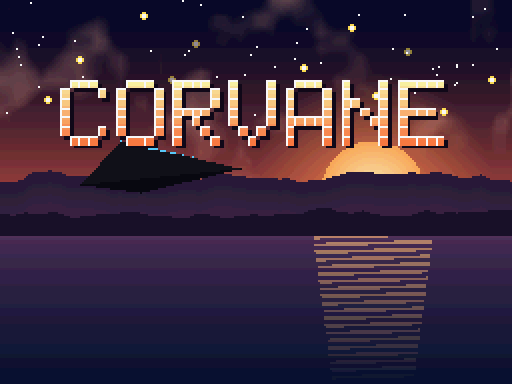
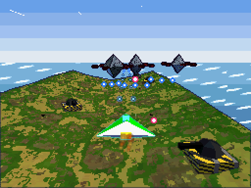
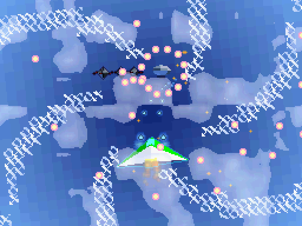
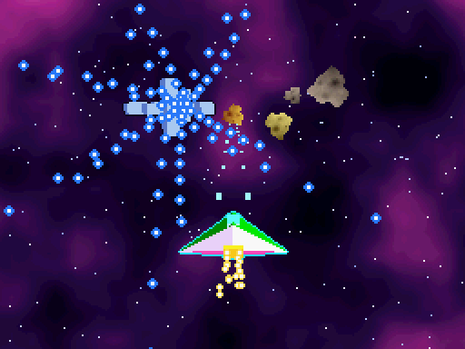
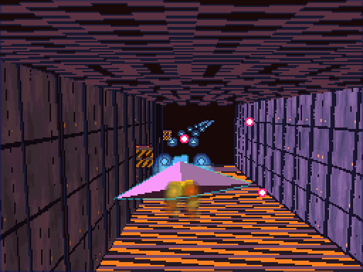
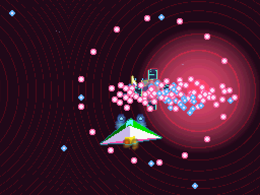
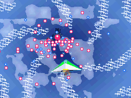

# Corvane (코르베인)

[](LICENSE)
[](#빌드)
[](#빌드)
[](docs/QA-KO.md)

[English](README.md)

<p align="center"></p>

닌텐도 DS용 오리지널 3D 액션 슈팅 게임입니다. 소형 호버 전투기로 3D 지형 위를 날며
다섯 개의 전선을 돌파합니다. 위 화면은 3D 전장, 아래 화면은 레이더와 터치 락온이 있는
전술 화면이고, 적의 탄막은 2D 스프라이트로 3D 화면 위에 겹쳐 그립니다.

기획 원칙에 따라 DS의 2D·3D·사운드·시스템 기능을 실제 게임플레이에 쓰도록 만들었고,
각 기능만 따로 보여 주는 **기능 데모 빌드 65종**을 같은 소스에서 뽑을 수 있습니다.

- 언어: C (게임 본체, ARM9 + 자체 ARM7 코어), Python 3 (빌드 타임 도구)
- 툴체인: BlocksDS v1.25.0 (도커 이미지 다이제스트 고정)
- 라이선스: Apache-2.0 — 서드파티 고지는 `THIRD_PARTY_NOTICES`, 에셋 출처는 `ASSETS-KO.md`

## 빌드

도커만 있으면 됩니다. `build.sh`가 고정된 BlocksDS 이미지
(`skylyrac/blocksds@sha256:c5f19b95…f8e5e4`) 위에 Python 3을 더한 빌드 이미지를 만들고
그 안에서 `make`를 실행합니다.

```sh
./build.sh                    # corvane.nds (본 빌드, 세이브 칩 EEPROM 64 KB)
./build.sh SAVE=flash         # corvane-save-flash.nds (FLASH 256 KB 변형)
./build.sh SAVE=fram          # corvane-save-fram.nds  (FRAM 32 KB 변형)
./build.sh DEMO=2d-blend      # corvane-2d-blend.nds   (기능 데모 하나)
./build.sh demos              # 기능 데모 65종 전부
./build.sh -j8 release        # build/release/{rom,demos}: corvane-vX.Y.Z 태그가 배포하는 파일
./build.sh clean
```

에셋은 빌드할 때 `tools/mkassets.py`가 코드로 생성하므로 저장소에 바이너리 에셋이 없습니다.
빌드 산출물(`build/`, `*.nds`)은 커밋하지 않습니다(`.gitignore`).

## 조작

| 입력 | 동작 |
|---|---|
| 십자키 | 이동 |
| A | 사격 (길게 누르면 차지, 떼면 차지샷) |
| B | 부스트·회피 (부스트 중 피탄 무시, 스테이지 3에서는 잔상) |
| L / R | 카메라 회전 |
| X | 폭탄 (화면 전체 공격, 탄 소거, 조종사 컷인) |
| 터치 | 레이더의 적을 짚어 유도 미사일 락온 / 스테이지 4에서는 전장을 직접 짚어 조준 사격 |
| Start | 일시정지 (Select: 포기, R: 한 프레임 진행) |
| Select | 개발자 콘솔(8bpp text BG) 켜기/끄기 |
| 뚜껑 닫기 | 자동 일시정지 후 절전, 열면 복귀 |

melonDS(macOS)에서 키가 먹지 않으면 `Config > Input and hotkeys`의 키보드 매핑이 비어 있는
경우입니다. 이 프로젝트에서 쓴 매핑: A=X, B=Z, X=S, Y=A, L=Q, R=W, Start=Return,
Select=Backspace, 십자키=방향키, 뚜껑=C, 일시정지=P, 빨리감기=Tab(누르는 동안).
설정 파일(`~/Library/Preferences/melonDS/melonDS.toml`)을 직접 고칠 때 주의할 점:
macOS의 Qt는 방향키에 `KeypadModifier`(0x20000000)를 붙여 보내므로 방향키 값은
`0x01000012~15 | 0x20000000`(553648146~553648149)이어야 합니다. melonDS가 켜져 있으면
종료할 때 설정을 덮어쓰므로 끈 상태에서 고치세요. 한글 입력 상태에서 글자 키가 씹히면
입력 소스를 영문(ABC)으로 바꾸고 플레이하세요.

타이틀에서 Select를 누르면 시작 스테이지를 고를 수 있습니다(QA용).
일시정지 중 L+R을 누른 채 A를 누르면 스테이지를 즉시 클리어합니다(QA용).

## 게임 흐름

부팅 로고(VRAM 직접 표시) → 인트로 영상(메인 메모리 FIFO 표시) → 타이틀(가만히 두면
데모 플레이) → 브리핑 → 스테이지 → 결과(자동 저장) → … → 다섯 스테이지 후 양화면 3D
엔딩과 스태프 롤 → 기록 저장. 게임 오버면 컨티뉴(그 스테이지 처음부터)를 고릅니다.

| 스테이지 | 무대 | 주인공 기법 |
|---|---|---|
| 1 해안 방어선 | 낮의 해안 요새 | 4x4 압축 텍스처 지형, 거리 포그, 3D 뒤의 2D 바다 + HBlank DMA 물결 |
| 2 구름 위 상공 | 구름바다와 비행선 함대 | 회전 어파인 하늘, 3D 위로 알파 블렌딩되는 구름, 알파 전용 포그, RTC 밤이면 WIN0/WIN1 탐조등, 반투명 비행선 |
| 3 궤도 정거장 | 성운 앞의 정거장 | 1024x512 대형 비트맵 성운, 툰 셰이딩·엣지 마킹, 부스트 잔상(디스플레이 캡처), 확장 팔레트 어파인 운석 |
| 4 요새 내부 | 좁은 복도와 허브 | 화면 스왑 후 터치 조준, Z 버퍼, near plane 클리핑, 경보등 광원 4개, 그림자 폴리곤 |
| 5 코어 | 반응로 | 계층 행렬 보스, 반투명 방어막, 박스 테스트 피격, 안티에일리어싱, 후면 비트맵, 사운드 캡처 에코, 폴리곤 한계 돌파 보너스 |

### 스크린샷

<table>
<tr><td></td><td></td><td></td></tr>
<tr><td align="center">1 해안 방어선</td><td align="center">2 구름 위 상공</td><td align="center">3 궤도 정거장</td></tr>
<tr><td></td><td></td><td></td></tr>
<tr><td align="center">4 요새 내부</td><td align="center">5 코어</td><td align="center">스테이지 2 보스</td></tr>
</table>

<sub>빌드한 ROM을 헤드리스 DeSmuME 0.9.12(`tools/emu/`)에서 캡처했습니다(melonDS·실기 아님). 위(3D) 화면을 최근접 보간 2배로 키웠고, 스테이지 4는 화면이 스왑되므로 아래 화면입니다. GIF는 스테이지 2 보스전의 일부입니다.</sub>

## 디렉터리

```
arm7/source/        자체 ARM7 코어: 입력·RTC·전원(libnds), 레지스터 직접 사운드 엔진
arm9/source/core/   시스템: IPC/FIFO, IRQ, 타이머, DMA, BIOS, 하드웨어 수학, 입력/리플레이,
                    세이브(SPI 직접), NitroFS, 카트 DMA
arm9/source/gfx/    VRAM 배치, OAM, 텍스트 BG, 효과, 3D(gl3d), 모델, 지형/복도
arm9/source/game/   씬, 스테이지 루프, 보스, 스테이지별 연출, HUD, 엔딩
arm9/source/demo/   기능 데모 빌드
common/cv_ipc.h     ARM9↔ARM7 메시지 형식
tools/              mkassets.py(에셋 생성), stage_editor.py, replay.py, cvtools/
docs/QA-KO.md       melonDS 검수 기록 양식과 데모별 기대 화면
licenses/           서드파티 라이선스 원문 (ROM의 NitroFS에도 들어감)
```

## 하드웨어 기능과 코드 위치

| 영역 | 기능 | 쓰는 곳 | 코드 |
|---|---|---|---|
| 시스템 | ARM9·ARM7 분업, IPCSYNC 마운트 확인, 자체 FIFO 메시지 | 효과음·BGM 요청, 입력 패킷, WRAM 인계 | `common/cv_ipc.h`, `core/sys.c`, `arm7/source/*` |
| | 공유 WRAM(WRAMCNT) | 평소 ARM7의 스트리밍 링 버퍼, 로딩 중 ARM9의 해제 스크래치 | `core/sys.c`, `core/nitro.c`, `arm7/source/sound7.c` |
| | 인터럽트 | VBlank 루프, HBlank, VCount, 타이머, DMA, IPC FIFO, 키(일시정지 절전 복귀) | `core/irq.c` |
| | 타이머 4개·캐스케이드 | 0→1 플레이 시간, 2 보스 박자 IRQ, 3 프로파일러(1·64), 분주비 1/64/256/1024 | `core/timer.c` |
| | DMA 모든 시작 모드 | 즉시, VBlank(OAM), HBlank(물결), 라인 시작(인트로 바), 메인 메모리 표시, 카트, 지오메트리 FIFO, fill | `core/dma.c`, `core/cart.c` |
| | BIOS | LZ77(VRAM·WRAM), CpuSet/FastSet, Div/Sqrt, IntrWait/VBlankIntrWait, Halt, GetCRC16 | `core/nitro.c`, `core/save.c`, `gfx/text.c`, `demo/demo.c` |
| | 하드웨어 나눗셈·제곱근 | 유도탄, 투영, 카메라 | `core/cvmath.c` |
| 2D | 엔진 A·B, 화면 스왑 | 전장/전술 화면, 스테이지 4 | `game/stagefx.c`, `game/hud.c` |
| | text BG 4bpp·8bpp | HUD, 브리핑, 8bpp 개발자 콘솔 | `gfx/text.c`, `game/hud.c` |
| | 어파인·확장 어파인·비트맵·대형 비트맵 | 하늘, 로고 확대, 타이틀, 성운 | `game/stagefx.c`, `game/scenes.c` |
| | 모자이크, 윈도우, OBJ 윈도우, 블렌딩, 마스터 밝기 | 피격·전환, 탐조등, 레이더 마스크, 구름·밤, 페이드 | `gfx/fx.c`, `game/hud.c` |
| | 스프라이트(일반·어파인·비트맵·1D/2D·우선순위·모자이크) | 탄막, 운석, 컷인, 폭발 | `gfx/oam.c`, `game/stage.c` |
| | 확장 팔레트(BG·OBJ) | 브리핑 일러스트, 운석 색 변종 | `game/scenes.c`, `game/stagefx.c` |
| | VRAM A~I 재배치 | 장면마다 배치표 | `gfx/vram.c` |
| | 디스플레이 캡처, 표시 모드 | 잔상, 양화면 3D 엔딩, 부팅 로고, 인트로 | `game/stagefx.c`, `game/ending.c`, `game/scenes.c` |
| 3D | 지오메트리 FIFO(DMA + 직접 포트) | 모델은 디스플레이 리스트 DMA, 지형은 포트 쓰기 | `gfx/gl3d.c`, `gfx/terrain.c` |
| | 행렬 스택, 광원 4개, 클리핑, 텍스처 7종, 폴리곤 속성, 툰/하이라이트, 엣지, 포그, AA·알파 테스트, Z/W 버퍼·후면 비트맵, 박스/위치/방향 테스트, 3D+2D 합성, 폴리곤 RAM 한계 | 스테이지 표 참고 | `gfx/*`, `game/boss.c`, `game/stage.c` |
| 사운드 | 16채널(BGM 8 + 효과음 8), PCM8/16/ADPCM, PSG 사각파·노이즈, 사운드 캡처 에코, 스트리밍 | 전 장면 | `arm7/source/sound7.c`, `core/snd.c` |
| 카트·주변기기 | NitroFS, 세이브 칩(EEPROM/FLASH/FRAM), 펌웨어 사용자 설정, RTC, 터치, 전원 | 로딩, 기록·설정·진행 저장, 타이틀 이름·기체 색, 밤/낮, 락온, 절전 | `core/nitro.c`, `core/save.c`, `game/game.c`, `arm7/source/main.c` |

## QA

- **기능 데모 빌드**: `./build.sh DEMO=<이름>` — 이름 목록은 `Makefile`의 `DEMOS`와
  `docs/QA-KO.md`. 데모는 확인 대상 기능과 메인 화면 text BG 콘솔만 씁니다.
- **고정 체크포인트**: 데모는 120프레임에 확인 화면을 완성하고, 값은 메인 RAM
  `0x0237F000`에 `{u32 magic "CVER", u32 데모 이름 해시, u32 프레임, u32 값[13]}`으로 씁니다.
- **입력 리플레이**: 모든 스테이지 플레이는 키·터치·뚜껑·RTC 시각·시드를 프레임 단위로
  기록해 세이브 칩에 남깁니다. 기록 화면에서 X로 마지막 판을 재생합니다.
  `tools/replay.py dump corvane.sav`로 .sav에서 로그를 꺼내 볼 수 있습니다.
- **난수**: 고정 시드 또는 입력 로그의 시드만 씁니다(타이머·RTC 미사용).
  보스 박자 타이머는 VBlank에서 시작해 프레임과 위상이 고정됩니다.
- **데모 플레이**: 타이틀에서 20초 기다리면 내장 로그(`demo1–5.rpl`)로 각 스테이지 핵심 구간을 플레이합니다.
- **도구**: `tools/stage_editor.py show 1`(ASCII 미리보기), `export`/`import`로 JSON 편집 →
  `tools/stages/stageN.json`이 있으면 빌드가 그 스테이지를 씁니다.

### 검증 현황 (2026-11-11 갱신)

- BlocksDS v1.25.0(고정 다이제스트)로 본 빌드, 세이브 변형 2종, 데모 65종이 경고 없이 빌드됩니다.
- `./build.sh clean && ./build.sh`를 두 번 해도 `corvane.nds`의 SHA-256이 같습니다(재현 가능 빌드).
- 헤드리스 DeSmuME 0.9.12(py-desmume)로 자동 스모크 테스트를 돌렸습니다:
  부팅 → 인트로 → 타이틀 → 브리핑 → 스테이지 1~5 → 보스 → 결과 → 엔딩 → 스태프 롤 → 기록,
  메뉴 전부, 데모 65종 체크포인트 도달, 세이브 EEPROM/FLASH/FRAM 쓰기·재로드,
  녹화한 판과 재생한 판의 게임 상태 메모리가 비트 단위로 일치함을 확인했습니다.
- **melonDS 1.1 검수** (2026-11-11, 이슈 #3, 기록은 [`docs/QA-KO.md`](docs/QA-KO.md#melonds-검수-기록-2026-11-11)):
  - DeSmuME가 가리고 있던 버그 8건을 찾았습니다. v0.1.0에서는 스테이지 1 브리핑 뒤
    게임이 멈췄고, melonDS에서 아무것도 저장되지 않았고, 데모 7종이 멈췄고 그 밖에도 잘못된 값을 낸 데모가 있었습니다.
  - 수정(#14~#20, #22)을 적용하면 데모 65종이 모두 melonDS에서 체크포인트에 도달하고
    본 빌드 체크리스트도 모두 통과합니다. 부팅부터 기록까지의 완주, 저장·재로드,
    동일한 리플레이를 포함합니다.
  - 검수는 melonDS 코어(`tools/melonds/mds.sh`)에서 스크립트로 진행했고, melonDS.app과는
    GDB 스텁으로 대조했습니다. 사람이 직접 완주하거나 소리를 들어 보지는 않았습니다.
- 실기, DSi, 플래시카트 로더 검수는 하지 않았습니다.

## 기획서의 열린 질문에 대한 이번 구현의 선택

| 질문 | 선택 |
|---|---|
| 본 빌드의 세이브 칩 | EEPROM 64 KB. FLASH·FRAM은 변형 빌드. melonDS는 헤더 게임 코드(`CRVN`)로 칩을 정하며 모든 빌드에 8 KB EEPROM을 에뮬레이트합니다. 게임이 이를 감지해 리플레이를 더 짧게(6140바이트) 저장합니다 |
| 에셋 제작 방식 | 전부 코드로 직접 제작(CC0 수집 없음) |
| 언어 지원 범위 | 게임 텍스트는 영어 한 가지(자체 5x7 폰트). 펌웨어 언어 설정은 읽어서 설정 화면에 표시 |
| 실기 검수 | 미정 — 현재는 에뮬레이터 스모크 테스트만 |
| 저장소 위치와 공개 시점 | 미정 (빌드 산출물은 커밋하지 않도록 설정만 해 둠) |

## 라이선스

- Corvane 소스와 생성 에셋: Apache License 2.0 (`LICENSE`, `NOTICE`, `ASSETS-KO.md`).
  모든 소스 파일 첫 줄에 `SPDX-License-Identifier: Apache-2.0`이 있습니다.
- ROM에 들어가는 서드파티: libnds(zlib), BlocksDS crts(MPL-2.0, 일부 zlib),
  picolibc(BSD 계열), libgcc(GPL-3.0 + 런타임 예외). 고지는 `THIRD_PARTY_NOTICES`,
  원문은 `licenses/`에 있고, 같은 파일들이 ROM의 NitroFS `/licenses/`에도 들어가
  게임 안 **크레딧 → X(라이선스 뷰어)** 로 읽을 수 있습니다.
- BlocksDS 기본 ARM7 코어 대신 자체 코어를 쓰므로 DSWiFi·lwIP·Mbed TLS·Maxmod·LibXM7은 들어가지 않습니다.
- 새 라이브러리를 연결하면 `THIRD_PARTY_NOTICES`, `licenses/`, 게임 크레딧(`game/scenes.c`)을 함께 갱신하세요.
