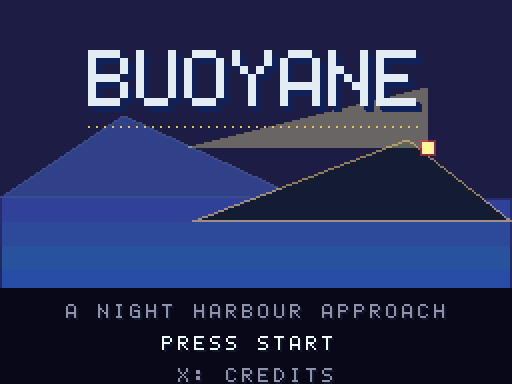
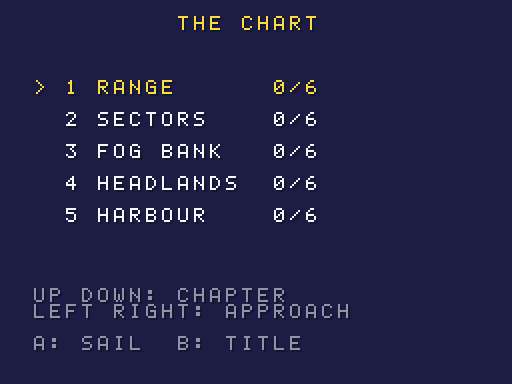
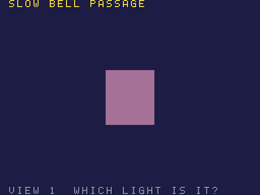
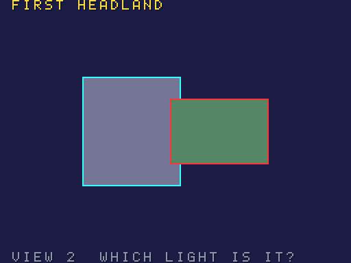

# Buoyane

[English](README.md)

<p align="center">   </p>

<sub>빌드한 ROM을 헤드리스 melonDS 1.1(`tools/melonds/mds.sh`, 소프트웨어 렌더러)에서 캡처했으며 DeSmuME나 실기가 아닙니다. 3장과 4장은 스크립트로 진행하는 리허설 ROM에서 가져왔습니다. 위 화면만 2배 최근접 확대(512×384).</sub>

닌텐도 DS용 오리지널 밤 항구 접근 게임입니다 (작업 중: 해도, 접근 30개의 항해, 연감, 판정까지 있고 타이틀 그림과 QA 문서가 이어집니다).
작은 배를 몰아 지어낸 항구로 들어가며, 불빛이 어떻게 보이는지로 각 불빛의 이름을 맞힙니다. 스스로 판정도 합니다:
리허설 ROM과 확인 ROM 다섯 개가 픽셀 정확한 3D 장면을 그려 캡처하고, 다른 에뮬레이터가 회귀 테스트로 쓸 수 있는 결과 블록을 냅니다.

**시험하는 하드웨어 영역 (레벨 2, "3D 렌더링 가장자리"):** 폴리곤 규칙(1-dot 폴리곤과 DISP_1DOT_DEPTH, 깊이 테스트 Equal, far plane 비트,
POLYGON_ATTR 래치, 알파 테스트), 텍스처 블렌딩(highlight, decal, 와이어프레임), fog·edge marking·안티앨리어싱 후처리.
기본 동작은 레벨 1 전제 조건이 먼저 지킵니다.

## 플레이 방식

여섯 접근씩 다섯 장입니다. 관문 세 곳에서 위 화면이 불빛 하나를 그 장의 3D 규칙(1-dot 폴리곤의 범위 컷오프, 섞인 W 점, fog 밀도, edge marking, 깊이 Equal)으로 보여 주고, 해도에는 후보 불빛 세 개가 있어 그와 같은 모습인 것을 고릅니다. Select는 이 보기에서 후보마다 어떻게 보이는지 적어 둔 연감을 열어, 3D 그림이 틀려도 어떤 에뮬레이터에서든 접근을 끝낼 수 있게 합니다. QA: [docs/QA-KO.md](docs/QA-KO.md), 실기: [docs/HW-QA-KO.md](docs/HW-QA-KO.md).

## 빌드

```sh
./build.sh                 # buoyane.nds
./build.sh demos           # 리허설 + 확인 ROM
```

Docker가 필요합니다(고정된 이미지의 BlocksDS v1.25.0). 클린 빌드 두 번은 같은 SHA-256을 냅니다.

## 에뮬레이터 테스트로 쓰기

`buoyane-rehearsal.nds`(약 500프레임) 또는 `buoyane-check-{dot,fog,edge,depth,blend}.nds`(약 150프레임)를 돌려 `0x0237F000`의
64워드 결과 블록을 읽고 판정합니다:

```sh
tools/melonds/mds.sh run games/buoyane/buoyane-rehearsal.nds 300 out/x "" 299 | python3 games/buoyane/tools/judge.py --profile melonds-1.1-software
```

`expected.json`에 항목(레벨, 근거, 역할)과, `known`에 각 에뮬레이터가 지금 틀리는 항목(2026-11-17 측정)이 있습니다:
melonDS 1.1 소프트웨어: `aa-opaque-dot-hidden`, `wire-texture-alpha`, GL Compute: 이 둘과 `edge-aa-translucent`, GL Classic: 18개, DeSmuME py-desmume 0.0.9: 16개. 기대값은 GBATEK 기준이고,
실기 값이 없는 한 항목(`fog-alpha-glitch`)은 정보용입니다.

진행은 저장됩니다. 접근을 하나 끝낼 때마다 카트 세이브(공용 세이브 블록의 continue 필드)에 쓰고 부팅할 때 읽습니다.
QA 실행은 끝날 때 카트 본래의 세이브를 되돌려 놓습니다. 배치: `arm9/source/game/rehearsal.h`.

## 크레딧

소스: Apache-2.0. 모든 그래픽·소리·곡은 이 저장소의 코드가 생성합니다([ASSETS-KO.md](ASSETS-KO.md)). BlocksDS로 빌드했고,
서드파티 고지는 [THIRD_PARTY_NOTICES](THIRD_PARTY_NOTICES)에 있습니다.
