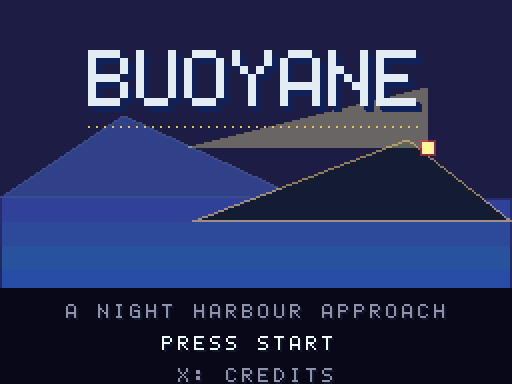
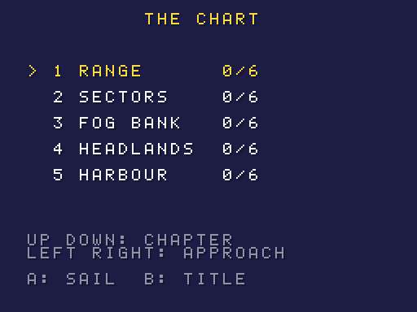
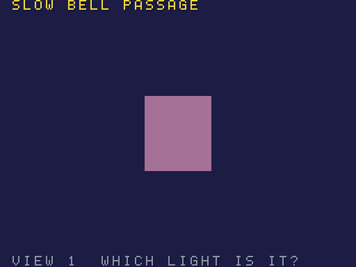
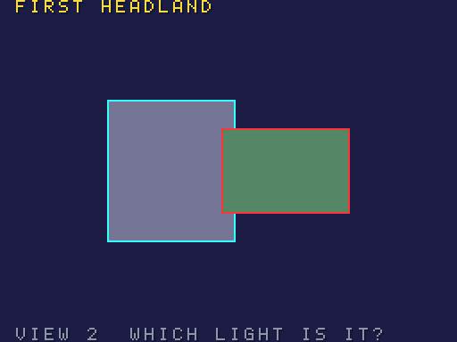

# Buoyane

[](LICENSE)
[](#build)
[](#build)

[한국어](README-KO.md)

<p align="center">   </p>

<sub>Captured from the built ROM in headless melonDS 1.1 (`tools/melonds/mds.sh`, software renderer), not DeSmuME or real hardware; chapters 3 and 4 come from the rehearsal ROM, which plays by script. Top screen only at 2x nearest-neighbour (512×384).</sub>

An original night-harbour approach game for the Nintendo DS (work in progress: the chart, the voyage with 30
approaches, the almanac and the judge are in; the title art and the QA notes follow). You steer a small boat into a made-up harbour and
name each light by how it looks. It also judges itself: a rehearsal ROM and five check ROMs draw
pixel-exact 3D scenes, capture them and report a result block that other emulators can use as a regression test.

**Hardware areas it tests (level 2, "3D rendering edges"):** polygon rules (1-dot polygons and DISP_1DOT_DEPTH, depth test Equal,
the far-plane bit, POLYGON_ATTR latching, the alpha test), texture blending (highlight, decal, wireframe) and the
fog, edge-marking and anti-aliasing post-pass. Prerequisites (level 1) guard the basic behaviour first.

## How it plays

Five chapters of six approaches. At each of three gates the top screen shows one light, drawn with the 3D rule the chapter is about (range cut-off for 1-dot polygons, mixed-W dots, fog density, edge marking, depth Equal); the chart offers three candidate lights and you name the one that looks like that. Select opens the almanac, which lists what each candidate looks like in this view, so every approach can be finished on any emulator even when the 3D picture is wrong. QA: [docs/QA.md](docs/QA.md), hardware: [docs/HW-QA.md](docs/HW-QA.md).

## Build

```sh
./build.sh                 # buoyane.nds
./build.sh demos           # rehearsal + check ROMs
```

Needs Docker (BlocksDS v1.25.0 in a pinned image). Two clean builds give the same SHA-256.

## Using it as an emulator test

Run `buoyane-rehearsal.nds` (about 500 frames) or one of `buoyane-check-{dot,fog,edge,depth,blend}.nds` (about 150 frames), read the
64-word result block at `0x0237F000`, and grade it:

```sh
tools/melonds/mds.sh run games/buoyane/buoyane-rehearsal.nds 300 out/x "" 299 | python3 games/buoyane/tools/judge.py --profile melonds-1.1-software
```

`expected.json` lists the items (level, basis, role) and, under `known`, what each emulator currently gets wrong (measured 2026-11-20):
melonDS 1.1 software: `aa-opaque-dot-hidden`, `wire-texture-alpha`; GL Compute: those two and `edge-aa-translucent`; GL Classic: 17 items; DeSmuME py-desmume 0.0.9: 15 items. Expected values
are from GBATEK; the two items without a hardware value (`fog-alpha-glitch`, `aa-marked-line-complete`) are informational. Layout: `arm9/source/game/rehearsal.h`.

## Credits

Source: Apache-2.0. Every graphic, sound and song is generated by code in this repository (see [ASSETS.md](ASSETS.md)). Built with BlocksDS;
third-party notices in [THIRD_PARTY_NOTICES](THIRD_PARTY_NOTICES).
