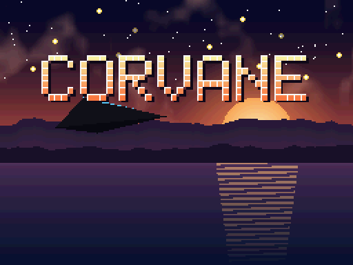
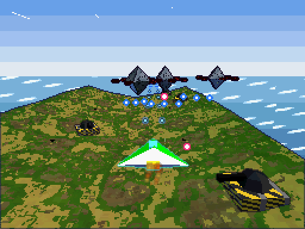
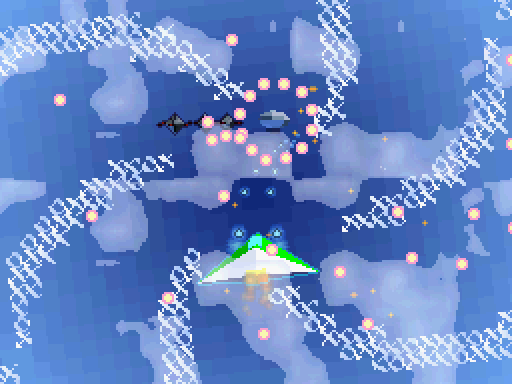
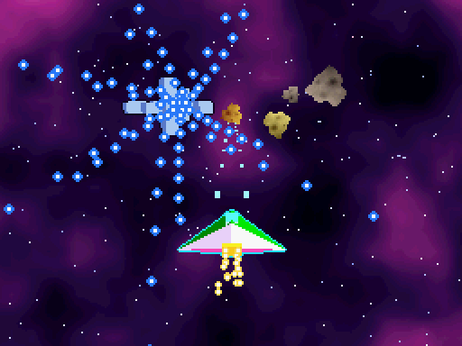
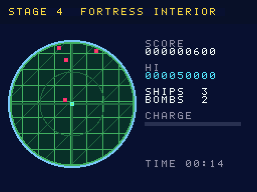
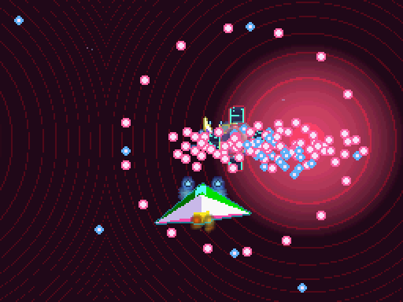
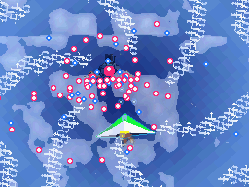

# Corvane

[](LICENSE)
[](#build)
[](#build)
[](docs/QA.md)

[한국어](README-KO.md)

<p align="center"></p>

An original 3D action shooter for the Nintendo DS. You fly a small hover fighter
over 3D terrain and break through five fronts. The top screen is the 3D
battlefield, the bottom screen is a tactical view with radar and touch lock-on,
and enemy bullet patterns are drawn as 2D sprites over the 3D scene.

**Hardware areas it tests:** 2D engines A and B, the 3D geometry/rendering engine, ARM7 sound, DMA/timers/IPC/interrupts, and cart, save, RTC, touch and power I/O.

Following the design principles, the game puts the DS's 2D, 3D, sound and system
features to work in actual gameplay, and the same source builds **65 feature demo
ROMs** that each show one feature on its own.

- Languages: C (game, ARM9 + own ARM7 core), Python 3 (build-time tools)
- Toolchain: BlocksDS v1.25.0 (Docker image pinned by digest)
- Licence: Apache-2.0 — third-party notices in `THIRD_PARTY_NOTICES`, asset sources in `ASSETS.md`

## Build

Docker is all you need. `build.sh` builds an image from the pinned BlocksDS image
(`skylyrac/blocksds@sha256:c5f19b95…f8e5e4`) plus Python 3, and runs `make` inside it.

```sh
./build.sh                    # corvane.nds (main build, EEPROM 64 KB save chip)
./build.sh SAVE=flash         # corvane-save-flash.nds (FLASH 256 KB variant)
./build.sh SAVE=fram          # corvane-save-fram.nds  (FRAM 32 KB variant)
./build.sh DEMO=2d-blend      # corvane-2d-blend.nds   (one feature demo)
./build.sh demos              # all 65 feature demos
./build.sh -j8 release        # build/release/{rom,demos}: what a corvane-vX.Y.Z tag ships
./build.sh clean
```

Assets are generated by code (`tools/mkassets.py`) at build time, so the repository
holds no binary assets. Build output (`build/`, `*.nds`) is never committed (`.gitignore`).

## Controls

| Input | Action |
|---|---|
| D-pad | Move |
| A | Fire (hold to charge, release for a charge shot) |
| B | Boost / dodge (bullets can't hit you while boosting; afterimage in stage 3) |
| L / R | Rotate camera |
| X | Bomb (hits the whole screen, clears bullets, pilot cut-in) |
| Touch | Tap an enemy on the radar to lock on homing missiles / in stage 4, tap the battlefield to aim directly |
| Start | Pause (Select: quit, R: advance one frame) |
| Select | Toggle the developer console (8bpp text BG) |
| Close lid | Auto pause, then sleep; resumes when opened |

If keys do nothing in melonDS (macOS), the keyboard mapping under
`Config > Input and hotkeys` is empty. The mapping used for this project:
A=X, B=Z, X=S, Y=A, L=Q, R=W, Start=Return, Select=Backspace, D-pad=arrow keys,
lid=C, pause=P, fast-forward=Tab (hold).
When editing the config file (`~/Library/Preferences/melonDS/melonDS.toml`) by hand:
Qt on macOS sends arrow keys with `KeypadModifier` (0x20000000), so the arrow
values must be `0x01000012–15 | 0x20000000` (553648146–553648149). melonDS
overwrites the config when it quits, so edit it while melonDS is closed. If letter
keys get swallowed while a Korean input source is active, switch to ABC to play.

On the title screen, Select picks the starting stage (for QA).
While paused, hold L+R and press A to clear the stage instantly (for QA).

## Game flow

Boot logo (direct VRAM display) → intro film (main-memory FIFO display) → title
(attract-mode demo play if left alone) → briefing → stage → results (auto save)
→ … → after five stages, an ending with 3D on both screens and the staff roll →
record saved. On game over you may continue (from the start of that stage).

| Stage | Setting | Featured techniques |
|---|---|---|
| 1 Coastal Line | Shore fortress by day | 4x4-compressed texture terrain, distance fog, 2D sea behind the 3D layer + HBlank-DMA waves |
| 2 Above the Clouds | Cloud sea and an airship fleet | Rotating affine sky, clouds alpha-blended over 3D, alpha-only fog, WIN0/WIN1 searchlights at night (RTC), translucent airships |
| 3 Orbital Station | Station in front of a nebula | 1024x512 large-bitmap nebula, toon shading + edge marking, boost afterimage (display capture), extended-palette affine meteors |
| 4 Fortress Interior | Narrow corridors and hubs | Screen swap with touch aiming, Z-buffer, near-plane clipping, four alarm lights, shadow polygons |
| 5 The Core | Reactor | Hierarchical-matrix boss, translucent shield, box-test hit detection, anti-aliasing, rear-plane bitmap, sound-capture echo, polygon-limit overload bonus |

### Screenshots

<table>
<tr><td></td><td></td><td></td></tr>
<tr><td align="center">1 Coastal Line</td><td align="center">2 Above the Clouds</td><td align="center">3 Orbital Station</td></tr>
<tr><td></td><td></td><td></td></tr>
<tr><td align="center">4 Fortress Interior</td><td align="center">5 The Core</td><td align="center">Stage 2 boss</td></tr>
</table>

<sub>Captured from the built ROM in headless DeSmuME 0.9.12 (`tools/emu/`), not melonDS or real hardware. Top screen only at 2x nearest-neighbour (512×384); in stage 4 the screens swap, so the top screen there is the radar HUD. The GIF is part of the stage 2 boss fight, also at 2x.</sub>

## Directories

```
arm7/source/        own ARM7 core: input, RTC, power (libnds), register-level sound engine
arm9/source/core/   system: IPC/FIFO, IRQ, timers, DMA, BIOS, hardware maths, input/replay,
                    save (direct SPI), NitroFS, cart DMA
arm9/source/gfx/    VRAM layout, OAM, text BGs, effects, 3D (gl3d), models, terrain/corridor
arm9/source/game/   scenes, stage loop, bosses, per-stage effects, HUD, ending
arm9/source/demo/   feature demo builds
common/cv_ipc.h     ARM9↔ARM7 message formats
tools/              mkassets.py (asset generation), stage_editor.py, replay.py, cvtools/
docs/QA.md          melonDS QA record sheet and expected screen per demo
licenses/           third-party licence texts (also shipped in the ROM's NitroFS)
```

## Hardware features and where the code is

| Area | Feature | Used for | Code |
|---|---|---|---|
| System | ARM9/ARM7 split, IPCSYNC mount check, own FIFO messages | sound effect and BGM requests, input packets, WRAM handover | `common/cv_ipc.h`, `core/sys.c`, `arm7/source/*` |
| | Shared WRAM (WRAMCNT) | ARM7 streaming ring buffer normally, ARM9 decompression scratch while loading | `core/sys.c`, `core/nitro.c`, `arm7/source/sound7.c` |
| | Interrupts | VBlank loop, HBlank, VCount, timers, DMA, IPC FIFO, keys (wake from pause sleep) | `core/irq.c` |
| | Four timers + cascade | 0→1 play time, 2 boss beat IRQ, 3 profiler (1 and 64), prescalers 1/64/256/1024 | `core/timer.c` |
| | Every DMA start mode | immediate, VBlank (OAM), HBlank (waves), line start (intro bars), main-memory display, cart, geometry FIFO, fill | `core/dma.c`, `core/cart.c` |
| | BIOS | LZ77 (VRAM and WRAM), CpuSet/FastSet, Div/Sqrt, IntrWait/VBlankIntrWait, Halt, GetCRC16 | `core/nitro.c`, `core/save.c`, `gfx/text.c`, `demo/demo.c` |
| | Hardware divide / square root | homing missiles, projection, camera | `core/cvmath.c` |
| 2D | Engines A and B, screen swap | battlefield / tactical screen, stage 4 | `game/stagefx.c`, `game/hud.c` |
| | Text BGs 4bpp and 8bpp | HUD, briefing, 8bpp developer console | `gfx/text.c`, `game/hud.c` |
| | Affine, extended affine, bitmap, large bitmap | sky, logo zoom, title, nebula | `game/stagefx.c`, `game/scenes.c` |
| | Mosaic, windows, OBJ window, blending, master brightness | hits and transitions, searchlights, radar mask, clouds and night, fades | `gfx/fx.c`, `game/hud.c` |
| | Sprites (normal, affine, bitmap, 1D/2D, priority, mosaic) | bullet patterns, meteors, cut-in, explosions | `gfx/oam.c`, `game/stage.c` |
| | Extended palettes (BG and OBJ) | briefing illustrations, meteor colour variants | `game/scenes.c`, `game/stagefx.c` |
| | VRAM banks A–I remapping | one layout table per scene | `gfx/vram.c` |
| | Display capture, display modes | afterimage, dual-screen 3D ending, boot logo, intro | `game/stagefx.c`, `game/ending.c`, `game/scenes.c` |
| 3D | Geometry FIFO (DMA + direct port writes) | models as display lists via DMA, terrain via port writes | `gfx/gl3d.c`, `gfx/terrain.c` |
| | Matrix stack, four lights, clipping, all 7 texture formats, polygon attributes, toon/highlight, edge marking, fog, AA and alpha test, Z/W buffer and rear-plane bitmap, box/position/vector tests, 3D+2D compositing, polygon RAM limit | see the stage table | `gfx/*`, `game/boss.c`, `game/stage.c` |
| Sound | 16 channels (8 BGM + 8 SFX), PCM8/16/ADPCM, PSG square and noise, sound-capture echo, streaming | every scene | `arm7/source/sound7.c`, `core/snd.c` |
| Cart and peripherals | NitroFS, save chip (EEPROM/FLASH/FRAM), firmware user settings, RTC, touch, power | loading; records, settings and progress saves; name on the title and ship colour; day/night; lock-on; sleep | `core/nitro.c`, `core/save.c`, `game/game.c`, `arm7/source/main.c` |

## QA

- **Feature demo builds**: `./build.sh DEMO=<name>` — names are in the `Makefile`'s
  `DEMOS` and in `docs/QA.md`. A demo uses only the feature under test plus a text BG
  console on the main screen.
- **Fixed checkpoint**: a demo completes its screen at frame 120 and writes values to
  main RAM at `0x0237F000` as `{u32 magic "CVER", u32 demo-name hash, u32 frame, u32 values[13]}`.
- **Input replay**: every stage run records keys, touch, lid, RTC hour and seed frame by
  frame and keeps the log on the save chip. Press X on the records screen to replay the
  last run. `tools/replay.py dump corvane.sav` pulls the log out of a .sav.
- **Randomness**: only a fixed seed or the seed from the input log (no timers, no RTC).
  The boss beat timer starts in VBlank so its phase is locked to the frame.
- **Demo play**: wait 20 seconds on the title and the built-in logs (`demo1–5.rpl`) play
  the core of each stage.
- **Tools**: `tools/stage_editor.py show 1` (ASCII preview), `export`/`import` for JSON
  editing → when `tools/stages/stageN.json` exists the build uses that stage.

### Verification status (updated 2026-11-11)

- With BlocksDS v1.25.0 (pinned digest) the main build, both save variants and all 65
  demos build without warnings.
- Running `./build.sh clean && ./build.sh` twice gives the same SHA-256 for
  `corvane.nds` (reproducible build).
- Automated smoke tests ran on headless DeSmuME 0.9.12 (py-desmume):
  boot → intro → title → briefing → stages 1–5 → bosses → results → ending → staff roll
  → records, every menu, all 65 demos reaching their checkpoint, EEPROM/FLASH/FRAM save
  write and reload, and bit-identical game-state memory between a recorded run and its replay.
- **melonDS 1.1 QA** (2026-11-11, issue #3; record in [`docs/QA.md`](docs/QA.md#melonds-qa-record-2026-11-11)):
  - It found eight bugs that DeSmuME hid. On v0.1.0 the game stopped after the stage 1
    briefing, nothing could be saved in melonDS, seven demos hung and more reported wrong values.
  - With the fixes (#14–#20, #22), all 65 demos reach their checkpoint in melonDS and every
    item of the main checklist passes. That includes a full run from boot to the records,
    saves and their reload, and an identical replay.
  - The QA was scripted on the melonDS core (`tools/melonds/mds.sh`) and checked against
    melonDS.app over its GDB stub. No person has played it through or listened yet.
- No testing on real hardware, DSi or flashcart loaders.

## Using it as an emulator test

`build/release/judge/` (the `corvane-vX.Y.Z-judge` release file) holds `expected.json` and `judge.py` for the demo ROMs
of `build/release/demos/` (the `-demos` release file; they are not copied twice). Run every demo ROM for at least 120
frames, print its result block at `0x0237F000` as a `RESULT <hex words>` line (16 words or more) and grade the log:

```sh
tools/melonds/mds.sh demos games/corvane/build/release/demos > demos.log     # RENDERER=gl|compute
python3 games/corvane/tools/judge.py --profile melonds-1.1-software demos.log
```

`judge.py` exits 0 on pass, 1 when a gating item fails or the profile differs, 2 when there is no usable input (a demo
is missing; `--partial` or `--demo NAME` grade only what is in the log). Every item has a `level` from 1 to 4
([docs/LEVELS.md](../../docs/LEVELS.md)) and `judge.py` prints a per-level summary (`LEVELS L1 a/b OK · …`); the level never
changes a verdict. Four profiles are recorded (melonDS 1.1 software, GL Classic, GL Compute; DeSmuME); nothing has been
measured on real hardware yet. All 75 demos are judged; the screen and sound demos grade themselves with capture probes and ARM7 channel reports (see
[docs/QA.md](docs/QA.md#judging-expectedjson-toolsjudgepy) for what stays unjudged or informational).

## Choices for the design document's open questions

| Question | Choice |
|---|---|
| Save chip for the main build | EEPROM 64 KB; FLASH and FRAM as variant builds. melonDS picks the chip from the header game code (`CRVN`) and emulates an 8 KB EEPROM for every build; the game detects it and keeps a shorter replay there (6140 bytes; a longer run is cut) |
| How assets are made | all made directly in code (no CC0 collection) |
| Language support | game text in English only (own 5x7 font); the firmware language setting is read and shown on the settings screen |
| Real-hardware QA | undecided — emulator smoke tests only for now |
| Repository location and release timing | undecided (build output is set up never to be committed) |

## Licence

- Corvane source and generated assets: Apache License 2.0 (`LICENSE`, `NOTICE`, `ASSETS.md`).
  Every source file starts with `SPDX-License-Identifier: Apache-2.0`.
- Third-party code in the ROM: libnds (zlib), BlocksDS crts (MPL-2.0, parts zlib),
  picolibc (BSD-style), libgcc (GPL-3.0 + runtime exception). Notices are in
  `THIRD_PARTY_NOTICES`, the full texts in `licenses/`; the same files are shipped in the
  ROM's NitroFS `/licenses/` and can be read in game under **Credits → X (licence viewer)**.
- Corvane runs its own ARM7 core instead of the BlocksDS default, so DSWiFi, lwIP,
  Mbed TLS, Maxmod and LibXM7 are not included.
- When linking a new library, update `THIRD_PARTY_NOTICES`, `licenses/` and the in-game
  credits (`game/scenes.c`) together.

---

Not affiliated with or endorsed by Nintendo. Nintendo DS is a trademark of Nintendo.
