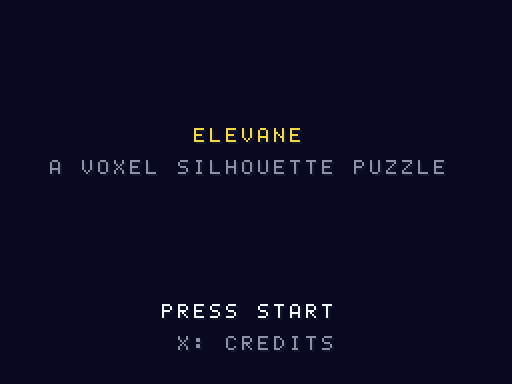
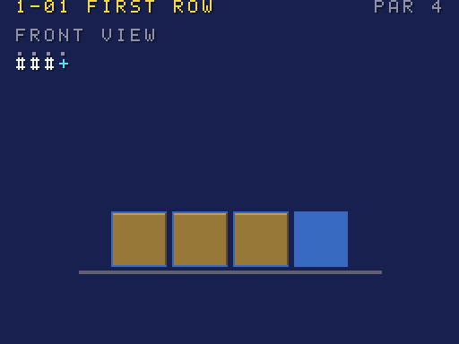
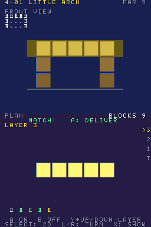
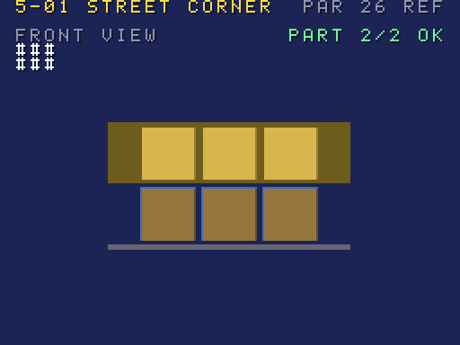
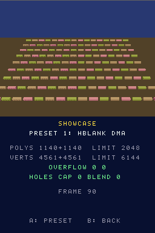

# Elevane

[](LICENSE)
[](#빌드)
[](#빌드)
[](tools/puzzles)

[English](README.md)

<p align="center">    </p>

닌텐도 DS용 오리지널 복셀 실루엣 퍼즐입니다. 주문서 하나는 정면도와 평면도 실루엣이고,
두 실루엣을 만드는 블록 구조물을 쌓으면 납품됩니다. 블록이 적을수록 별을 더 받습니다.
위 화면은 정면도, 아래 화면은 평면도이며 **두 화면 모두 3D**입니다(디스플레이 캡처, 화면마다
30fps). 스스로 판정하도록도 만들었습니다: 리허설 ROM이 고정 스크립트로 게임을 플레이하며 캡처
경로가 동작했는지 보고하므로 다른 에뮬레이터가 회귀 테스트로 쓸 수 있습니다
([에뮬레이터 테스트로 쓰기](#에뮬레이터-테스트로-쓰기) 참고).

**시험하는 하드웨어 영역:** 양쪽 화면의 3D 디스플레이 캡처, HBlank DMA 합성, 뒷면(rear plane), 지오메트리·폴리곤 한계. 스크립트 리허설로 확인.

**상태.** 다섯 장(퍼즐 40개), 2D 격자 모드, 감상 모드, 리허설과 판정, 라이선스 뷰어가 있는
크레딧, 게임 전체를 스스로 플레이하는 숨은 자동 QA 실행까지 끝났고, DeSmuME와 melonDS(소프트웨어,
GL, compute 렌더러)에서 헤드리스로 돌아갑니다. **실기 측정값은 아직 없습니다**: 기대값이 문서
(GBATEK)나 ROM 자체 논리에서 나오지 않는 항목은 실기 값이 생길 때까지 참고용입니다.
데스크톱 에뮬레이터에서의 손 조작감은 아직 검토하지 않았습니다. 진행 상황과 별은 아직 저장하지 않습니다.

- 언어: C (게임, ARM9 + 자체 ARM7 코어), Python 3 (빌드 도구)
- 툴체인: BlocksDS v1.25.0 (다이제스트로 고정한 Docker 이미지)
- 라이선스: Apache-2.0 — 서드파티 고지는 `THIRD_PARTY_NOTICES`, 에셋 출처는 `ASSETS.md`

## 플레이

타이틀에서 Start, 장(좌우)과 주문서(상하)를 고르고 A로 시작합니다.

| 장 | 격자 | 새로 배우는 것 |
|---|---|---|
| 1 견습 | 4x4, 높이 2까지 | 터치로 쌓기, 두 도면 읽기 |
| 2 창고 | 5x5, 높이 3까지 | L/R로 위 화면을 오른쪽·뒤·왼쪽 옆면으로 돌리기 |
| 3 시계탑 | 6x6, 높이 5까지 | par: 별 평가는 내 블록 수와 최소 블록 수를 비교 |
| 4 다리 | 가로 8까지 | 작업 층(Y + 위/아래 또는 층 막대), 아치. 모든 블록은 바닥에 닿아야 함 |
| 5 도시 | 8x8까지 | 주문서 하나에 구조물 여러 개(Y 탭으로 전환), 모두 맞아야 함 |

| DS 버튼 | 동작 (melonDS 키) |
|---|---|
| 십자키 (방향키) | 커서 이동 |
| A (X) / B (Z) | 기둥 올리기 / 내리기 (작업 층이 있으면 그 칸 켜기 / 끄기). 두 도면이 맞으면 A가 납품 |
| 터치 | 평면도 칸을 눌러 올리기, 0.5초 누르면 비우기, 층 막대를 눌러 층 고르기 |
| L / R (Q / W) | 위 화면 시점 돌리기 |
| Y (A) | + 위/아래: 작업 층, 탭: 다음 구조물 |
| Select (Backspace) | 2D 격자 모드(같은 퍼즐을 두 화면의 숫자로, 3D 없음) / 3D로 복귀 |
| X (S) | 감상 모드: 3D 한 프레임 한도보다 큰 완성작 (A로 캡처 경로 전환) |
| Start (Return) | 목록으로 |

에뮬레이터마다 정확도 차이가 보일 수 있지만 진행을 막지 않습니다: 2D 격자가 3D 도면이 보여 주는
것을 모두 보여 줍니다. 타이틀에서 L+R+X+Y를 2초 누르면 자동 QA 실행이 시작됩니다.

## 빌드

Docker만 있으면 됩니다.

```sh
./build.sh                    # elevane.nds
./build.sh SAVE=flash         # elevane-save-flash.nds
./build.sh SAVE=fram          # elevane-save-fram.nds
./build.sh demos              # elevane-rehearsal.nds
./build.sh -j8 release        # build/release/{rom,demos,judge}: elevane-vX.Y.Z 태그가 배포하는 것
./build.sh clean
```

클린 빌드 두 번은 같은 SHA-256을 냅니다. 퍼즐 도구(Python 3, 표준 라이브러리만):
`python3 tools/puzzle_check.py`가 모든 퍼즐을 검사하고 par를 출력하며,
`python3 -m unittest discover -s tools/tests`가 단위 테스트를 돌립니다.

## 에뮬레이터 테스트로 쓰기

`build/release/judge/`에 리허설 ROM, `expected.json`, `judge.py`, `compare.py`가 있습니다. 리허설은 장마다 첫
퍼즐을 풀고 감상 프리셋 두 개를 돌린 뒤 `0x0237F000`에 결과 블록을 남깁니다(형식:
`arm9/source/game/rehearsal.h`).

```sh
# 이 저장소의 melonDS 헤드리스 러너 (RENDERER=soft|gl|compute, MELONDS_COMMIT=<sha>)
RENDERER=gl tools/melonds/mds.sh run games/elevane/elevane-rehearsal.nds 4000 out/x "" 3999 \
  | python3 games/elevane/tools/judge.py --profile melonds-1.1-gl-classic
# 같은 에뮬레이터 소프트웨어 렌더러와 1배 스크린샷 비교, 연속 프레임
python3 games/elevane/tools/compare.py --ref out/soft --test out/gl --frames 380,381,382,383 --phase showcase
```

모든 항목에는 1~4의 `level`이 있고([docs/LEVELS-KO.md](../../docs/LEVELS-KO.md)), `judge.py`는 레벨별 요약
(`LEVELS L1 a/b OK · …`)을 출력합니다. 레벨은 판정과 종료 코드에 영향을 주지 않습니다.

`judge.py`는 통과 시 0, 필수 항목 실패나 프로필 불일치 시 1, 쓸 수 있는 결과가 없으면 2로 끝납니다.
프로필 일곱 개가 기록되어 있습니다(DeSmuME, melonDS 1.1과 master `4ce2188` 각각의 소프트웨어,
OpenGL classic, compute). 알려진 결과: master GL과 Compute는 감상 프리셋 1의 왼쪽 절반을 비웁니다
(melonDS #2618 결함, 플레이에는 영향 없음). 리어 플레인 프리셋 2는 모든 GL 렌더러에서 한쪽만 보입니다
(별개 결함). 문서·보고·ROM 논리 출처가 없는 항목은 실기 값이 생길 때까지 `unconfirmed`입니다.

## 문서

- [docs/QA-KO.md](docs/QA-KO.md): 무엇을 어디서 확인했는지 (DeSmuME, melonDS, 실기)
- [ASSETS-KO.md](ASSETS-KO.md): 모든 에셋은 코드가 생성하며 생성기가 명시되어 있음
- `AGENTS.md`: 기여자용 코드 지도와 규약

---

Nintendo와 제휴하거나 Nintendo의 승인을 받은 프로젝트가 아닙니다. Nintendo DS는 Nintendo의 상표입니다.
