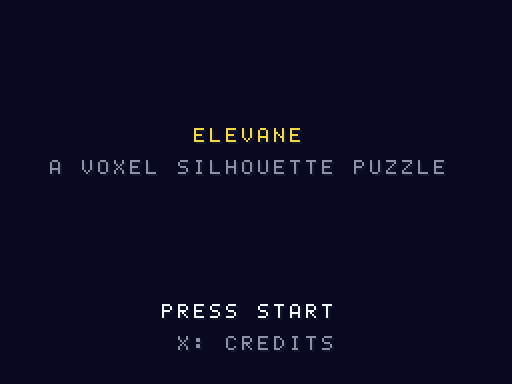
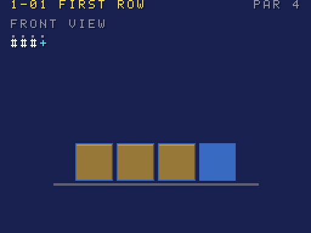
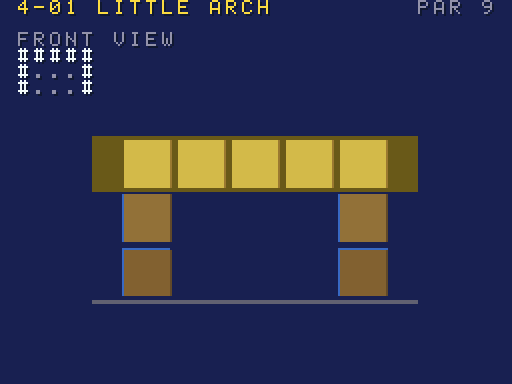
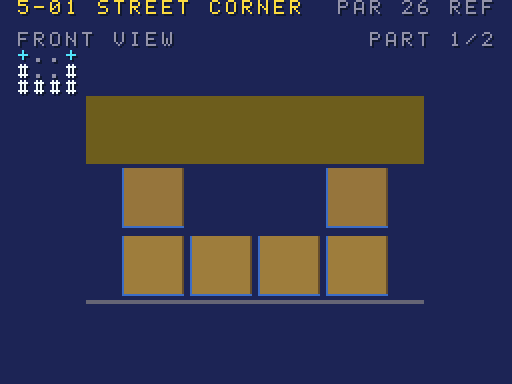
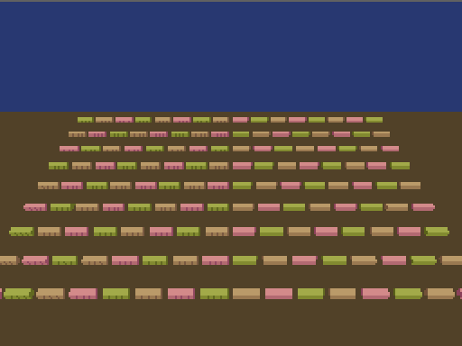

# Elevane

[](LICENSE)
[](#build)
[](#build)
[](tools/puzzles)

[한국어](README-KO.md)

<p align="center">    </p>

<sub>Captured from the built ROM with the headless emulators of this repository (`tools/emu/`, `tools/melonds/`); the emulator of each picture was not recorded, and not real hardware. Top screen only (the front view) at 2x nearest-neighbour (512×384).</sub>

An original voxel silhouette puzzle for the Nintendo DS. Each order is a front and a plan
silhouette; build a block structure that makes both and it is delivered, fewer blocks earn
more stars. The top screen is the front view, the bottom screen the plan view, **both in
3D** (display capture, 30 fps each). It is also built to judge itself: a rehearsal ROM plays
the game with a fixed script and reports whether the capture paths worked, so other
emulators can use it as a regression test (see [Using it as an emulator test](#using-it-as-an-emulator-test)).

**Hardware areas it tests:** display capture of 3D on both screens, HBlank-DMA compositing, the rear plane and geometry/polygon limits, checked by a scripted rehearsal.

**Status.** All five chapters (40 puzzles), a 2D grid mode, a showcase mode, the rehearsal and
its judge, the credits with the licence viewer and a hidden auto QA run that plays the whole
game are done and run headless in DeSmuME and melonDS (software, GL and compute renderers).
**Nothing has been measured on real hardware yet**: items whose expected value does not come
from the documentation (GBATEK) or the ROM's own logic stay informational until hardware
values arrive. Hands-on feel in a desktop emulator has not been
reviewed. Progress and stars are not saved yet.

- Languages: C (game, ARM9 + own ARM7 core), Python 3 (build-time tools)
- Toolchain: BlocksDS v1.25.0 (Docker image pinned by digest)
- Licence: Apache-2.0 — third-party notices in `THIRD_PARTY_NOTICES`, asset sources in `ASSETS.md`

## Playing

Start on the title, choose a chapter (left/right) and an order (up/down), A to start.

| Chapter | Grid | New |
|---|---|---|
| 1 Apprentice | 4x4, up to 2 high | touch stacking, reading two views |
| 2 Warehouse | 5x5, up to 3 | L/R turn the top view to the right, back and left side |
| 3 Clock tower | 6x6, up to 5 | par: the star rating compares your blocks with the fewest possible |
| 4 Bridges | up to 8 wide | the work layer (Y + up/down, or the layer bar), arches; every block must reach the floor |
| 5 The city | up to 8x8 | several structures per order (Y tap switches), all must match |

| DS button | Action (melonDS key) |
|---|---|
| D-pad (arrows) | move the cursor |
| A (X) / B (Z) | raise / lower the column (with a work layer: switch that cell on / off); A delivers when both views match |
| Touch | tap a plan cell to raise it, hold half a second to empty it, touch the layer bar to pick a layer |
| L / R (Q / W) | turn the top view |
| Y (A) | + up/down: work layer; a tap: next structure |
| Select (Backspace) | 2D grid mode (the same puzzle as numbers on both screens, no 3D at all) / back to 3D |
| X (S) | showcase mode: the work drawn bigger than one 3D frame holds (A switches the capture path) |
| Start (Return) | back to the list |

Accuracy differences between emulators are visible but never block progress: the 2D grid
shows everything the 3D views do. Title: hold L+R+X+Y for two seconds to start the auto QA run.

## Build

Docker is all you need.

```sh
./build.sh                    # elevane.nds
./build.sh SAVE=flash         # elevane-save-flash.nds
./build.sh SAVE=fram          # elevane-save-fram.nds
./build.sh demos              # elevane-rehearsal.nds
./build.sh -j8 release        # build/release/{rom,demos,judge}: what an elevane-vX.Y.Z tag ships
./build.sh clean
```

Two clean builds give the same SHA-256. Puzzle tools (Python 3, standard library only):
`python3 tools/puzzle_check.py` checks every puzzle and prints its par;
`python3 -m unittest discover -s tools/tests` runs the unit tests.

## Using it as an emulator test

`build/release/judge/` holds the rehearsal ROM, `expected.json`, `judge.py` and `compare.py`.
The rehearsal solves the first puzzle of every chapter, then runs both showcase presets and
leaves a result block at `0x0237F000` (layout: `arm9/source/game/rehearsal.h`).

```sh
# melonDS headless runner of this repository (RENDERER=soft|gl|compute, MELONDS_COMMIT=<sha>)
RENDERER=gl tools/melonds/mds.sh run games/elevane/elevane-rehearsal.nds 4000 out/x "" 3999 \
  | python3 games/elevane/tools/judge.py --profile melonds-1.1-gl-classic
# 1x screenshots against the same emulator's software renderer, consecutive frames
python3 games/elevane/tools/compare.py --ref out/soft --test out/gl --frames 380,381,382,383 --phase showcase
```

Every item has a `level` from 1 to 4 ([docs/LEVELS.md](../../docs/LEVELS.md)); `judge.py` prints a per-level
summary (`LEVELS L1 a/b OK · …`) and the level never changes a verdict or an exit code.

`judge.py` exits 0 on pass, 1 when a gating item fails or the profile differs, 2 when there
is no usable result. Seven profiles are recorded (DeSmuME; melonDS 1.1 and master `4ce2188`,
each software, OpenGL classic and compute). Known results: master GL and Compute leave the
left half of showcase preset 1 empty (the melonDS #2618 defect, play is unaffected), the
rear-plane preset 2 shows one side only on every GL renderer (a separate defect).
Items without a documentation, report or ROM-logic source are `unconfirmed` until real
hardware values exist.

## Documentation

- [docs/QA.md](docs/QA.md): what was checked where (DeSmuME, melonDS, hardware)
- [ASSETS.md](ASSETS.md): every asset is generated by code, with its generator
- `AGENTS.md`: code map and contracts for contributors

---

Not affiliated with or endorsed by Nintendo. Nintendo DS is a trademark of Nintendo.
