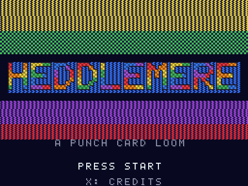
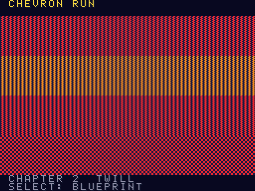

# Heddlemere

[English](README.md)

닌텐도 DS용 오리지널 펀치카드 베틀 퍼즐입니다. 다섯 장, 장마다 주문서 여덟 개. 주문서 하나는 네 줄짜리 작은
태피스트리이고, 줄마다 카드(실 색, 짜임, 뒷장에서는 잉아 프로그램·여유 레버·염색 라인)를 뚫어 천이 주문서와
같아지면 납품합니다. 가장 적은 단계(par)로 끝내면 별 세 개입니다.

목표 레벨 **L3**, 영역 **3D 엔진과 스캔라인 타이밍**(저장소 루트의 `docs/LEVELS-KO.md`). ROM은 스스로도
판정합니다. 리허설 ROM이 라인·프레임 길이, HBlank 플래그, VBlank 플래그, VCOUNT 쓰기, 지오메트리 명령의
사이클 비용을 재고, `tools/judge.py`가 결과 블록을 `expected.json`과 대조합니다(종료 코드 0 통과, 1 NG 또는 프로필 불일치, 2 결과 없음).



*타이틀(위 화면, 2배, melonDS 1.1 소프트웨어에서 캡처): 래스터로 짠 천 위에 짜 넣은 이름.*

## 상태

뼈대, 측정 코어, 직조: 주문 모델, par가 붙은 주문 40개, 글자만 쓰는 플레이 장면, 스크립트 플레이어, 측정 타이밍 항목 18개가 든
리허설 블록 `HMRH`(`arm9/source/judge/timing.c`), `expected.json`, 에뮬레이터 프로필 네 개가 있는 `tools/judge.py`,
QA 실행(주문 40개 전부, 크레딧, 그다음 측정). 위 화면의 천은 HBlank 인터럽트가 라인마다 스크롤(짜임)과 팔레트 항목(실 색)을 써서 짭니다. Select를 누르면 도면 보기로 바뀌고, 같은 픽셀을 래스터 효과 없이 CPU가 계산해서 그립니다. 천 아래에는 진짜 행렬 명령으로 3D 잉아 틀을 그리고, 주문을 납품하면 프로그램을 지오메트리 엔진에 돌려 잰 사이클을 GBATEK 비용과 견주는 램프가 켜집니다(정보용).
타이틀 그림은 임시입니다(`TODO(title)`).



*주문 2-01(위 화면, 2배, melonDS 1.1 소프트웨어): 네 띠가 각각 실 색과 짜임을 가집니다.*

## 장

| 장 | 플레이어가 돌리는 열 | 가르치는 것 |
|---|---|---|
| 1 평직 | 색, 짜임 | 커서와 단계 |
| 2 능직 | 색, 짜임 | 짜임 네 가지 |
| 3 모터 | + 프로그램 | 프로그램마다 GX 사이클 비용이 다릅니다(GBATEK 수치). 주문의 예산(라인)이 한도입니다 |
| 4 여유 | + 레버 | VCOUNT 쓰기로 그 줄에 예산 10라인을 더 줍니다. 주문마다 몇 번 쓸 수 있는지 정해져 있습니다 |
| 5 염색소 | + 염색 | 셔틀 색은 조용한 라인 192..213에서만 바꿀 수 있습니다 |

## 빌드

```sh
./build.sh                  # heddlemere.nds
./build.sh DEMO=rehearsal   # heddlemere-rehearsal.nds, judge.py가 채점하는 ROM
./build.sh -j8 release      # build/release/{rom,demos,judge}
```

빌드는 Docker 컨테이너(BlocksDS를 digest로 고정)에서 돌고 호스트에는 아무것도 설치하지 않습니다. 클린 빌드
두 번은 같은 SHA-256을 냅니다. 조작: 십자키 위/아래로 칸을 고르고, 왼쪽/오른쪽으로 돌리고, A로 납품, B로 목록.
코드 지도는 `AGENTS.md`, QA 실행은 `docs/QA-KO.md`를 보세요.

라이선스: 소스는 Apache-2.0, 모든 에셋은 코드가 생성합니다(`ASSETS-KO.md`), 서드파티 런타임 라이브러리는
`THIRD_PARTY_NOTICES`에 있습니다.
