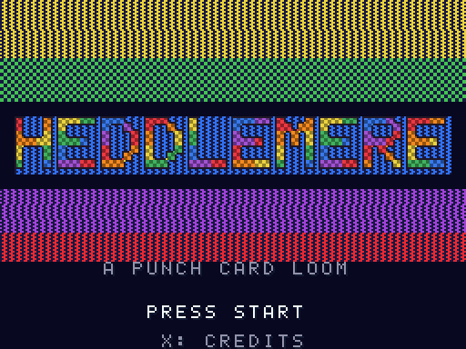
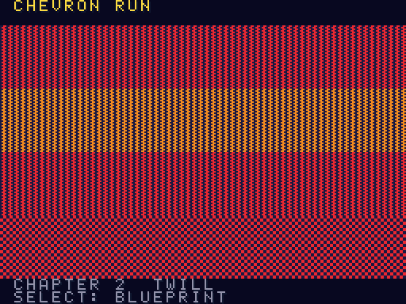

# Heddlemere

[한국어](README-KO.md)

An original punch-card loom puzzle for the Nintendo DS, in five chapters of eight orders. Each order is a
small tapestry of four rows: punch every row's card (thread colour, weave, and in later chapters the heddle
program, the slack lever and the dye line) until the cloth matches the order, then deliver it. The fewest
single steps (par) earns three stars.

Target level **L3**, area **3D engine and scanline timing** (`docs/LEVELS.md` in the repository root). The ROM
also judges itself: a rehearsal ROM measures line and frame length, the HBlank flag, the VBlank flag, VCOUNT
writes and the cycle costs of geometry commands, and `tools/judge.py` grades the result block against
`expected.json`. It publishes the block `HMRH`; `tools/judge.py` grades it (exit 0 pass, 1 NG or profile mismatch, 2 no usable result).



*Title (top screen, 2x, captured in melonDS 1.1 software): the name woven over a raster-woven cloth.*

## Status

Scaffold, measurement core and weave: the order model, the 40 orders with their par, a plain text play scene, the scripted
player, the rehearsal block `HMRH` with 18 measured timing items (`arm9/source/judge/timing.c`), `expected.json`, `tools/judge.py`
with four emulator profiles, the QA run (all 40 orders, the credits, then the measurements). The cloth is woven on the top screen by an HBlank interrupt that writes the scroll (weave) and a palette entry (thread colour) of every line; Select switches to the blueprint view, the same pixels computed by the CPU without any raster effect. The heddle frame is drawn in 3D below the cloth with the real matrix commands, and delivering an order runs the programs through the geometry engine (a lamp compares the measured cycles with the GBATEK costs; information only). The title picture is a placeholder (`TODO(title)`).



*Order 2-01 (top screen, 2x, melonDS 1.1 software): four bands, each its own thread colour and weave.*

## Chapters

| Chapter | Columns the player turns | What it teaches |
|---|---|---|
| 1 Plain weave | colour, weave | the cursor and the steps |
| 2 Twill | colour, weave | all four weaves |
| 3 Motor | + program | each program costs GX cycles (GBATEK figures); the order's budget in lines limits it |
| 4 Slack | + lever | a VCOUNT write gives a row 10 more lines of budget; the order allows a few uses |
| 5 Dye house | + dye | the shuttle colour changes only in the quiet lines 192..213 |

## Build

```sh
./build.sh                  # heddlemere.nds
./build.sh DEMO=rehearsal   # heddlemere-rehearsal.nds, the ROM that judge.py grades
./build.sh -j8 release      # build/release/{rom,demos,judge}
```

The build runs in a Docker container (BlocksDS pinned by digest); nothing is installed on the host.
Two clean builds give the same SHA-256. Controls: D-pad up/down chooses a cell, left/right turns it, A
delivers, B returns to the list; see `AGENTS.md` for the code map and `docs/QA.md` for the QA run.

Licence: Apache-2.0 for the source; every asset is generated by code (`ASSETS.md`); third-party runtime
libraries are listed in `THIRD_PARTY_NOTICES`.
