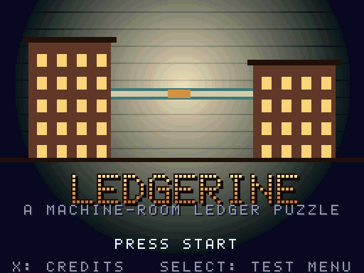
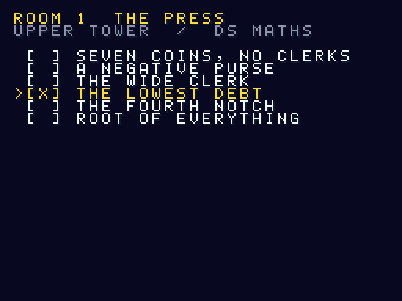
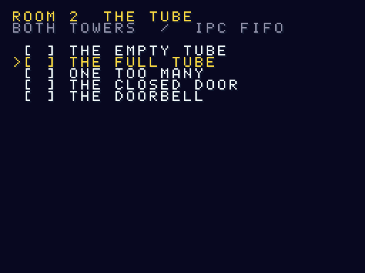

# Ledgerine

[](LICENSE)
[](#빌드)
[](#빌드)

[English](README.md)

<p align="center">  </p>

<sub>빌드한 ROM을 headless melonDS 1.1(`tools/melonds/mds.sh`)에서 캡처했습니다. DeSmuME나 실기가 아닙니다. 방 화면은 키 입력 실행에서 얻었습니다(1번 방은 한 줄을 맞춘 상태, 2번 방은 테스트 메뉴로 열었습니다). 위 화면만 2배 nearest-neighbour(512×384)입니다.</sub>

닌텐도 DS용 오리지널 기계실 장부 퍼즐입니다. 플레이어는 기송관으로 이어진 탑 두 개(위·아래 화면)에 걸친
오래된 회계소의 야간 서기입니다. 방마다 다이얼과 레버가 달린 기계가 하나씩 있고, 레버를 당기면 콘솔의 실제
하드웨어 장치가 돌아가 그 결과가 장부에 적힙니다. 경계값이 곧 의도한 풀이입니다. 서기 0명에게 나눈 동전 7개는
7개 그대로 돌아오고, 빈 기송관은 마지막 캡슐을 메아리로 돌려줍니다. 게임은 스스로를 판정하기도 합니다.
리허설 ROM이 시스템 하드웨어(수학 장치, FIFO, 타이머, DMA, WRAM·VRAM 제어, BIOS)의 예외·경계값·에러 경로를
정확한 기댓값과 비교해 결과 블록으로 내보내므로, 다른 에뮬레이터도 회귀 테스트로 쓸 수 있습니다.

**검사하는 하드웨어 영역 (레벨 2, "시스템 경계"):** DS 수학 장치의 예외와 경계(0으로 나누기, 오버플로, 예약 모드,
64비트 제곱근), IPC FIFO(빈 읽기, 에러 비트, full, 꺼짐, 엣지 트리거 IRQ), 타이머(cascade, reload, 멈춘 값 읽기),
DMA(repeat reload 규칙, 전송 뒤 레지스터 상태, DMA 중 ITCM 코드 실행), WRAM·VRAM 제어(절반 교체, 미러, 바이트 쓰기,
뱅크 오프셋), BIOS(CpuFastSet, LZ77, BitUnPack, RLUnComp, ARM7 CpuSet 보호).

**현재 상태.** 여섯 방(장부 줄 31개) 전부 플레이할 수 있습니다: 압착기, 기송관, 시계벽, 벨트, 금고, 규칙서. 리허설과 판정기
(목표 항목 29개, 전제 조건 4개), 숨은 자동 QA 실행이 있습니다. 실기에서는 아무것도 측정하지 않았고, BIOS 항목은 에뮬레이터가
돌리는 BIOS를 그대로 채점합니다. 데스크톱 에뮬레이터에서의 손맛은 아직 검토하지 않았습니다. 진행 상황은 저장하지 않습니다.

- 언어: C (게임, ARM9 + 자체 ARM7 코어), Python 3 (빌드 도구)
- 툴체인: BlocksDS v1.25.0 (다이제스트로 고정한 Docker 이미지)
- 라이선스: Apache-2.0 — 서드파티 고지는 `THIRD_PARTY_NOTICES`, 에셋 출처는 `ASSETS.md`

## 플레이

타이틀에서 시작합니다. 방마다 위 화면에 장부 줄이, 아래 화면에 고른 줄의 다이얼과 레버가 나옵니다. 줄은 ROM 안의 GBATEK 규칙
모델이 그 줄이 원하는 값을 내면 **맞춰진** 것입니다. 하드웨어의 답은 모델의 답 옆에 찍히고, 둘이 다르면 `MACHINE DISAGREES`가
나오지만 게임은 멈추지 않습니다. 모든 줄을 맞춘 뒤 장부를 덮으면(Start) 그 방의 감사가 돌고 다음 방이 열립니다.

| DS 버튼 | 동작 (melonDS 키) |
|---|---|
| 십자키 위/아래 (방향키) | 장부 줄 고르기 |
| 십자키 좌/우 | 다이얼 A 돌리기 |
| L / R (Q / W) 또는 Y / X (A / S) | 다이얼 B 돌리기 (다이얼이 둘인 줄) |
| A (X) | 레버 당기기: 하드웨어 장치 실행 |
| Start (Return) | 모든 줄이 맞으면 장부 덮기 |
| B (Z) | 타이틀로 |

| 방 | 뒤에 있는 하드웨어 | 줄 |
|---|---|---|
| 1 압착기 | DS 수학 장치: 0으로 나누기, 오버플로, 예약 모드, 64비트 제곱근 | 6 |
| 2 기송관 | ARM7과의 IPC FIFO: 빈 읽기, 에러 비트, full, 꺼짐, 수신 IRQ | 5 |
| 3 시계벽 | 타이머: cascade, 32비트 reload+start, 늦은 reload, 멈춘 값 읽기 | 5 |
| 4 벨트 | DMA: repeat reload 규칙, 전송 뒤 레지스터, DMA 중 ITCM 코드 | 5 |
| 5 금고 | 공유 WRAM 절반·미러, VRAM 바이트 쓰기, 뱅크 오프셋, ARM7의 bank C | 5 |
| 6 규칙서 | BIOS: CpuFastSet, LZ77, BitUnPack, RLUnComp, 나눗셈 | 5 |

## 빌드

```sh
./build.sh                  # ledgerine.nds
./build.sh DEMO=rehearsal   # ledgerine-rehearsal.nds, judge.py가 채점하는 ROM
./build.sh -j8 release      # build/release/{rom,demos,judge}
```

빌드는 Docker 컨테이너(다이제스트로 고정한 BlocksDS) 안에서 돌고, 호스트에는 아무것도 설치하지 않습니다.
클린 빌드 두 번은 같은 SHA-256을 냅니다.

## 에뮬레이터 테스트로 쓰기

`ledgerine-rehearsal.nds`는 모든 방의 감사를 돌리고 0x0237F000에 64워드 결과 블록(id `LDRH`)을 남깁니다(배치는
`arm9/source/game/ledger.h`). `tools/judge.py`가 `expected.json`(목표 레벨 2, 영역 "시스템 경계")과 비교해 채점합니다. 저장 칩도
NitroFS도 필요 없습니다. 모든 항목은 하드웨어 결과를 GBATEK 상수와 비교한 것이며, 숫자와 카운터 관계만 보고 사이클 수는 보지
않습니다(DMA 항목 하나만 두 배 간격의 타이머 값 두 개를 비교합니다).

```sh
tools/melonds/mds.sh run games/ledgerine/ledgerine-rehearsal.nds 900 out/lg "" 899 \
  | python3 games/ledgerine/tools/judge.py --profile melonds-1.1-software
RESULT_WORDS=64 tools/emu/emu.sh run games/ledgerine/ledgerine-rehearsal.nds 900 out/lg "" 899 \
  | python3 games/ledgerine/tools/judge.py --profile desmume-pydesmume-0.0.9
```

종료 코드 0: 모든 gating 항목이 통과했거나 실패한 집합이 프로필과 같습니다. `expected.json`의 `known`에 에뮬레이터 버전과
렌더러별 프로필이 있습니다. **규칙서는 에뮬레이터가 돌리는 BIOS를 채점합니다.** 여기 프로필은 headless melonDS의 내장 대체
BIOS와 DeSmuME의 HLE에서 나온 것이고, 실제 BIOS 덤프로 돌리면 다를 수 있으며 그 프로필은 항목을 따로 추가해야 합니다. **`ledgerine-press-min.nds`**는 따로 채점합니다(`judge.py` boot `press-min`, 항목 1개): 모드 2 나눗셈 `-2^63 / -1`이 DeSmuME를 멈추게 해서 리허설에는 넣지 않았고, DeSmuME를 채점하는 CI는 이 ROM을 건너뜁니다. 기송관·금고·
규칙서의 ARM7 쪽은 이 ROM의 ARM7 코어가 필요합니다(실험 한 번 동안 libnds FIFO 처리를 멈춥니다).
