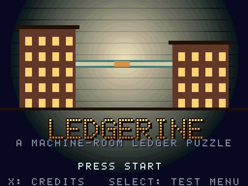
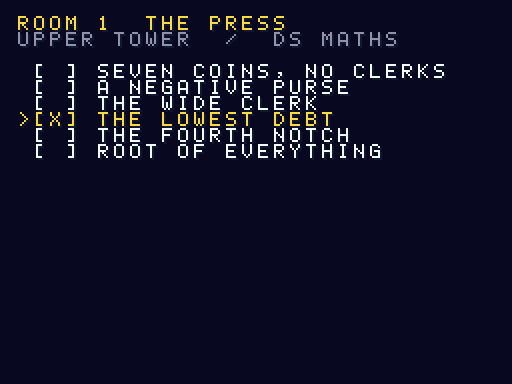
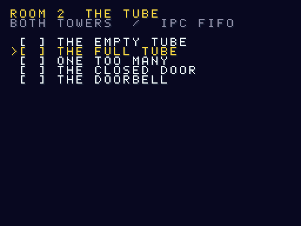

# Ledgerine

[](LICENSE)
[](#build)
[](#build)

[한국어](README-KO.md)

<p align="center">  </p>

<sub>Captured from the built ROM in headless melonDS 1.1 (`tools/melonds/mds.sh`), not DeSmuME or real hardware; the room screens come from a keyed run (a line of room 1 balanced; room 2 opened from the test menu). Top screen only at 2x nearest-neighbour (512×384).</sub>

An original machine-room ledger puzzle for the Nintendo DS. You are the night clerk of an old counting
house that stands in two towers joined by a pneumatic tube (the two screens). Each room holds a machine
with dials and a lever; pull the lever and a real hardware device of the console runs, and its answer
is written into the ledger. The boundary values are the intended solutions: seven coins shared among
no clerks come back as seven, an empty tube returns its last capsule as an echo. It is also built to
judge itself: a rehearsal ROM runs the exceptions, boundary values and error paths of the system
hardware (maths unit, FIFO, timers, DMA, WRAM and VRAM control, BIOS) against exact expected values and
reports a result block, so other emulators can use it as a regression test.

**Hardware areas it tests (level 2, "system edges"):** the exceptions and edges of the DS maths unit
(divide by zero, overflow, the reserved mode, 64-bit root), the IPC FIFO (empty reads, error bit, full,
disabled, edge-triggered IRQ), timers (cascade, reload, frozen reads), DMA (repeat reload rules, register
state after a transfer, ITCM code during DMA), WRAM and VRAM control (half swaps, mirrors, byte writes,
bank offsets) and BIOS (CpuFastSet, LZ77, BitUnPack, RLUnComp, the ARM7 CpuSet guard).

**Status.** All six rooms (31 ledger lines) are playable: the press, the tube, the clock wall, the belt, the vault and the
rule book, the rehearsal and its judge (29 target items, 4 prerequisites) and the hidden auto QA run. On real hardware
(run 1 on a DS Lite (2026-11-17), see [docs/HW-QA.md](docs/HW-QA.md)) one gating item differs and is under review; the BIOS items grade whichever BIOS the emulator runs. Hands-on feel in a desktop emulator has
not been reviewed. Progress is not saved.

- Languages: C (game, ARM9 + own ARM7 core), Python 3 (build-time tools)
- Toolchain: BlocksDS v1.25.0 (Docker image pinned by digest)
- Licence: Apache-2.0 — third-party notices in `THIRD_PARTY_NOTICES`, asset sources in `ASSETS.md`

## Playing

Start on the title. Each room shows its ledger lines on the top screen; the chosen line's dials and lever are on the bottom
screen. A line **balances** when the ROM's own GBATEK rule model gives the value the line wants; the hardware's answer is printed
beside the model's and a difference prints `MACHINE DISAGREES` without stopping you. Balance every line, then close the books
(Start): the room's audit runs and the next room opens.

| DS button | Action (melonDS key) |
|---|---|
| D-pad up/down (arrows) | choose a ledger line |
| D-pad left/right | turn dial A |
| L / R (Q / W) or Y / X (A / S) | turn dial B (lines that have one) |
| A (X) | pull the lever: run the hardware device |
| Start (Return) | close the books when every line balances |
| B (Z) | back to the title |

| Room | Hardware behind it | Lines |
|---|---|---|
| 1 The press | DS maths unit: divide by zero, overflow, the reserved mode, the 64-bit root | 6 |
| 2 The tube | IPC FIFO with the ARM7: empty reads, error bit, full, disabled, receive IRQ | 5 |
| 3 The clock wall | timers: cascade, 32-bit reload and start, deferred reload, frozen reads | 5 |
| 4 The belt | DMA: repeat reload rules, registers after a transfer, ITCM code during a DMA | 5 |
| 5 The vault | shared WRAM halves and mirrors, VRAM byte writes, bank offsets, ARM7 bank C | 5 |
| 6 The rule book | BIOS: CpuFastSet, LZ77, BitUnPack, RLUnComp, divide | 5 |

## Build

```sh
./build.sh                  # ledgerine.nds
./build.sh DEMO=rehearsal   # ledgerine-rehearsal.nds, the ROM that judge.py grades
./build.sh -j8 release      # build/release/{rom,demos,judge}
```

The build runs in a Docker container (BlocksDS pinned by digest); nothing is installed on the host.
Two clean builds give the same SHA-256.

## Using it as an emulator test

`ledgerine-rehearsal.nds` runs every room's audit and leaves a 64-word result block (id `LDRH`) at 0x0237F000
(layout in `arm9/source/game/ledger.h`); `tools/judge.py` grades it against `expected.json` (target level 2, area "system
edges"). No save chip and no NitroFS are needed. Every item is a hardware result compared with a GBATEK constant: the
audits compare numbers and counter relationships, never a cycle count (the one DMA item compares two timer readings a
factor of 2 apart).

```sh
tools/melonds/mds.sh run games/ledgerine/ledgerine-rehearsal.nds 900 out/lg "" 899 \
  | python3 games/ledgerine/tools/judge.py --profile melonds-1.1-software
RESULT_WORDS=64 tools/emu/emu.sh run games/ledgerine/ledgerine-rehearsal.nds 900 out/lg "" 899 \
  | python3 games/ledgerine/tools/judge.py --profile desmume-pydesmume-0.0.9
```

Exit code 0: every gating item passed (or the failing set equals the profile's). `known` in `expected.json` holds one
profile per emulator version and renderer. **The rule book grades the BIOS** the emulator runs: the profiles here come from
the built-in replacement BIOS of headless melonDS and DeSmuME's HLE; a run with a real BIOS dump can differ, and a profile
for it needs its own entry. **`ledgerine-press-min.nds`** is graded on its own (`judge.py` boot `press-min`, one item): the mode 2 division `-2^63 / -1` hangs DeSmuME, so that check is not in the rehearsal; a CI that grades DeSmuME skips this ROM. The ARM7 side of the tube, the vault and the rule book needs the ARM7 core in this ROM (it stops
the libnds FIFO handling for the length of one experiment).
