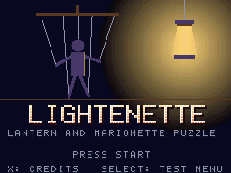
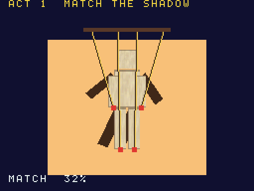
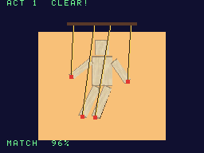
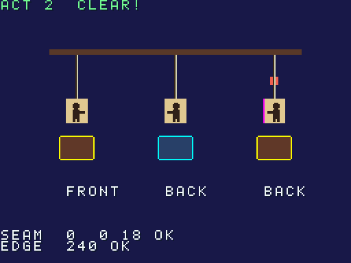
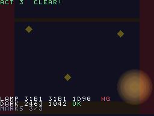
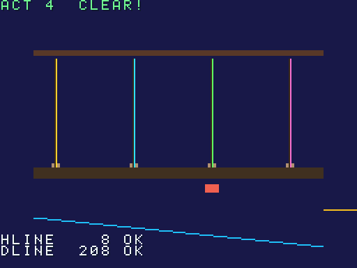
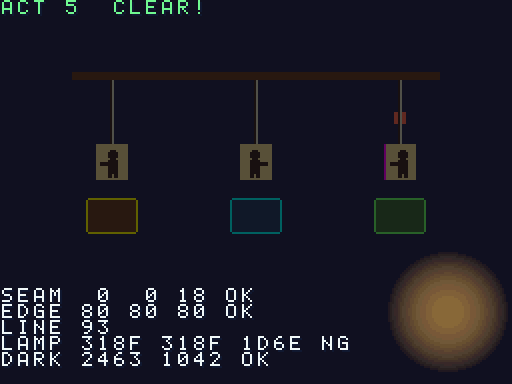

# Lightenette

[](LICENSE)
[](#빌드)
[](#빌드)
[](expected.json)

[English](README.md)

<p align="center">      </p>

<sub>빌드한 ROM을 헤드리스 DeSmuME 0.9.12(`tools/emu/`)로 찍은 화면입니다. melonDS나 실기가 아닙니다(3막 그림의 "NG"는 DeSmuME의 알려진 랜턴 블렌드 차이입니다). 위 화면만 최근접 이웃 2배(512×384)로 실었습니다.</sub>

닌텐도 DS용 오리지널 퍼즐 액션 게임입니다. 등불을 들고 터치스크린으로 마리오네트
인형극을 조종합니다. 동시에 ROM이 스스로 판정하도록 만들었습니다. 자기 화면을
캡처해 정해진 색의 픽셀 수를 세고, 에뮬레이터가 실기와 어긋난 적이 있는 항목의
통과/실패를 보고하므로 다른 에뮬레이터가 회귀 테스트로 쓸 수 있습니다
([에뮬레이터 테스트로 쓰기](#에뮬레이터-테스트로-쓰기) 참고).

**시험하는 하드웨어 영역:** 디스플레이 캡처, 반투명 OBJ 블렌딩, 마스터 밝기, 3D 텍스처 좌표, 에지 마킹, 선 폴리곤처럼 melonDS 렌더러가 실기와 달랐던 영역.

**상태.** 5막, 정확도 판정, 리허설 모드, `expected.json`, 판정 스크립트까지 완성되어
DeSmuME와 melonDS(소프트웨어, GL, 컴퓨트 렌더러)의 헤드리스 실행에서 동작합니다.
**실기에서는 아직 아무것도 측정하지 않았습니다.** 기대값이 문서(GBATEK)나 제3자 보고에서
온 항목만 판정(gating) 대상이고, 나머지는 실기 값이 들어올 때까지 참고용입니다. 데스크톱
에뮬레이터에서의 조작감 검토도 아직 하지 않았습니다.

- 언어: C(게임, ARM9 + 자체 ARM7 코어), Python 3(빌드 시 도구)
- 툴체인: BlocksDS v1.25.0 (digest로 고정한 Docker 이미지)
- 라이선스: Apache-2.0 — 서드파티 고지는 `THIRD_PARTY_NOTICES`, 에셋 출처는 `ASSETS.md`

## 플레이

타이틀: Start는 1막부터, X는 크레딧과 라이선스 뷰어, Select는 테스트 메뉴(원하는 막,
정확도 판정, 리허설)입니다. 막을 깨면 다음 막으로 이어집니다.

1. **1막.** 터치스크린의 슬라이더 네 개를 끌어 종이 마리오네트의 팔다리를 위 화면의 그림자에 맞춥니다(겹침 85%를 20프레임 유지).
2. **2막.** 인형을 고르고(좌/우 또는 탭) L/R로 돌려, 세 종이 인형이 터치스크린이 요구하는 방향을 보게 합니다. 돌리기는 정점에 직접 적은 역방향 텍스처 좌표로 카드를 뒤집는 것이며, 세 번째(꿰맨) 인형의 뒷면에는 재단선이 보일 수 있습니다.
3. **3막.** 무대는 거의 까맣습니다(밝기 감소 효과를 건 3D 레이어). 반투명 등불을 D-pad나 드래그로 움직여 숨은 표식 세 개를 하나씩 밝히세요. 아래 화면은 지도입니다.
4. **4막.** 라인 폴리곤 줄 네 가닥이 꼬여 있습니다. 못 두 개를 골라 줄을 맞바꿔 서로 교차하지 않게 합니다.
5. **5막.** 피날레: 등불로 인형을 하나씩 밝히고 터치스크린이 요구하는 면으로 돌립니다. 받침대에는 엣지 마킹 색이 세 가지 쓰입니다.

정확도 차이는 눈에 보이지만 진행을 막지 않습니다. 모든 단서는 아래 화면에도 표시되고,
줄은 정점 색과 외곽선으로 이중 표시됩니다.

## 빌드

Docker만 있으면 됩니다.

```sh
./build.sh                    # lightenette.nds
./build.sh SAVE=flash         # lightenette-save-flash.nds
./build.sh SAVE=fram          # lightenette-save-fram.nds
./build.sh demos              # acc-stage, rehearsal, l2-* 데모 ROM 9개
./build.sh -j8 release        # build/release/{rom,demos,judge}: lightenette-vX.Y.Z 태그가 배포하는 것
./build.sh clean
```

깨끗한 빌드를 두 번 하면 SHA-256이 같습니다.

## 에뮬레이터 테스트로 쓰기

판정은 ROM이 스스로 합니다. 에뮬레이터는 ROM을 돌리고 메인 RAM을 읽을 수만 있으면 됩니다.

1. `lightenette-rehearsal.nds`를 실행합니다(바로 리허설로 부팅: 1막은 터치 스크립트, 2~5막은 키 스크립트로 재생한 뒤 판정). 세이브 칩, 펜 입력, NitroFS가 필요 없어 어떤 카트 커널에서도 동작합니다. `lightenette-acc-stage.nds`는 정적 판정 장면만 실행합니다.
2. 1800프레임 뒤(리허설은 약 864~954프레임에 끝나고, 모든 막이 각자의 한도까지 가는 최악의 경우를 1800이 덮습니다) `0x0237F000`의 결과 블록(64워드, 배치는 `arm9/source/game/rehearsal.h`, `arm9/source/judge/judge.h`: 매직 `0x52455643`, 항목 ID, 프레임, 값)을 읽습니다. 같은 값과 OK/NG가 화면에도 그려지므로 스크린샷으로도 확인할 수 있습니다. 매직 워드는 맨 마지막에 쓰므로 매직이 맞으면 블록이 완성된 것입니다. 디스플레이 캡처마다 '완료' 비트가 있고(판정은 `values[3]`의 비트 8~10, 막은 `values[17]`, `[25]`, `[31]`, `[44]`), 완료되지 않은 캡처의 값은 `0xFFFF`로 읽힙니다.
3. 판정: `python3 tools/judge.py <로그>`(Python 3 표준 라이브러리만)가 블록을 `expected.json`과 비교해, 판정 대상이 모두 OK면 0, NG가 있거나 리허설이 끝나지 않았으면 1, 쓸 수 있는 결과가 없으면(유효한 블록 없음, 모르는/맞지 않는 `--boot`, 읽을 수 없는 파일) 2를 반환합니다. `expected.json`은 스크립트와 같은 폴더(릴리스 키트 구성)에서 먼저, 없으면 한 단계 위(소스 트리)에서 찾습니다. melonDS 헤드리스 러너와 DeSmuME 하네스의 `RESULT` 줄(`demos` 명령이 붙이는 ROM 이름 접두어도 인식하며 `--demo NAME`으로 하나를 고름)과 `PEEK` 덤프를 읽고, 형식이 이상한 줄은 경고만 내고 건너뜁니다. 캡처가 끝나지 않았거나 픽셀 값이 '캡처 안 됨' 표식인 항목은 NG입니다.
4. 알려진 차이: `python3 tools/judge.py --profile NAME <로그>`는 실패한 판정 항목이 `expected.json`의 해당 에뮬레이터 프로필 `known` 목록과 정확히 같을 때만 0을 반환합니다(`--list-profiles`로 확인: `melonds-1.1-software`, `melonds-1.1-gl-classic`, `melonds-1.1-gl-compute`, `desmume-pydesmume-0.0.9`). 새로 실패한 항목과 새로 통과한 항목을 보고하므로, 고쳐진 에뮬레이터가 조용히 지나가지 않고 드러납니다. 리뷰어가 melonDS master `4ce2188`에서 #2503이 이미 고쳐졌다고 알려 왔지만 우리는 확인하지 않았습니다.

```sh
tools/melonds/mds.sh run games/lightenette/lightenette-rehearsal.nds 1800 out/mds/reh "" 1799 > reh.log   # RENDERER=gl|compute
python3 games/lightenette/tools/judge.py reh.log
python3 games/lightenette/tools/judge.py --profile melonds-1.1-software reh.log   # NG 집합이 같을 때만 0
```

모든 항목에는 1~4의 `level`이 있고([docs/LEVELS-KO.md](../../docs/LEVELS-KO.md)), `judge.py`는 레벨별 요약
(`LEVELS L1 a/b OK · …`)을 출력합니다. 레벨은 판정과 종료 코드에 영향을 주지 않습니다.

`expected.json`은 항목마다 프레임, 기대값, 허용 오차, 출처, 부팅 경로, 실기 모델을 적고, 필요하면 의존하는 캡처(`done`)와 픽셀을 읽는 항목인지(`pixels`)도 적습니다. 역방향 UV 재단선은 정성적으로 판정하며(0·1행은 깨끗, 2행은 선이 보임) 정확한 `0/0/18`은 에뮬레이터 측정값(L4)이라 여기서 판정하지 않고 `probes/`의 acc-stage 프로브가 기록합니다.
출처: `GBATEK`(문서화된 동작), `report:<ref>`(제3자의 실기 보고), `hw:<model>`(우리가
실기에서 측정), `rom`(ROM 자체의 결정적 로직), `unconfirmed`(미확정). `unconfirmed` 항목은
INFO만 출력하고 실행을 실패시키지 않으며, 실기 값이 들어오면 판정 항목으로 올라갑니다.
파일에는 `schema` 번호가 있고 릴리스마다 그 ROM에 맞는 `expected.json`을 함께 올리므로,
ROM + `expected.json` + `judge.py`를 같은 `lightenette-vX.Y.Z` 릴리스에서 받아 한 묶음으로
고정하세요. 현재 전부 OK인 기준은 melonDS 1.1 소프트웨어 렌더러이고, 다른 렌더러의 알려진
차이는 [docs/QA-KO.md](docs/QA-KO.md)에 있습니다.

### 레벨 2 데모 ROM

Lightenette는 레벨 2(경계 사례) 게임입니다([docs/LEVELS-KO.md](../../docs/LEVELS-KO.md)). 위의 화면 경계 사례 외에 작은 데모 ROM
9개 `lightenette-l2-<이름>.nds`를 함께 제공하며, 각각 `expected.json`의 boot 하나입니다(`l2-sys-irq`, `l2-sys-dma-vblank`,
`l2-sys-math`, `l2-3d-limits`, `l2-acc-dual`, `l2-2d-affine`, `l2-2d-mosaic`, `l2-2d-obj-bitmap`, `l2-snd-capture`).
120프레임을 돌고 평소의 결과 블록을 씁니다(ID = ROM의 데모 이름(예: `l2-sys-irq`)의 FNV-1a 32, 값은 `words[3:]`부터).
레벨 2 항목 12개를 담습니다: HBlank IRQ 횟수, VBlank DMA, 64비트 하드웨어 제곱근, 폴리곤 RAM 한계, 캡처를 통한 2패스 렌더링,
아핀 BG / 모자이크 / 비트맵 OBJ 픽셀, 사운드 캡처 신호. ROM 하나씩 판정합니다:

```sh
tools/melonds/mds.sh demos <l2 ROM 폴더> > l2.log     # RENDERER=gl|compute
python3 games/lightenette/tools/judge.py --demo lightenette-l2-acc-dual --profile melonds-1.1-software l2.log
```

에뮬레이터가 측정할 수 없는 항목(DeSmuME의 폴리곤 RAM 카운터)은 n/a(`na_when`)입니다. `--profile` 없이는 판정 대상 n/a 항목이
통과로 치지 않으며(`NOT GRADED`, 종료 코드 1) `--allow-na`를 붙이면 넘어갑니다. 프로필이 n/a 항목을 나열합니다.

## 구성

```
arm9/source/game/   장면: 타이틀, 1~5막, 크레딧과 라이선스 뷰어, 리허설
arm9/source/judge/  정확도 판정(캡처, 픽셀 수, 결과 블록)
arm9/source/demo/   데모 ROM 진입점(acc-stage, rehearsal)과 레벨 2 데모(l2.c)
arm9/source/core/   시스템, 입력, DMA, 세이브, 사운드(corvane 계층)
arm9/source/gfx/    2D/3D 계층(corvane 계층)
arm7/               자체 ARM7 코어
tools/              에셋 생성기와 judge.py(Python 3, 표준 라이브러리만)
expected.json       판정용 기대값
```

---

Nintendo와 제휴하거나 Nintendo의 승인을 받은 프로젝트가 아닙니다. Nintendo DS는 Nintendo의 상표입니다.
