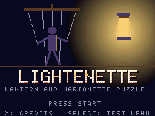
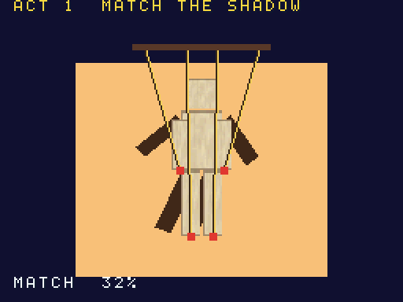
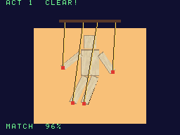
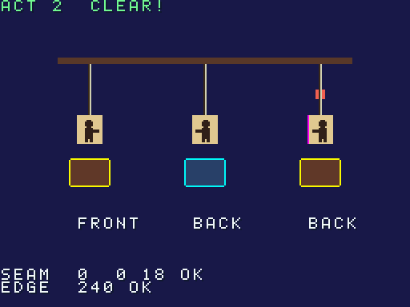
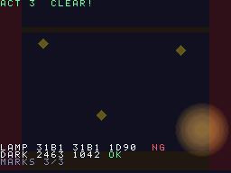
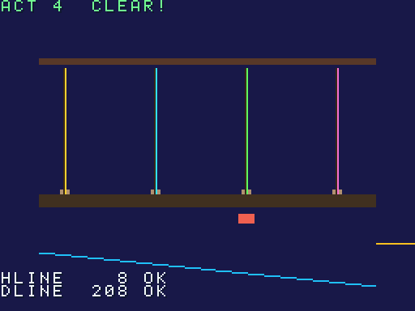
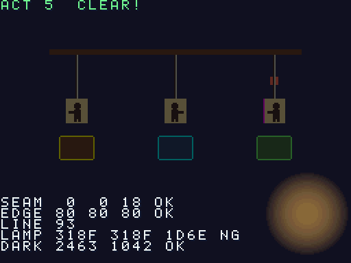

# Lightenette

[](LICENSE)
[](#build)
[](#build)
[](expected.json)

[한국어](README-KO.md)

<p align="center">      </p>

An original puzzle-action game for the Nintendo DS: you carry a lantern and work a
marionette show with the touch screen. It is also built to judge itself: the ROM
captures its own display, counts pixels of fixed colours and reports pass/fail for
cases where emulators have disagreed with hardware, so other emulators can use it as
a regression test (see [Using it as an emulator test](#using-it-as-an-emulator-test)).

**Hardware areas it tests:** display capture, semi-transparent OBJ blending, master brightness, 3D texture coordinates, edge marking and line polygons, where melonDS renderers have differed from hardware.

**Status.** Five acts, the accuracy judge, a rehearsal mode, `expected.json` and the
judging script are done and run headless in DeSmuME and in melonDS (software, GL and
compute renderers). **Nothing has been measured on real hardware yet**: items whose
expected value comes from the documentation (GBATEK) or a third-party report are
gating; the rest are informational until hardware values arrive. Hands-on feel in a
desktop emulator has not been reviewed either.

- Languages: C (game, ARM9 + own ARM7 core), Python 3 (build-time tools)
- Toolchain: BlocksDS v1.25.0 (Docker image pinned by digest)
- Licence: Apache-2.0 — third-party notices in `THIRD_PARTY_NOTICES`, asset sources in `ASSETS.md`

## Playing

Title: Start plays from act 1, X shows the credits and the licence viewer, Select opens
the test menu (any act, the accuracy judge, the rehearsal). Each cleared act leads to
the next.

1. **Act 1.** Drag the four touch-screen sliders to swing the paper marionette's limbs until they cover the shadow on the top screen (85% overlap held for 20 frames).
2. **Act 2.** Choose a doll (left/right or tap) and turn it with L/R until each of the three paper dolls faces the way the touch screen asks. The turn mirrors the card with reversed texture coordinates written into the vertices; the third (stitched) doll's back may show a seam.
3. **Act 3.** The stage is nearly black (3D layer with the brightness-decrease effect). Move the translucent lantern (D-pad or drag) over three hidden marks until each lights up; the bottom screen is a map.
4. **Act 4.** Four line-polygon strings are tangled: pick two pegs to swap their strings until none cross.
5. **Act 5.** The finale: light each doll with the lantern and turn it to the side the touch screen asks for, with three edge-marking colours on the plinths.

Accuracy differences are visible but never block progress: every clue is also on the
bottom screen, and strings carry vertex colour plus an outline.

## Build

Docker is all you need.

```sh
./build.sh                    # lightenette.nds
./build.sh SAVE=flash         # lightenette-save-flash.nds
./build.sh SAVE=fram          # lightenette-save-fram.nds
./build.sh demos              # lightenette-acc-stage.nds, lightenette-rehearsal.nds
./build.sh -j8 release        # build/release/{rom,demos,judge}: what a lightenette-vX.Y.Z tag ships
./build.sh clean
```

Two clean builds give the same SHA-256.

## Using it as an emulator test

The ROM decides by itself; the emulator only has to run it and expose main RAM.

1. Run `lightenette-rehearsal.nds` (boots straight into the rehearsal: act 1 from a touch script, acts 2 to 5 from key scripts, then the judge). It needs no save chip, no pen input and no NitroFS, so it works from any cart kernel. `lightenette-acc-stage.nds` runs only the static judge scene.
2. After 1800 frames (the rehearsal ends at about frame 864-954; 1800 covers the worst case where every act runs to its own limit) read the result block at `0x0237F000` (64 words; layout in `arm9/source/game/rehearsal.h` and `arm9/source/judge/judge.h`: magic `0x52455643`, item id, frame, values). The same numbers and OK/NG are drawn on screen, so a screenshot works too. The magic word is written last, so a block with the right magic is complete. Each display capture has a "finished" bit (`values[3]` bits 8-10 for the judge; `values[17]`, `[25]`, `[31]`, `[44]` for the acts); a value whose capture did not finish reads `0xFFFF`.
3. Grade it: `python3 tools/judge.py <log>` (Python 3 stdlib only) compares the block with `expected.json` and exits 0 when every gating item is OK, 1 if one is NG (or the rehearsal did not finish), 2 if there was no usable result (no valid block, unknown or mismatching `--boot`, unreadable files). It finds `expected.json` next to itself (the release kit layout) or one folder up (the source tree). It reads the `RESULT` line of the melonDS headless runner and of the DeSmuME harness (a leading ROM name from the `demos` commands is accepted, `--demo NAME` picks one), or a `PEEK` dump; malformed lines are skipped with a warning. An item whose capture did not finish, or whose pixel is the "not captured" marker, is NG.
4. Known differences: `python3 tools/judge.py --profile NAME <log>` exits 0 only when the failing gating items are exactly the `known` list of that emulator profile in `expected.json` (`--list-profiles` shows them: `melonds-1.1-software`, `melonds-1.1-gl-classic`, `melonds-1.1-gl-compute`, `desmume-pydesmume-0.0.9`). Newly failing items and newly passing items are reported, so a fixed emulator shows up instead of passing silently. A reviewer reported that melonDS master `4ce2188` already fixed #2503; we have not verified that.

```sh
tools/melonds/mds.sh run games/lightenette/lightenette-rehearsal.nds 1800 out/mds/reh "" 1799 > reh.log   # RENDERER=gl|compute
python3 games/lightenette/tools/judge.py reh.log
python3 games/lightenette/tools/judge.py --profile melonds-1.1-software reh.log   # exit 0 only if the NG set matches
```

Every item has a `level` from 1 to 4 ([docs/LEVELS.md](../../docs/LEVELS.md)); `judge.py` prints a per-level
summary (`LEVELS L1 a/b OK · …`) and the level never changes a verdict or an exit code.

`expected.json` lists every item: frame, expected value, tolerance, source, boot path and hardware
model, and optionally the captures it depends on (`done`) and whether it reads pixels (`pixels`). The reversed-UV cut line is graded qualitatively (rows 0 and 1 clean, row 2 shows the line); the exact `0/0/18` is an emulator measurement and only an informational item. Sources: `GBATEK` (documented behaviour), `report:<ref>` (a third-party hardware report),
`hw:<model>` (measured by us on hardware), `rom` (the ROM's own deterministic logic),
`unconfirmed`. Items from `unconfirmed` sources only print INFO and never fail a run; when a
hardware value arrives the item moves up to gating. The file carries a `schema` number and each
release ships the `expected.json` that matches its ROM, so pin the pair (ROM + `expected.json` +
`judge.py`) from the same `lightenette-vX.Y.Z` release. The software renderer of melonDS 1.1 is the
current all-OK reference; the other renderers' known differences are listed in [docs/QA.md](docs/QA.md).

## Layout

```
arm9/source/game/   scenes: title, acts 1-5, credits and licence viewer, rehearsal
arm9/source/judge/  accuracy judge (capture, pixel counts, result block)
arm9/source/demo/   demo ROM entry (acc-stage, rehearsal)
arm9/source/core/   system, input, DMA, save, sound (corvane layers)
arm9/source/gfx/    2D/3D layers (corvane layers)
arm7/               own ARM7 core
tools/              asset generators and judge.py (Python 3, stdlib only)
expected.json       expected values for the judge
```

---

Not affiliated with or endorsed by Nintendo. Nintendo DS is a trademark of Nintendo.
