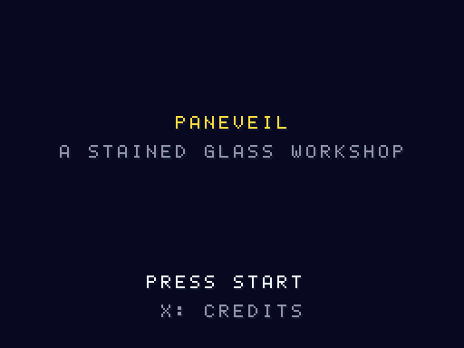
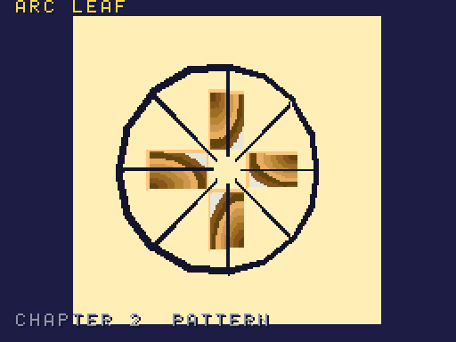
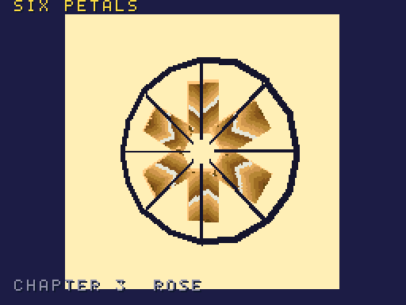
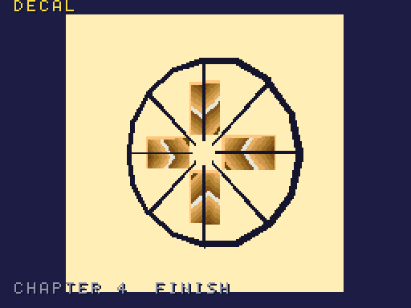
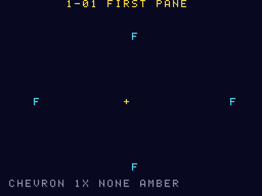

# Paneveil

[](LICENSE)
[](#빌드)
[](#빌드)

[English](README.md)

<p align="center">    </p>

<sub>빌드한 ROM을 헤드리스 melonDS 1.1(`tools/melonds/mds.sh`)로 찍은 것이며 DeSmuME나 실기가 아닙니다. 2~4장은 스크립트로 플레이하는 리허설 ROM에서 설정하는 도중에 찍었습니다. 위 화면만 2배 최근접 이웃 확대(512×384).</sub>

닌텐도 DS용 오리지널 스테인드글라스 공방 게임입니다. 주문서에는 장미창 하나가 적혀 있습니다.
유리, 문양, 색, 꽃잎과 고리의 수입니다. 창을 주문서대로 맞춘 뒤 가마에 구우면 되고, 돌린
횟수가 적을수록 별을 더 받습니다. 위 화면은 뒤에서 빛을 받는 창을 3D로 보여 줍니다. 스스로
판정하도록도 만들었습니다. 리허설 ROM이 3D 지오메트리 엔진(행렬 스택, 행렬 load/multiply,
지오메트리 명령, 폴리곤·텍스처 속성)을 정확한 기대값과 비교해 결과 블록을 내므로, 다른
에뮬레이터가 회귀 시험으로 쓸 수 있습니다([에뮬레이터 시험으로 쓰기](#에뮬레이터-시험으로-쓰기)).

**시험하는 하드웨어 영역(레벨 1, "3D 지오메트리·텍스처"):** 행렬 스택(push, pop, store,
restore, 투영 스택, GXSTAT 스택 레벨), 행렬 load/multiply(CLIPMTX_RESULT, VECMTX_RESULT),
지오메트리 명령(packed GXFIFO와 직접 포트, 버텍스 포맷 6종), 폴리곤 속성(앞/뒷면, alpha,
와이어프레임, 깊이 시험), 텍스처 속성(repeat, flip, clamp, 색 0, 팔레트 base, 텍스처 좌표 원천).

**상태.** 다섯 장(창 30개)을 모두 플레이할 수 있습니다. 위 화면의 3D 창, 아래 화면의 설정, 2D 도식
모드(Select), 가마 램프, 리허설과 그 판정기(가마 점검과 라이트박스, 30항목), 숨은 자동 QA 실행이 있습니다.
DS Lite(R4 카드)에서 QA 실행이 크레딧까지 가고 판정 항목 31개가 모두 OK였으며, 모든 체크포인트가 melonDS와 같았습니다([docs/HW-QA-KO.md](docs/HW-QA-KO.md)). 데스크톱
에뮬레이터에서의 손 조작감은 검토하지 않았습니다. 진행과 별은 아직 저장하지 않습니다.

- 언어: C(게임, ARM9 + 자체 ARM7 코어), Python 3(빌드 시점 도구)
- 툴체인: BlocksDS v1.25.0(Docker 이미지를 digest로 고정)
- 라이선스: Apache-2.0 — 서드파티 고지는 `THIRD_PARTY_NOTICES`, 에셋 출처는 `ASSETS.md`

## 플레이

타이틀에서 장(좌우)과 창(위아래)을 고르고 A로 시작합니다. 주문서는 설정 열두 개 중 일부의 목표 값을 적어 두고,
적지 않은 설정은 첫 값 그대로 두어야 합니다.

| 장 | 설정 | 뒤에 있는 하드웨어 동작 |
|---|---|---|
| 1 유리 | 면, 농도 | 폴리곤 앞/뒷면 렌더 비트, alpha 31 / 16 / 0(와이어프레임) |
| 2 문양 | 문양, 반복, 거울, 가장자리, 색, 오려 내기 | 텍스처 repeat, flip, clamp, 팔레트 base, 색 0 |
| 3 장미창 | 꽃잎, 고리 | 행렬 스택: 꽃잎마다 push / 회전 / pop, 고리마다 store / restore |
| 4 마감 | 데칼, 결 | depth test Equal 덧그림, 텍스처 좌표 변환 모드 1 |
| 5 정자 | 대부분, 마지막 창은 열두 개 모두 | 전부 |

| DS 버튼 | 동작 (melonDS 키) |
|---|---|
| 십자키 위/아래(방향키) | 설정 고르기 |
| 십자키 좌/우 | 설정을 한 칸 돌림(어느 쪽으로든) |
| A (X) | 주문서와 맞으면 창을 굽기. 한 번 더 누르면 다음 창 |
| B (Z) | 목록으로 |
| Select (Backspace) | 3D 창 / 2D 도식(같은 상태를 글자로 보여 줌. 모든 창을 여기서 풀 수 있음) |

별은 걸음 수를 par와 비교합니다(3: par 이내, 2: 3 초과까지, 1: 그 이상). 아래 화면의 가마 램프는 판정기의 행렬 점검
결과이며, 3D 그림이 틀려도 진행은 막히지 않습니다.

## 빌드

```sh
./build.sh                  # paneveil.nds
./build.sh DEMO=rehearsal   # paneveil-rehearsal.nds, judge.py가 채점하는 ROM
./build.sh -j8 release      # build/release/{rom,demos,judge}
```

빌드는 Docker 컨테이너(digest로 고정한 BlocksDS) 안에서 돕니다. 호스트에는 아무것도 설치하지
않습니다. 클린 빌드를 두 번 하면 SHA-256이 같습니다.

## 에뮬레이터 시험으로 쓰기

`paneveil-rehearsal.nds`(`./build.sh DEMO=rehearsal`)는 판정을 돌린 뒤 0x0237F000에 64워드 결과 블록을
남기고(배치는 `arm9/source/game/rehearsal.h`), `tools/judge.py`가 이를 `expected.json`(목표 레벨 1,
영역 "3D geometry and texturing")과 비교합니다. 세이브 칩도 NitroFS도 필요 없습니다.

**가마 점검**은 고정된 명령열을 지오메트리 엔진에 보내고(직접 포트와 packed GXFIFO), GXSTAT 27번 비트가
0이 되기를 기다린 뒤, GXSTAT 스택 레벨과 `CLIPMTX_RESULT`(16워드), `VECMTX_RESULT`(9워드)를 GBATEK 규칙의
정수 모델과 비교합니다. 행렬 원소는 모두 1.19.12에서 정확히 표현되므로 곱셈 반올림 방식과 무관하고,
렌더러도 관여하지 않습니다.

```sh
tools/melonds/mds.sh run games/paneveil/paneveil-rehearsal.nds 1000 out/pv "" 999 \
  | python3 games/paneveil/tools/judge.py --profile melonds-1.1-software
RESULT_WORDS=64 tools/emu/emu.sh run games/paneveil/paneveil-rehearsal.nds 1000 out/pv "" 999 \
  | python3 games/paneveil/tools/judge.py --profile desmume-pydesmume-0.0.9
```

종료 코드 0: 게이트 항목이 모두 통과했거나(또는 실패 집합이 프로필과 같음). `expected.json`의 `known`에
에뮬레이터 버전·렌더러마다 프로필이 하나씩 있습니다.
