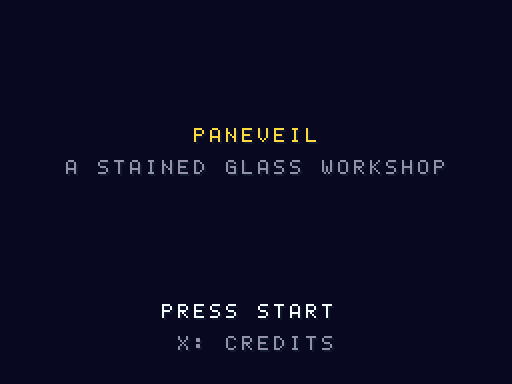
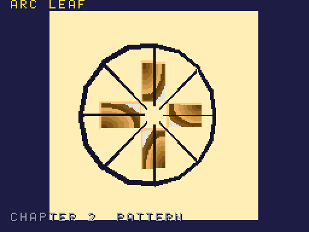
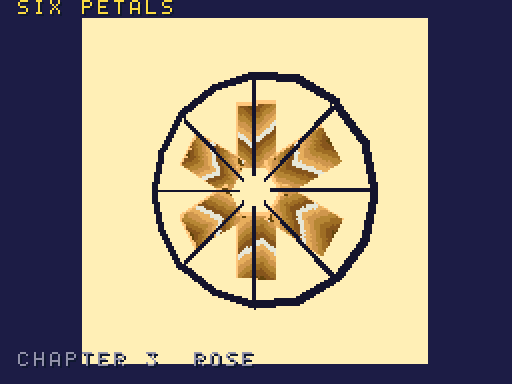
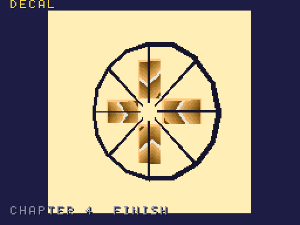
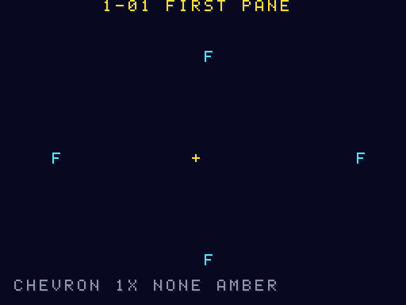

# Paneveil

[](LICENSE)
[](#build)
[](#build)

[한국어](README-KO.md)

<p align="center">    </p>

<sub>Captured from the built ROM in headless melonDS 1.1 (`tools/melonds/mds.sh`), not DeSmuME or real hardware; chapters 2 to 4 come from the rehearsal ROM, which plays by script, mid-setting. Top screen only at 2x nearest-neighbour (512×384).</sub>

An original stained-glass workshop game for the Nintendo DS. Each order describes a rose window:
the glass, the pattern, the colour and how many petals and rings it has. Set the window to the
order and fire it in the kiln; fewer turns earn more stars. The top screen shows the window in 3D,
lit from behind. It is also built to judge itself: a rehearsal ROM checks the 3D geometry engine
(matrix stack, matrix load/multiply, geometry commands, polygon and texture attributes) against
exact expected values and reports a result block, so other emulators can use it as a regression
test (see [Using it as an emulator test](#using-it-as-an-emulator-test)).

**Hardware areas it tests (level 1, "3D geometry and texturing"):** the matrix stack (push, pop,
store, restore, the projection stack and the GXSTAT stack level), matrix load/multiply
(CLIPMTX_RESULT, VECMTX_RESULT), geometry commands (packed GXFIFO and direct ports, the six vertex
formats), polygon attributes (front/back face, alpha, wireframe, depth test) and texture attributes
(repeat, flip, clamp, colour 0, palette base, texture coordinate source).

**Status.** All five chapters (30 windows) are playable: the 3D window on the top
screen, the settings on the bottom screen, a 2D schematic mode (Select), the kiln lamp, the rehearsal and its judge
(kiln check and light box: 30 items) and the hidden auto QA run. On a DS Lite (R4 card) the QA run reached the credits
and all 31 judged items were OK, with every checkpoint equal to melonDS ([docs/HW-QA.md](docs/HW-QA.md)). Hands-on feel in a desktop
emulator has not been reviewed. Progress and stars are not saved yet.

- Languages: C (game, ARM9 + own ARM7 core), Python 3 (build-time tools)
- Toolchain: BlocksDS v1.25.0 (Docker image pinned by digest)
- Licence: Apache-2.0 — third-party notices in `THIRD_PARTY_NOTICES`, asset sources in `ASSETS.md`

## Playing

Start on the title, choose a chapter (left/right) and a window (up/down), A to start.
An order names a target value for some of the twelve settings; every setting you leave out stays at its first value.

| Chapter | Settings | Hardware behind it |
|---|---|---|
| 1 Glass | side, tint | polygon front/back render bits, alpha 31 / 16 / 0 (wireframe) |
| 2 Pattern | motif, repeat, mirror, edge, colour, cutout | texture repeat, flip, clamp, palette base, colour 0 |
| 3 Rose | petals, rings | matrix stack: push / rotate / pop per petal, store / restore per ring |
| 4 Finish | decal, grain | depth test Equal overlay, texture coordinate transformation mode 1 |
| 5 Pavilion | most of them, the last window all twelve | everything |

| DS button | Action (melonDS key) |
|---|---|
| D-pad up/down (arrows) | choose a setting |
| D-pad left/right | turn the setting one step (either way round) |
| A (X) | fire the window when it matches the order; again for the next window |
| B (Z) | back to the list |
| Select (Backspace) | 3D window / 2D schematic (the same state as text; every window can be solved in it) |

Stars compare your steps with par (3: within par, 2: up to 3 above, 1: more). The kiln lamp on the bottom screen shows the
result of the judge's matrix check; a wrong 3D picture never blocks progress.

## Build

```sh
./build.sh                  # paneveil.nds
./build.sh DEMO=rehearsal   # paneveil-rehearsal.nds, the ROM that judge.py grades
./build.sh -j8 release      # build/release/{rom,demos,judge}
```

The build runs in a Docker container (BlocksDS pinned by digest); nothing is installed on the host.
Two clean builds give the same SHA-256.

## Using it as an emulator test

`paneveil-rehearsal.nds` (`./build.sh DEMO=rehearsal`) runs the judge and leaves a 64-word result block
at 0x0237F000 (layout in `arm9/source/game/rehearsal.h`); `tools/judge.py` grades it against
`expected.json` (target level 1, area "3D geometry and texturing"). No save chip and no NitroFS are needed.

The **kiln check** sends fixed command sequences to the geometry engine (direct ports and packed GXFIFO),
waits for GXSTAT bit 27 to clear, and compares GXSTAT stack levels, `CLIPMTX_RESULT` (16 words) and
`VECMTX_RESULT` (9 words) with an integer model of GBATEK's rules. Every matrix element is exact in 1.19.12, so the
answer does not depend on how a product is rounded, and no renderer is involved.

```sh
tools/melonds/mds.sh run games/paneveil/paneveil-rehearsal.nds 1000 out/pv "" 999 \
  | python3 games/paneveil/tools/judge.py --profile melonds-1.1-software
RESULT_WORDS=64 tools/emu/emu.sh run games/paneveil/paneveil-rehearsal.nds 1000 out/pv "" 999 \
  | python3 games/paneveil/tools/judge.py --profile desmume-pydesmume-0.0.9
```

Exit code 0: every gating item passed (or the failing set equals the profile's). `known` in `expected.json`
holds one profile per emulator version and renderer.
