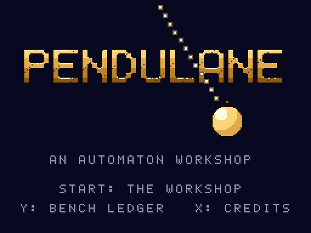
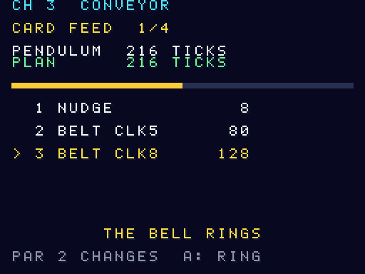
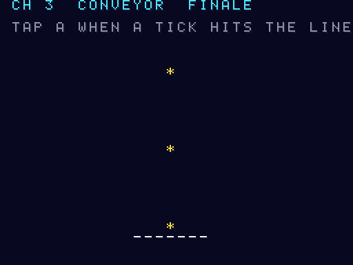

# Pendulane

[](LICENSE)
[](#빌드)
[](#빌드)

[English](README.md)

<p align="center">  </p>

<sub>빌드한 ROM을 headless melonDS 1.1(`tools/melonds/mds.sh`)에서 찍었습니다 (DeSmuME나 실기가 아님). 장치와 피날레는 스크립트로 진행하는 QA 실행에서 가져왔습니다. 위쪽 화면만, 2배 nearest-neighbour (512×384).</sub>

닌텐도 DS용 오리지널 자동인형 공방 게임입니다. 장치마다 예산 퍼즐입니다: 슬롯마다 역을 하나씩 골라, 계획의 틱(하드웨어 단계의 책 값)이 진자의 흔들림과 정확히 같아지게 합니다. 스스로를 판정하도록 만들어졌습니다: 리허설 ROM이 콘솔에서 CPU·버스·사운드
타이밍을 재고 (지금은 나눗셈·제곱근 장치의 busy 시간, 펌웨어 SPI 바이트 시간, ARM7 메모리 타이밍, 사운드 채널 타이밍, 슬롯 1 카트 gap) 결과 블록을 내놓으므로,
다른 에뮬레이터가 회귀 테스트로 쓸 수 있습니다.

**검사하는 하드웨어 영역 (레벨 3, "CPU, bus and sound timing"):** 지금은 하드웨어 나눗셈(모드 0, 1, 2)과 제곱근 장치의 busy 시간("DS Maths"),
4 MHz와 512 kHz의 펌웨어 SPI 바이트 시간("DS Serial Peripheral Interface Bus (SPI)"), ARM7의 메인 RAM·WRAM·VRAM 접근 타이밍("DS Memory Timings"), 사운드 채널 타이밍("DS Sound Notes": Busy가 꺼지는 시점, PCM·PSG·ADPCM이 들리기까지 몇 샘플이 걸리는지, Hold 재시작이 무엇을 내는지), 슬롯 1 카트 전송의 gap("DS Cartridge I/O Ports": 두 클럭 속도에서 gap1의 클럭 펄스 수)입니다.
모든 값은 두 측정의 차이라서 측정 자체의 고정 비용이 상쇄됩니다.

**상태.** 벤치 넷과 게임: 다섯 장(방아, 종 줄, 컨베이어, 큰길, 음관)에 장치 20개, 장마다 리듬 곡으로 마무리, 벤치 장부, 숨은 자동 QA 실행. 진행은 아직 저장되지 않습니다. 실기(2026-11-17 DS Lite 실행 1, [docs/HW-QA-KO.md](docs/HW-QA-KO.md))에서는 판정 타이밍 항목 두 개가 달라 검토 중입니다.

- 언어: C (게임, ARM9 + 자체 ARM7 코어), Python 3 (빌드 도구)
- 툴체인: BlocksDS v1.25.0 (digest로 고정한 Docker 이미지)
- 라이선스: Apache-2.0 — 서드파티 고지는 `THIRD_PARTY_NOTICES`, 에셋 출처는 `ASSETS.md`

## 빌드

```sh
./build.sh                  # pendulane.nds
./build.sh DEMO=rehearsal   # 리허설 ROM
./build.sh clean
```

## 에뮬레이터 테스트로 쓰기

`pendulane-rehearsal.nds`를 부팅해 약 60프레임을 돌린 뒤 `0x0237F000`의 64워드 결과 블록(id `PDRH`)을 읽습니다. 채점은
[English README](README.md#using-it-as-an-emulator-test)의 명령과 같습니다. `judge.py`는 판정 항목이 모두 OK(또는 프로파일 일치)이면
0으로 끝납니다. 항목은 `expected.json`에 GBATEK 섹션과 난이도 레벨과 함께 있습니다 (저장소 루트 `docs/LEVELS-KO.md`).

## 조작

타이틀: Start는 장치 목록, Y는 벤치 장부(측정을 바로 보는 화면), X는 크레딧. 목록: 좌우 장, 상하 장치, A 시작, B 뒤로. 장치: 상하 슬롯, 좌우 역, 계획의 틱이 진자와 같을 때 A로 종을 울림, X는 이 장의 장부와 봉인을 위해 벤치 실행, B 뒤로. 피날레: 박자에 맞춰 A. melonDS 키 배치는 저장소 `AGENTS.md`를 보세요.
