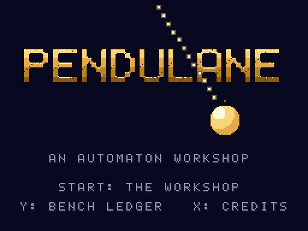
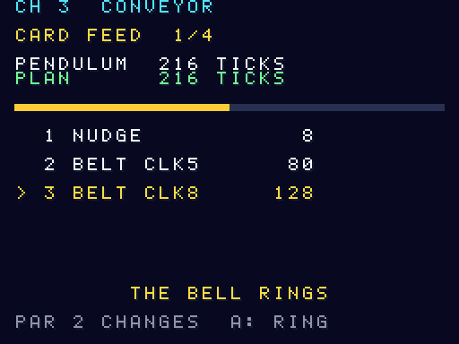
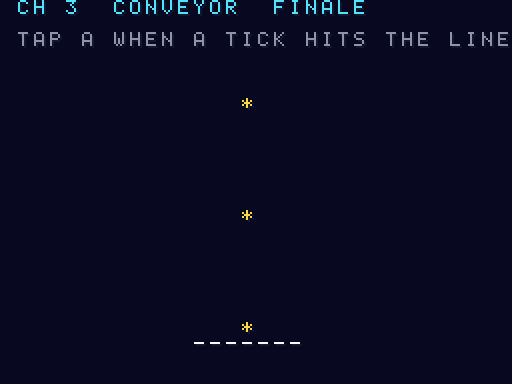

# Pendulane

[](LICENSE)
[](#build)
[](#build)

[한국어](README-KO.md)

<p align="center">  </p>

<sub>Captured from the built ROM in headless melonDS 1.1 (`tools/melonds/mds.sh`), not DeSmuME or real hardware; the contraption and finale come from the QA run, which plays by script. Top screen only at 2x nearest-neighbour (512×384).</sub>

An original automaton-workshop game for the Nintendo DS. Every contraption is a budget puzzle: pick a station for each slot so the plan's ticks (the book costs of hardware steps) add up to the pendulum's swing. It is built to judge itself: a rehearsal ROM measures
CPU, bus and sound timings on the console (busy times of the divide and square-root unit, the firmware SPI byte time, ARM7 memory
timings, sound channel timing and the slot-1 gap) and reports a result block, so other emulators can use it as a regression test.

**Hardware areas it tests (level 3, "CPU, bus and sound timing"):** so far the busy times of the hardware divider (modes 0, 1, 2) and
the square-root unit ("DS Maths"), the firmware SPI byte time at 4 MHz and 512 kHz ("DS Serial Peripheral Interface Bus (SPI)") and ARM7
main RAM, WRAM-vs-main-RAM and VRAM access timings ("DS Memory Timings"), and sound channel timing ("DS Sound Notes": when Busy clears, how many samples a PCM, PSG and ADPCM channel needs before it is heard, what a Hold restart plays) and the slot-1 cartridge transfer gap ("DS Cartridge I/O Ports": gap1 in clock pulses at two clock rates). Every value is the difference of two measurements, so the
fixed cost of the measurement cancels.

**Status.** The four benches and the game: 20 contraptions in five chapters (mill, bell rope, conveyor, highway, organ), each ended by a rhythm piece, a bench ledger and the hidden auto QA run. Progress is not saved yet. Nothing has been measured on real hardware.

- Languages: C (game, ARM9 + own ARM7 core), Python 3 (build-time tools)
- Toolchain: BlocksDS v1.25.0 (Docker image pinned by digest)
- Licence: Apache-2.0 — third-party notices in `THIRD_PARTY_NOTICES`, asset sources in `ASSETS.md`

## Build

```sh
./build.sh                  # pendulane.nds
./build.sh DEMO=rehearsal   # the rehearsal ROM
./build.sh clean
```

## Using it as an emulator test

Boot `pendulane-rehearsal.nds`, run about 60 frames, and read the 64-word result block at `0x0237F000` (id `PDRH`). Grade it:

```sh
RESULT_WORDS=64 tools/emu/emu.sh run games/pendulane/pendulane-rehearsal.nds 300 out/x "" 299 \
  | python3 games/pendulane/tools/judge.py --profile desmume-pydesmume-0.0.9
tools/melonds/mds.sh run games/pendulane/pendulane-rehearsal.nds 300 out/x "" 299 \
  | python3 games/pendulane/tools/judge.py --profile melonds-1.1-software     # RENDERER=gl, compute
```

`judge.py` exits 0 when every gating item is OK (or the profile matches). Items are listed in `expected.json` with their GBATEK section
and difficulty level (see `docs/LEVELS.md` in the repository root).

## Controls

Title: Start opens the contraption list, Y the bench ledger (a live look at the measurement), X the credits. List: left/right chapter, up/down contraption, A start, B back. Contraption: up/down slot, left/right station, A rings the bell when the plan's ticks equal the pendulum's, X runs the bench for the chapter's ledger and seal, B back. Finale: A on the beat. See the repository `AGENTS.md` for the melonDS key map.
