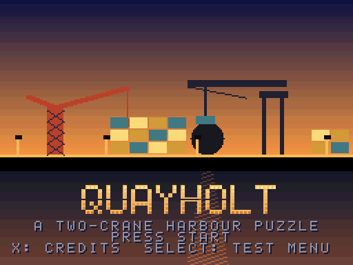
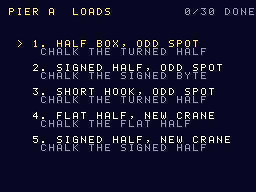
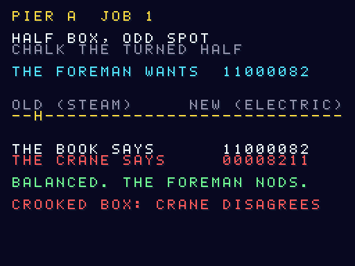

# Quayholt

[English](README.md)

<p align="center">  </p>

닌텐도 DS용 오리지널 크레인 두 대 항구 퍼즐이자, 에뮬레이터 개발자를 위한 스스로 판정하는 테스트 ROM입니다.
현재 상태: **항구 게임, 측정 하네스, 리허설, 판정이 갖춰졌습니다.** QA 실행은 30개 작업을 모두 풉니다. 타이틀 다듬기,
크레딧, 실기 계획은 릴리스 전에 마무리합니다.

목표 레벨 **L2**, 영역 **ARM 코어 가장자리**: ARM9(v5TE)·ARM7(v4T) 명령 가장자리와 ARM9 CP15(보호 유닛, TCM, 캐시).
판정 항목마다 고정된 시험 데이터에 명령 하나(또는 CP15 동작 하나)를 실행하고, 원시 결과를 GBATEK에서 손으로 계산한
상수와 비교합니다. L2의 뜻은 [docs/LEVELS-KO.md](../../docs/LEVELS-KO.md)를 보세요.

## 게임

해질녘 부두의 크레인 두 대: 옛 증기 크레인(콘솔의 두 번째 프로세서)과 새 전기 크레인(주 프로세서). 부두 여섯 곳(적재, 블록, 계산,
세관, 사물함, 장부판)에 작업이 다섯 개씩 있습니다. 작업은 장치 하나, 반장이 원하는 분필 값, 쓸 수 있는 크레인을 정합니다.
크레인(X)과 세팅(좌우, L/R은 큰 걸음)을 고르고 들어 올립니다(A). A, B 부두의 일부 작업은 두 크레인 중 어느 쪽으로든 할 수 있지만, 반장이 원하는 값은 한 크레인만 내놓습니다. 갈고리는 선택한 프로세서에서 진짜 명령(또는 진짜 시스템 동작)
하나를 실행하고, 게임은 답 두 개를 비교합니다: **장부**(문서화된 동작을 담은 ROM 자체 모델)와 **크레인**(콘솔이 실제로 한 일).
작업이 맞는지는 장부만 정하므로 어느 에뮬레이터에서나 모든 작업을 끝낼 수 있고, 크레인이 다르게 답하면 상자에 **비뚤어짐** 표시가
붙습니다. `tools/qyjobs/check.py`가 장부만으로 30개가 모두 풀리고 공짜 문제가 없음을 증명합니다.

조작: 십자키 선택, A 열기/들어 올리기, X 다른 크레인, L/R 다른 부두 또는 큰 세팅 걸음, B 뒤로. 타이틀에서 Select는 테스트 메뉴
(리허설, 크레딧), X는 크레딧입니다.

## 판정 항목

| 부두 | 항목 |
|---|---|
| A 적재 | `ldrh7-odd`, `ldrsh7-odd`, `thumb7-ldrh-odd` |
| B 블록 | `stm7-base-new`, `ldm7-base-nowb`, `ldm9-base-wb`, `stm7-empty`, `thumb7-stmia-base-new`, `stm-pc12`, `ldm9-empty` (미확인) |
| C 계산 | `alu7-rn-pc12`, `qdadd9-dbl-sat`, `smla9-q-nosat`, `cp15-prev5-bit15` |
| D 세관 | `cp15-ctrl-bits`, `bkpt9-pabt`, `pu-priority`, `pu-background`, `pu-user-ro`, `pu-code-xn` |
| E 사물함 | `itcm-over-dtcm`, `dtcm-mirror`, `itcm-size`, `tcm-dma-bus`, `dtcm-load-mode` (미확인), `itcm-load-mode` (미확인) |
| F 장부판 | `dcache-dma-stale`, `dcache-wb-dirty`, `dcache-inval-drop`, `icache-stale` (모두 미확인: 캐시 동작은 아직 실기 근거가 없습니다) |

전제 조건(L1): 정렬된 LDR/STR 워드, ARM·Thumb 상태의 일반 LDM/STM, FIFO로 측정 단계에 응답하는 ARM7, SWI와 미정의
명령을 받는 예외 하네스, 읽기/쓰기 보호 영역, 쓴 값을 돌려주는 DTCM, 메인 RAM DMA 복사, 켜고 끌 수 있는 캐시 제어 비트. 미확인 항목은 아직
실기 근거가 없어서 DS Lite 실행이 맞다고 확인하기 전까지는 정보용입니다([docs/QA-KO.md](docs/QA-KO.md)).

## 빌드와 판정

```sh
./build.sh demos        # quayholt-rehearsal.nds 와 부두별 ROM
python3 tools/judge.py --profile melonds-1.1-software run.log
```

`expected.json`은 항목과, 에뮬레이터별로 알려진 실패를 적습니다. melonDS 프로필은 인터프리터 기준이므로 melonDS의
JIT를 끄고 실행하세요.

*스크린샷: melonDS 1.1(headless, 소프트웨어 렌더러), 위 화면.*

## 실기

아직 콘솔에서 돌리지 않았습니다. 계획, ROM 순서, 미확인 항목 일곱 개는 [docs/HW-QA-KO.md](docs/HW-QA-KO.md)에 있습니다. 릴리스에는
Wood 계열 R4 커널용 `quayholt-hw-support.nds`(게임 코드 `####`)도 들어 있습니다.

## 라이선스

전부 Apache-2.0이고, ROM은 제3자 런타임 라이브러리와 그 고지도 담습니다(`THIRD_PARTY_NOTICES`, `licenses/`).
모든 에셋은 코드가 생성합니다([ASSETS-KO.md](ASSETS-KO.md)).
