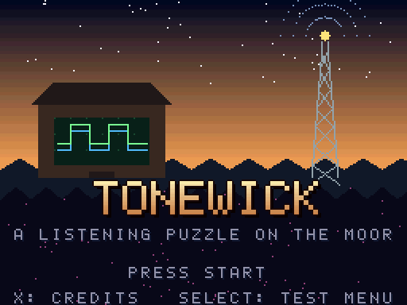
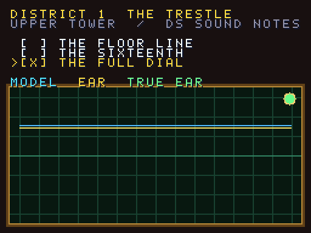
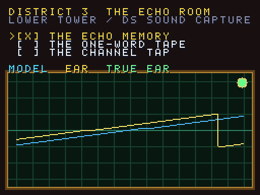

# Tonewick

[](LICENSE)
[](#빌드)
[](#빌드)

[English](README.md)

<p align="center">  </p>

<sub>빌드한 ROM을 headless melonDS 1.1(`tools/melonds/mds.sh`)에서 캡처했습니다. DeSmuME나 실기가 아닙니다. 지역 화면은 키 입력 실행(한 줄을 듣고 난 상태)에서 얻었습니다. 위 화면만 2배 nearest-neighbour(512×384)입니다.</sub>

닌텐도 DS용 오리지널 청음 퍼즐입니다. 플레이어는 황야의 감청소를 지키는 신호지기로, 오실로스코프로 네 지역에 걸친
끊긴 신호선 12개를 고칩니다. 신호선 하나는 콘솔 사운드 블록의 레지스터 필드 하나입니다. 경계값이 곧 의도한 풀이입니다.
duty 7인 사각파는 바닥을 떠나지 않고, 4워드보다 짧은 테이프는 선을 계속 busy로 두면서 소리를 내지 않으며, 캡처 길이 0은
1워드를 씁니다. ROM은 캡처 유닛으로 자기 사운드 블록의 소리를 직접 듣기 때문에 게임이 스스로를 판정하기도 합니다.
리허설 ROM이 사운드 채널, 캡처 유닛, 그리고 이웃한 장치(RTC, 전원관리, 세이브 칩, 펌웨어 설정)의 예외·경계값·문서화된
버그를 정확한 기댓값과 비교해 결과 블록으로 내보내므로, 다른 에뮬레이터도 회귀 테스트로 쓸 수 있습니다.

**검사하는 하드웨어 영역 (레벨 2, "소리·입출력 경계"):** 사운드 채널의 경계(duty 7, 분주, 볼륨 레지스터 127, 4워드보다 짧은
테이프, hold 비트, ADPCM 루프 재적재, 노이즈 시프트 레지스터), 사운드 캡처 유닛(길이 0, 채널 소스, add 오버플로 버그와
둘 다 음수인 버그), 그리고 옆 장치들(24시간 모드의 RTC AM/PM 플래그, 전원관리 레지스터 미러, EEPROM 상태 비트, 가장 최신
펌웨어 사용자 설정 사본).

**현재 상태.** ARM7 사운드 실험실(ARM9가 넘기는 레지스터 스크립트와 메인 RAM의 캡처 버퍼), 실험, 네 지역의 신호선
12개, 리허설과 판정기(목표 17개, 전제 조건 10개. 세이브 항목은 세이브 칩이 있을 때만 셉니다), 숨은 자동 QA 실행이
있습니다. 스코프(모델 파형과 귀가 캡처한 파형)와 터치 조작부는 들어 있고, 테스트 메뉴의 아침 점검 일지 화면이 시계·전원·세이브 칩·펌웨어 읽기값을 규칙과 견줍니다. 실기에서는 아직 측정하지 않았습니다. 진행 상황은
저장하지 않습니다.

- 언어: C(게임, ARM9 + 자체 ARM7 코어), Python 3(빌드 도구)
- 툴체인: BlocksDS v1.25.0 (다이제스트로 고정한 Docker 이미지)
- 라이선스: Apache-2.0 — 서드파티 고지는 `THIRD_PARTY_NOTICES`, 에셋 출처는 `ASSETS.md`

## 플레이

타이틀에서 시작합니다. 지역마다 신호선이 세 줄 있습니다. 위 화면에 줄 목록과 스코프가 뜹니다. 파란 궤적은 다이얼의 현재
설정에서 그 줄이 이런 소리여야 한다고 ROM 자신의 GBATEK 모델이 말하는 파형이고, 노란 궤적은 콘솔의 사운드 블록이 실제로
내서 캡처 유닛이 잡은 파형입니다. 모델이 그 줄이 요구하는 값을 내면 줄이 **풀립니다**. 귀의 답은 모델의 답 옆에 찍히고, 둘이
다르면 `THE EAR DISAGREES` 램프가 켜지지만 게임은 멈추지 않습니다(아무것도 캡처하지 못하면 `NO SIGNAL`). 세 줄을 모두 풀고
근무를 끝내면(Start) 그 지역의 감사가 돌고 다음 지역이 열립니다.

| DS 버튼 | 동작 (melonDS 키) |
|---|---|
| 십자키 위/아래 (방향키) | 신호선 고르기 |
| 십자키 왼쪽/오른쪽 | 다이얼 A 돌리기 |
| L / R (Q / W) 또는 Y / X (A / S) | 다이얼 B 돌리기(다이얼이 있는 줄) |
| A (X) | 듣기: 사운드 블록에서 실험을 돌립니다 |
| 터치 | 다이얼의 왼쪽/오른쪽 절반은 뒤로/앞으로, 레버는 듣기 |
| Start (Return) | 세 줄을 모두 풀었을 때 근무 종료 |
| B (Z) | 타이틀로 |

| 지역 | 뒤에 있는 하드웨어 | 줄 |
|---|---|---|
| 1 가설대 | PSG duty 7, 볼륨 분주, 볼륨 레지스터 127 | 3 |
| 2 이음매 | 4워드보다 짧은 테이프, hold 비트, 노이즈 시프트 레지스터 | 3 |
| 3 에코실 | ADPCM 루프 재적재, 캡처 길이 0, 채널 소스 | 3 |
| 4 교차점 | 캡처 add 오버플로 버그와 둘 다 음수인 버그, 아침 점검 일지(RTC, 전원관리, 세이브 칩, 펌웨어) | 3 |

실험이 도는 동안 스피커 앰프가 꺼지므로 듣는 동안 게임은 조용합니다. 테스트 메뉴(타이틀에서 Select)는 어느 지역이든,
아침 점검 일지(장치 읽기값과 규칙 비교), 리허설을 엽니다.

## 빌드

```sh
./build.sh                  # tonewick.nds
./build.sh DEMO=rehearsal   # tonewick-rehearsal.nds, judge.py가 채점하는 ROM
./build.sh -j8 release      # build/release/{rom,demos,judge}
```

빌드는 Docker 컨테이너(다이제스트로 고정한 BlocksDS)에서 돌며 호스트에는 아무것도 설치하지 않습니다.
클린 빌드를 두 번 하면 SHA-256이 같습니다.

## 에뮬레이터 테스트로 쓰기

`tonewick-rehearsal.nds`는 스크립트로 모든 줄을 풀고 모든 지역의 감사를 돌린 뒤 0x0237F000에 64워드 결과 블록(id `TWRH`)을
남깁니다(배치는 `arm9/source/game/lab.h`). `tools/judge.py`가 `expected.json`(목표 레벨 2, 영역 "소리·입출력 경계")과 견줘
채점합니다. 세이브 칩과 NitroFS는 필요 없습니다. ROM이 스스로 듣습니다. ARM7 코어가 레지스터 스크립트로 사운드 채널과
캡처 유닛을 시작하고, ARM9가 캡처한 샘플(소리가 시작되고 2프레임 뒤의 1024샘플)을 숫자로 줄입니다. 모든 항목은 측정값을
GBATEK 범위와 견주며, 판정 창은 프레임 단위와 비율이고 사이클 수는 쓰지 않습니다. 캡처가 끝내지 못한 값은 0xFFFF로 남아
그 항목이 실패합니다.

```sh
tools/melonds/mds.sh run games/tonewick/tonewick-rehearsal.nds 900 out/tw "" 899 \
  | python3 games/tonewick/tools/judge.py --profile melonds-1.1-software
RESULT_WORDS=64 tools/emu/emu.sh run games/tonewick/tonewick-rehearsal.nds 900 out/tw "" 899 \
  | python3 games/tonewick/tools/judge.py --profile desmume-pydesmume-0.0.9
```

종료 코드 0: gating 항목이 모두 통과했거나, 실패한 집합이 프로필과 같습니다. `expected.json`의 `known`에는 에뮬레이터 버전과
렌더러마다 프로필이 하나씩 있습니다. **현재 에뮬레이터에서 목표 항목 몇 개는 실패하는 것이 정상입니다**(melonDS 1.1: hold
비트, 캡처 버그 둘, 전원관리 미러. DeSmuME는 더 많음). L2 게임의 존재 이유이며 [docs/QA-KO.md](docs/QA-KO.md)를 보세요.
세이브 항목은 세이브 칩이 있어야 하고 없으면 n/a입니다. 실기에서는 아직 측정하지 않았습니다([docs/HW-QA-KO.md](docs/HW-QA-KO.md)).
캡처 버그 둘은 GBATEK에만 적혀 있습니다.

## 구성

| 경로 | 내용 |
|---|---|
| `arm9/source/game/` | 지역(`trestle.c`, `splice.c`, `echo.c`, `junction.c`), 귀(`ear.c`), 스코프와 조작부(`scope.c`), 장면, 리허설, QA 훅 |
| `arm9/source/core/sndlab.c`, `arm7/source/lab7.c` | 사운드 실험실: 레지스터 스크립트와 그것을 돌리는 ARM7 |
| `tools/` | `mkassets.py`와 `cvtools/`(에셋 생성기), `judge.py`, `tests/` |
| `expected.json` | 판정 항목, 레벨, 역할, 에뮬레이터 프로필 |
| `docs/` | `QA.md`, `HW-QA.md`(와 한국어 쌍둥이), `images/` |
