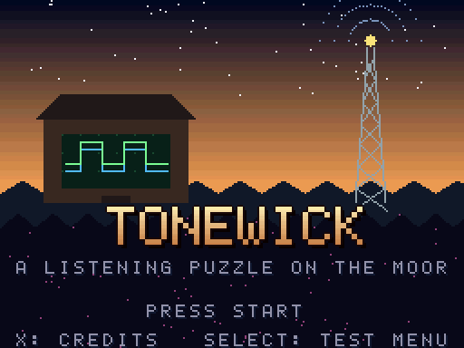
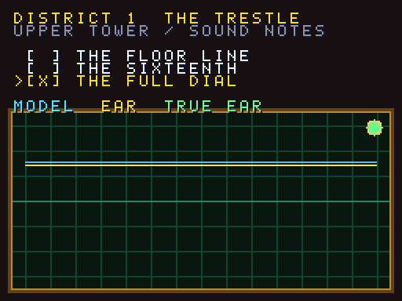
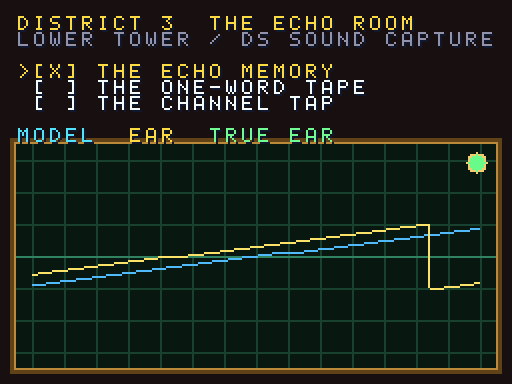

# Tonewick

[](LICENSE)
[](#build)
[](#build)

[한국어](README-KO.md)

<p align="center">  </p>

<sub>Captured from the built ROM in headless melonDS 1.1 (`tools/melonds/mds.sh`), not DeSmuME or real hardware; the district screens come from a keyed run (a line listened to). Top screen only at 2x nearest-neighbour (512×384).</sub>

An original listening puzzle for the Nintendo DS. You are the signal keeper of a listening post on a moor,
mending twelve broken signal lines in four districts with an oscilloscope. Each line is a register field of the
console's sound block, and the boundary values are the intended solutions: a square wave whose duty is 7 never
leaves the floor, a tape shorter than four words keeps its line busy and says nothing, a capture length of 0 writes
one word. The ROM listens to its own sound block with the capture units, so the game also judges itself: a rehearsal
ROM runs the exceptions, boundary values and documented bugs of the sound channels, the capture units and the
neighbouring devices (RTC, power management, save chip, firmware settings) against exact expected values and reports
a result block, so other emulators can use it as a regression test.

**Hardware areas it tests (level 2, "sound and I/O edges"):** the edges of the sound channels (duty 7, the divider,
volume register 127, tapes shorter than four words, the hold bit, the ADPCM loop reload, the noise shift register),
the sound capture units (length 0, the channel source, the add overflow and both-negative bugs) and the I/O devices
next to them (the RTC AM/PM flag in 24 hour mode, power management register mirrors, EEPROM status bits, the newest
firmware user-settings copy).

**Status.** The ARM7 sound lab (a register script the ARM9 hands over, with the capture buffer in main RAM), the
experiments, the twelve signal lines of the four districts, the rehearsal and its judge (17 target items, 10
prerequisites; the save items count only where a save chip exists) and the hidden auto QA run. The scope (the model's waveform against the ear's capture) and the
touch control panel are in, and a morning log screen (test menu) lists the clock, power, save chip and firmware
readings against their rules. On real hardware (run 1 on a DS Lite (2026-11-17), see [docs/HW-QA.md](docs/HW-QA.md)) one gating item differs and is under review. Progress is not saved.

- Languages: C (game, ARM9 + own ARM7 core), Python 3 (build-time tools)
- Toolchain: BlocksDS v1.25.0 (Docker image pinned by digest)
- Licence: Apache-2.0 — third-party notices in `THIRD_PARTY_NOTICES`, asset sources in `ASSETS.md`

## Playing

Start on the title. Each district has three signal lines. The top screen lists them and shows the scope: the blue trace is
what the ROM's own GBATEK model says the line should sound like at the dials' present setting, the yellow trace is what the
console's sound block actually produced, captured by the capture unit. A line **clears** when the model gives the class the
line needs; the ear's answer is printed beside the model's and a difference lights the lamp `THE EAR DISAGREES` without
stopping you (`NO SIGNAL` when nothing could be captured). Clear all three lines and end the shift (Start): the district's
audit runs and the next one opens.

| DS button | Action (melonDS key) |
|---|---|
| D-pad up/down (arrows) | choose a signal line |
| D-pad left/right | turn dial A |
| L / R (Q / W) or Y / X (A / S) | turn dial B (lines that have one) |
| A (X) | listen: run the experiment on the sound block |
| Touch | left / right half of a dial turns it back / on, the lever listens |
| Start (Return) | end the shift when all three lines are cleared |
| B (Z) | back to the title |

| District | Hardware behind it | Lines |
|---|---|---|
| 1 The trestle | PSG duty 7, the volume divider, volume register 127 | 3 |
| 2 The splice | a tape shorter than four words, the hold bit, the noise shift register | 3 |
| 3 The echo room | the ADPCM loop reload, capture length 0, the channel source | 3 |
| 4 The junction | the capture add-overflow and both-negative bugs, the morning log (RTC, power management, save chip, firmware) | 3 |

The speaker amplifier is switched off while an experiment runs, so the game is silent during a listen. The test menu (Select
on the title) opens any district, the morning log (the device readings against their rules) and the rehearsal.

## Build

```sh
./build.sh                  # tonewick.nds
./build.sh DEMO=rehearsal   # tonewick-rehearsal.nds, the ROM that judge.py grades
./build.sh -j8 release      # build/release/{rom,demos,judge}
```

The build runs in a Docker container (BlocksDS pinned by digest); nothing is installed on the host.
Two clean builds give the same SHA-256.

## Using it as an emulator test

`tonewick-rehearsal.nds` solves every line by script, runs every district's audit and leaves a 64-word result block (id `TWRH`)
at 0x0237F000 (layout in `arm9/source/game/lab.h`); `tools/judge.py` grades it against `expected.json` (target level 2, area
"sound and I/O edges"). No save chip and no NitroFS are needed. The ROM listens to itself: the ARM7 core starts a sound
channel and a capture unit from a register script and the ARM9 reduces the captured samples (1024 samples, two frames after
the sound started) to numbers. Every item is a measurement compared with a GBATEK range; the judged windows are whole frames
and ratios, never a cycle count. A value a capture never reached stays 0xFFFF and fails its item.

```sh
RTC=2026-11-16-15-30-00 tools/melonds/mds.sh run games/tonewick/tonewick-rehearsal.nds 900 out/tw "" 899 \
  | python3 games/tonewick/tools/judge.py --profile melonds-1.1-software
RTC_HOUR=15 RESULT_WORDS=64 tools/emu/emu.sh run games/tonewick/tonewick-rehearsal.nds 900 out/tw "" 899 \
  | python3 games/tonewick/tools/judge.py --profile desmume-pydesmume-0.0.9
```

`rtc-ampm-24h` reads the AM/PM flag and is graded only at 12:00 or later (n/a before), which is why the commands above fix the clock to the afternoon.

Exit code 0: every gating item passed (or the failing set equals the profile's). `known` in `expected.json` holds one profile
per emulator version and renderer. **Several target items are expected to fail in current emulators** (melonDS 1.1: the hold
bit, the two capture bugs, the power management mirrors; DeSmuME: more), which is the point of an L2 game; see
[docs/QA.md](docs/QA.md). The save items need a save chip and are n/a without one. Hardware: run 1 on a DS Lite
([docs/HW-QA.md](docs/HW-QA.md)); the two capture bugs are documented in GBATEK only.

## Layout

| Path | Contents |
|---|---|
| `arm9/source/game/` | the districts (`trestle.c`, `splice.c`, `echo.c`, `junction.c`), the ear (`ear.c`), scope and panel (`scope.c`), scenes, rehearsal, QA hooks |
| `arm9/source/core/sndlab.c`, `arm7/source/lab7.c` | the sound lab: the register script and the ARM7 that runs it |
| `tools/` | `mkassets.py` and `cvtools/` (asset generators), `judge.py`, `tests/` |
| `expected.json` | the judged items, levels, roles and emulator profiles |
| `docs/` | `QA.md`, `HW-QA.md` (and Korean twins), `images/` |
