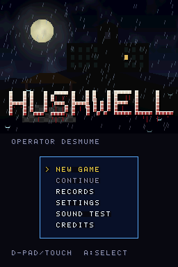
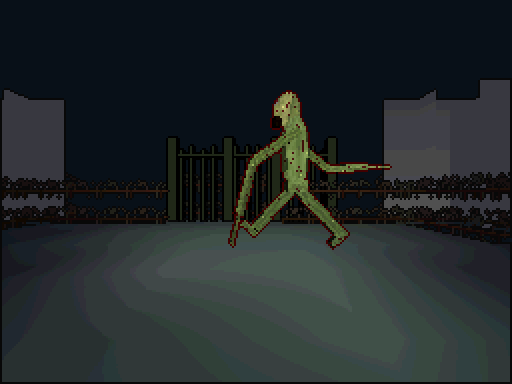
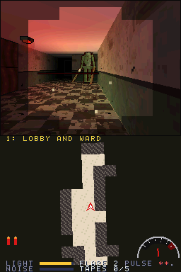
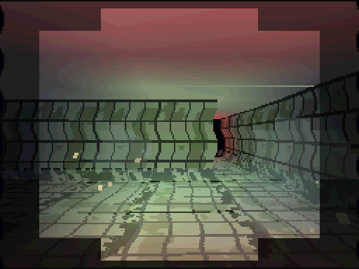
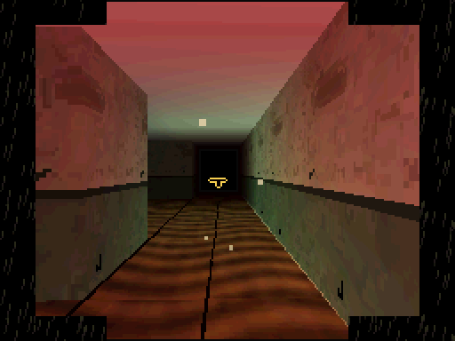
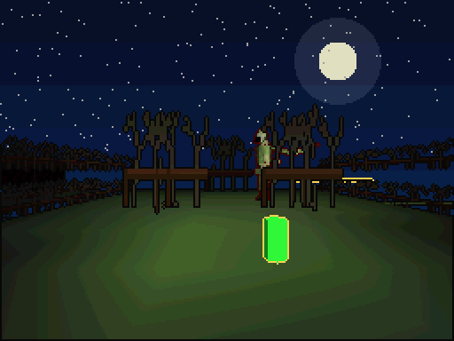
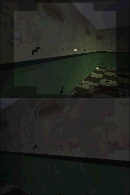

# Hushwell

[](LICENSE)
[](#빌드)
[](#빌드)
[](docs/QA-KO.md)

[English](README.md)

<p align="center"></p>

닌텐도 DS용 오리지널 1인칭 3D 서바이벌 호러입니다. 플레이어는 야간 무선 기사입니다.
사라진 조사팀의 마지막 무선을 따라, 오래된 우물 위에 지어진 산중의 폐쇄 요양원
허시웰로 들어갑니다. 우물에서 올라온 것은 소리로 사냥합니다. 가진 것은 손전등,
녹음기, 그리고 탄이 거의 없는 신호탄 권총뿐입니다.

위 화면은 HUD가 거의 없는 1인칭 3D 시점입니다. 아래 화면에는 탐색할수록 채워지는
손으로 그린 지도, 주운 테이프를 듣는 녹음기, 손전등 배터리, 그것이 가까워지면 바늘이
흔들리는 무선 잡음 미터가 있습니다. 공포 연출 하나하나가 DS 하드웨어 기능 하나를
쓰도록 만들었고, 같은 소스에서 기능 하나씩만 보여 주는 **기능 데모 ROM 65개**가
함께 빌드됩니다.

- 언어: C (게임, ARM9 + 자체 ARM7 코어), Python 3 (빌드 타임 도구)
- 툴체인: BlocksDS v1.25.0 (digest로 고정한 Docker 이미지)
- 라이선스: Apache-2.0 — 서드파티 고지는 `THIRD_PARTY_NOTICES`, 에셋 출처는 `ASSETS-KO.md`

## 빌드

Docker만 있으면 됩니다. `build.sh`가 고정된 BlocksDS 이미지에 Python 3를 더한 이미지를
만들고 그 안에서 `make`를 실행합니다.

```sh
./build.sh                    # hushwell.nds (본 빌드, EEPROM 64 KB 세이브 칩)
./build.sh SAVE=flash         # hushwell-save-flash.nds (FLASH 256 KB 변형)
./build.sh SAVE=fram          # hushwell-save-fram.nds  (FRAM 32 KB 변형)
./build.sh DEMO=3d-matrix     # hushwell-3d-matrix.nds  (기능 데모 하나)
./build.sh demos              # 기능 데모 65개 전부
./build.sh -j8 release        # build/release/{rom,demos}: hushwell-vX.Y.Z 태그가 배포하는 파일
./build.sh clean
```

에셋은 빌드할 때 코드(`tools/mkassets.py`)로 생성하므로 저장소에 바이너리 에셋이
없습니다. 빌드 결과물(`build/`, `*.nds`)은 커밋하지 않습니다.

## 조작

| 입력 | 동작 | melonDS (macOS) |
|---|---|---|
| 십자키 위/아래 | 앞으로 / 뒤로 걷기 | ↑ ↓ |
| 십자키 좌/우 | 돌아보기 (설정의 LOOK이 TOUCH DRAG면 터치 드래그로 돌아봄) | ← → |
| A | 조사, 문 열기, 무선기 사용(저장) | X |
| B (누른 채) | 달리기 — 빠르지만 발소리가 크다 | Z |
| Y | 손전등 켜기·끄기 | A |
| X | 아래 화면: 지도 ↔ 녹음기 | S |
| L (누른 채) | 숨죽이기: 웅크리고 천천히, 발소리 없음 | Q |
| R (누른 채) + A | 신호탄 겨누고 발사 (그것을 잠시 멈춘다) | W, X |
| Start | 일시정지 (Select: 그만두기, R: 한 프레임 진행, X/Y/B: 디버그 보기) | Return |
| Select | 위아래 화면 스왑 | Backspace |
| 터치 | 지도: 메모 핀 놓기/치우기 · 녹음기: 테이프 고르기, PLAY / REVERSE / STOP · 다이얼 자물쇠: 숫자 돌리기 | 마우스 |
| 뚜껑 닫기 | 자동 일시정지 후 절전 — 다시 열면 그것이 더 가까이 와 있다 | C |

QA 단축키: 타이틀에서 Select로 시작 챕터를 고릅니다. 일시정지 중 L+R을 누른 채 A를 누르면
그 챕터를 바로 클리어합니다.

## 플레이

그것은 복도를 떠돌아다닙니다. 발소리 하나하나가 그것이 들을 수 있는 소리입니다. 걸으면
조용하고, 달리면 멀리 퍼지고, 물을 헤치면 크고, 숨죽이면 들리지 않습니다. 손전등을 켜면
앞이 보이지만, 그것도 당신을 봅니다. 들키면 그것은 공격하고 물러났다가 다시 옵니다.
세 번 맞으면 어둠에 삼켜집니다. 신호탄은 그것을 몇 초 동안 멈춥니다. 비상 무선기에서
저장하고, 죽으면 마지막 무선기로 돌아갑니다.

챕터마다 열쇠 한두 개, 테이프 하나, 마지막 열쇠가 숨어 있습니다. 마지막 열쇠를 줍는 순간
추격이 시작됩니다. 그것이 곧장 달려오고 음악이 바뀌며, 출구까지 가야 합니다. 테이프 다섯
개를 모두 모으면 우물에서 두 번째 엔딩을 고를 수 있습니다.

| 챕터 | 장소 | 공포 연출 | 중심 하드웨어 |
|---|---|---|---|
| 프롤로그 | 비 오는 산길 | 끊기는 무선, 번개 속에 길을 가로지르는 형체 | HBlank DMA 빗줄기 레이어, 거리 포그, 스트리밍 BGM, 지오메트리 포트 직접 쓰기, W 버퍼 |
| 1 로비와 병동 | 좁은 복도와 병실 | 손전등 빛 밖의 어둠, 복도 끝을 가로지르는 그림자 | 조명 4개(손전등, 비상등, 번개, 신호탄), WIN0/WIN1 시야 마스크, 그림자 폴리곤, Z 버퍼, near plane 클리핑, 4x4 압축 벽·바닥, OBJ 윈도우 열쇠구멍 엿보기 |
| 2 침수된 수치료실 | 물에 잠긴 욕실과 보일러실 | 그것이 가까울 때 남는 잔상, 타일 벽에 울리는 발소리 | 반투명 수면, 디스플레이 캡처 잔상, 3D 레이어 HBlank 물결, VCount 화면 중간 전환, 알파 전용 포그, 사운드 캡처 리버브 |
| 3 기록 보관실 | 서고와 영사실 | 손상된 필름, 거꾸로 틀어야 들리는 목소리 | 메인 메모리 FIFO 표시 필름, 16bpp 비트맵 OBJ 사진, BG·OBJ 모자이크 필름 그레인, 윈도우 비네트, 역재생 테이프와 터치 다이얼 자물쇠 |
| 4 예배당과 정원 | 밤의 정원, 지붕 없는 예배당 | 실제 시각 0~4시(RTC)에 찾아오는 외곽선뿐인 방문자 | RTC, 툰 셰이딩(스테인드글라스 띠), 엣지 마킹, 알파 테스트 나뭇가지, 야외 W 버퍼, 후면 비트맵 하늘 |
| 5 우물 | 요양원 아래 갱도 | 양쪽 화면에 걸친 추격, 새카맣게 꺼지는 화면 | 디스플레이 캡처 기반 양화면 3D(앞/뒤), 벌레 떼의 폴리곤 RAM 초과, OBJ 라인 한계, 박스 테스트 명중, 엔진별 마스터 밝기, 안티에일리어싱, 16채널 |

모든 챕터에서 공통으로 쓰는 것: 엔진 B의 지도·녹음기, ARM9↔ARM7 IPC, 터치, 비상
무선기 저장. 펌웨어 사용자 설정도 쓰입니다. 무선 속 목소리가 DS 사용자 이름을 부르고,
생일에만 나오는 녹음이 있으며, 손전등 빛에 선호 색이 섞입니다.

### 스크린샷

<table>
<tr><td></td><td></td><td></td></tr>
<tr><td align="center">프롤로그: 산길</td><td align="center">1 로비와 병동</td><td align="center">2 침수된 수치료실</td></tr>
<tr><td></td><td></td><td></td></tr>
<tr><td align="center">3 기록 보관실</td><td align="center">4 예배당과 정원</td><td align="center">5 우물</td></tr>
</table>

<sub>빌드한 ROM을 헤드리스 DeSmuME 0.9.12(`tools/emu/`)로 찍은 화면입니다. melonDS나 실기가 아닙니다. 위는 3D 화면, 아래는 지도 화면이고, 5장 추격에서는 양쪽 화면 모두 3D(앞/뒤)입니다. DeSmuME의 기본 펌웨어 색이 초록이라 손전등 빛과 그것이 초록빛을 띱니다.</sub>

## 게임 흐름

부팅 로고(VRAM 직접 표시) → 경고문 → 타이틀(가만히 두면 데모 플레이) → 무선 교신 →
챕터 → 챕터 클리어(저장) → … → 5장이 끝나면 양화면 3D로 두 엔딩 중 하나, 스태프 롤 →
기록 저장. 죽으면 마지막 비상 무선기(없으면 챕터 시작)로 돌아갑니다.

## 디렉터리

```
arm7/source/        자체 ARM7 코어: 입력, RTC, 전원(libnds), 레지스터 직접 제어 사운드 엔진
arm9/source/core/   시스템: IPC/FIFO, IRQ, 타이머, DMA, BIOS, 하드웨어 연산, 입력/리플레이,
                    세이브(SPI 직접), NitroFS, 카트 DMA
arm9/source/gfx/    VRAM 배치, OAM, 텍스트 BG, 효과, 3D(gl3d), 모델, 빌보드/그림자
arm9/source/game/   장면, 챕터 루프(world.c), 렌더러(render.c), 챕터별 하드웨어(chfx.c),
                    아래 화면 HUD(hud.c), 엔딩
arm9/source/demo/   기능 데모 빌드
common/cv_ipc.h     ARM9↔ARM7 메시지 형식
tools/              mkassets.py(에셋 생성), cvtools/(맵, 이미지, 오디오, 코덱)
docs/QA-KO.md       melonDS 검수 기록지와 데모별 기대 화면
licenses/           서드파티 라이선스 원문(ROM의 NitroFS에도 들어감)
```

## 하드웨어 기능과 코드 위치

| 분야 | 기능 | 쓰는 곳 | 코드 |
|---|---|---|---|
| 시스템 | ARM9/ARM7 분업, IPCSYNC 마운트 확인, 자체 FIFO 메시지 | 사운드 요청, 입력 패킷, WRAM 넘기기 | `common/cv_ipc.h`, `core/sys.c`, `arm7/source/*` |
| | 공유 WRAM(WRAMCNT) | ARM7 스트리밍 링 버퍼, 맵 로딩 중 ARM9 압축 해제 작업 공간 | `core/sys.c`, `game/world.c` |
| | 인터럽트 | VBlank 루프, HBlank 비·물결, VCount 분할(2장), 타이머, DMA, IPC, 키(일시정지 절전 복귀) | `core/irq.c`, `game/chfx.c` |
| | 타이머 4개 + 캐스케이드 | 플레이 시간, 심장박동 박자(타이머 IRQ), 손전등 깜빡임(카운터 읽기), 프로파일러 | `core/timer.c`, `game/world.c` |
| | DMA 모든 시작 모드 | 맵 로드, OAM, HBlank 비·물결, 카트 읽기, 디스플레이 리스트, 필름(메인 메모리 표시), 채우기 | `core/dma.c`, `game/chfx.c` |
| | BIOS | LZ77(VRAM·WRAM), CpuSet/FastSet, Div/Sqrt, IntrWait, Halt, GetCRC16(세이브) | `core/*`, `gfx/text.c` |
| | 하드웨어 나눗셈·제곱근 | 소리 감쇠, 청각·시야 거리, 손전등 원뿔, 카메라 | `core/cvmath.c`, `game/render.c` |
| 2D | 엔진 A·B, 화면 스왑 | 3D 시점 / 지도·녹음기, Select로 스왑 | `game/chfx.c`, `game/hud.c` |
| | 텍스트, 어파인, 확장 어파인, 비트맵, 대형 비트맵 | 메시지, 도는 손그림 지도, 타이틀 로고, 타이틀 그림, 요양원 도면(2d-bitmap 데모) | `game/hud.c`, `game/scenes.c` |
| | 모자이크, 윈도우, OBJ 윈도우, 블렌딩, 마스터 밝기 | 필름 그레인, 시야 마스크, 열쇠구멍, 비, 페이드와 암전 | `game/chfx.c` |
| | 스프라이트(일반, 어파인, 비트맵, 1D/2D, 우선순위, 모자이크, 라인 한계) | 지도 화살표와 핀, 미터 바늘과 녹음기 릴, 사진, 벌레 떼 | `game/hud.c`, `game/render.c` |
| | 확장 팔레트(BG·OBJ) | 무선 교신 그림, 초상화 색 변형(데모) | `game/scenes.c`, `demo/demo.c` |
| | VRAM 뱅크 A~I | 장면마다 배치 하나(`VL_GAME`, `VL_CORE`, `VL_DUAL3D` 등) | `gfx/vram.c` |
| | 디스플레이 캡처, 디스플레이 모드 | 잔상, 양화면 추격과 엔딩, 부팅 로고, 영사기 필름 | `game/chfx.c`, `game/ending.c` |
| 3D | 지오메트리 FIFO(DMA 리스트 + 포트 직접 쓰기) | 소품과 그것은 디스플레이 리스트, 격자 세계는 포트 쓰기 | `gfx/gl3d.c`, `game/render.c` |
| | 행렬 스택, 조명, 클리핑, 텍스처 7종, 폴리곤 속성, 툰·하이라이트, 엣지 마킹, 포그, AA·알파 테스트, Z/W 버퍼, 후면 비트맵, 테스트, 합성, 폴리곤 한계 | 챕터 표 참고 | `game/render.c`, `game/chfx.c` |
| 사운드 | 16채널, PCM8/16/ADPCM, PSG 사각파·노이즈, 캡처 리버브, 스트리밍 | 발소리, 그것, 잡음, 테이프, 음악 | `arm7/source/sound7.c`, `core/snd.c` |
| 카트와 주변기기 | NitroFS, 세이브 칩, 펌웨어 사용자 설정, RTC, 터치, 전원 | 맵과 그림, 진행 저장, 이름·생일·색, 밤의 방문자, 지도 핀과 다이얼, 뚜껑 절전 | `core/*`, `game/*` |

## QA

- **기능 데모 빌드**: `./build.sh DEMO=<이름>` — 이름은 `Makefile`의 `DEMOS`와
  `docs/QA-KO.md`에 있습니다. 데모는 확인 대상 기능과 텍스트 BG 콘솔만 씁니다.
- **고정 체크포인트**: 데모는 120프레임째에 화면을 완성하고 메인 RAM `0x0237F000`에
  `{u32 매직 "CVER", u32 데모 이름 해시, u32 프레임, u32 값[13]}`을 씁니다.
- **입력 리플레이**: 챕터 플레이마다 키, 터치, 뚜껑, RTC 시, 시드, 그리고 시작 상태(챕터,
  무선기, 체력, 신호탄, 배터리, 열쇠, 테이프, 주운 물건)를 기록해 세이브 칩에 둡니다.
  기록 화면에서 X를 누르면 마지막 플레이를 다시 봅니다.
- **난수**: 그것의 AI와 연출용 난수는 세이브(또는 리플레이 로그)에 저장된 시드에서만
  뽑습니다. 타이머나 RTC를 시드로 쓰지 않습니다. 손전등 깜빡임은 타이머를 읽지만 화면에만
  영향을 줍니다.
- **데모 플레이**: 타이틀에서 20초 기다리면 내장 로그(`demo0–5.rpl`)가 챕터를 돌아다닙니다.
- **어두운 화면 검수**: 일시정지 후 X = 조명 모두 켜기, Y = 시야 마스크 끄기, B = 아래 화면
  개발자 콘솔. 설정에 밝기 보정이 있고, 일시정지 중 R로 한 프레임씩 진행합니다.

### 검증 현황 (이 게임을 만든 세션 기준, 2026-11-10)

- BlocksDS v1.25.0(고정 digest)으로 본 빌드와 데모 65개가 경고 없이 빌드됩니다.
- 헤드리스 DeSmuME 0.9.12(py-desmume) 자동 스모크 테스트: 부팅 → 경고문 → 타이틀 → 무선
  교신 → 모든 챕터(걷기, 지도, 녹음기, 손전등, 신호탄), 그것이 듣고 쫓고 공격하고 물러나기,
  사망 → 재시도, QA 챕터 클리어 → 양화면 엔딩 → 크레딧 → 기록 저장, 기록/설정/사운드 테스트
  화면, 데모 플레이, 5장 양화면 추격, 3장 필름과 다이얼, 4장 밤의 방문자, 우물 엔딩, 뚜껑
  절전, 녹화한 플레이와 리플레이의 일치, 데모 65개 체크포인트 도달. 자세한 내용은
  `docs/QA-KO.md`에 있습니다.
- 깨끗한 빌드 두 번의 `hushwell.nds` SHA-256이 같습니다(재현 가능한 빌드).
- **melonDS 검수는 아직 하지 않았습니다.** 기획서의 1차 목표(melonDS에서 완주)는
  `docs/QA-KO.md` 기록지로 확인해야 합니다. DeSmuME는 폴리곤 RAM 사용량과 초과 플래그를
  보고하지 않으므로 5장 벌레 떼와 `3d-limits`는 melonDS에서 확인해야 합니다.
- 실기 테스트는 하지 않았습니다.

## 기획서 열린 질문에 대한 선택

| 질문 | 선택 |
|---|---|
| 저장소 위치와 공개 시점 | 이 저장소(`hushwell/`), 공개는 메인테이너가 정할 때 `hushwell-vX.Y.Z` 태그로 |
| 본 빌드의 세이브 칩 종류 | EEPROM 64 KB, FLASH·FRAM은 변형 빌드 |
| 에셋 제작 방식 | 전부 코드로 생성(CC0 수집 없음) |
| 실기 검수 | 아직 — 에뮬레이터 스모크 테스트만 |
| 언어 지원 범위 | 게임 텍스트는 영어만(자체 5x7 폰트). 펌웨어 언어 설정은 읽어서 설정 화면에 보여 줌 |
| 마이크 연출(숨소리를 그것이 듣는다) | 넣지 않음(자체 ARM7 코어에 아직 마이크 경로가 없음) |
| 폭력·고어 수위와 경고문 | 화면에 고어 없음(공격은 흔들림, 소리, 좁아지는 시야로 표현), 부팅 시 번쩍임·큰 소리·폭력 표현 경고 |

## 라이선스

- Hushwell 소스와 생성 에셋: Apache License 2.0(`LICENSE`, `NOTICE`, `ASSETS-KO.md`).
  모든 소스 파일은 `SPDX-License-Identifier: Apache-2.0`으로 시작합니다.
- ROM에 들어가는 서드파티 코드: libnds(zlib), BlocksDS crts(MPL-2.0, 일부 zlib),
  picolibc(BSD 계열), libgcc(GPL-3.0 + 런타임 예외). 고지는 `THIRD_PARTY_NOTICES`,
  원문은 `licenses/`에 있고, 같은 파일이 ROM의 NitroFS `/licenses/`에 들어가 게임 안
  **크레딧 → X(라이선스 뷰어)**에서 읽을 수 있습니다.
- 자체 ARM7 코어를 쓰므로 DSWiFi, lwIP, Mbed TLS, Maxmod, LibXM7은 들어가지 않습니다.
