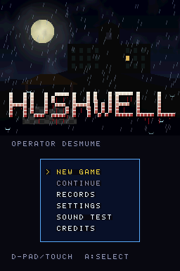
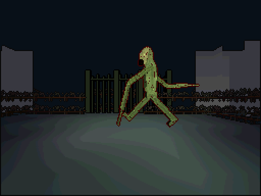
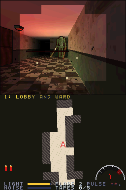
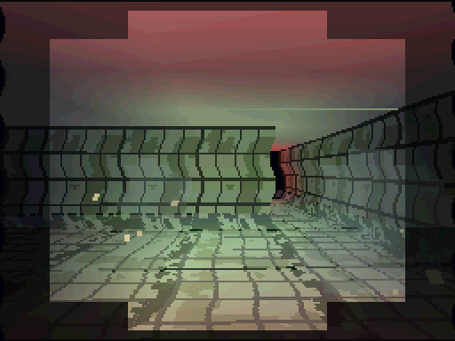
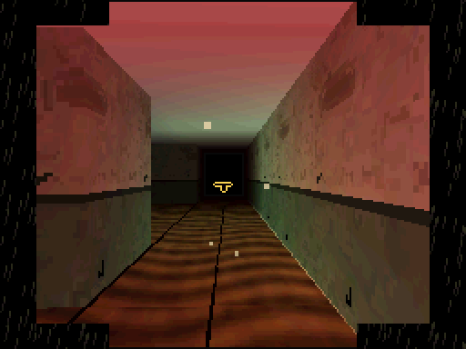
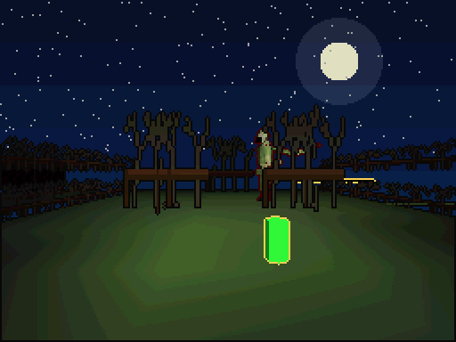
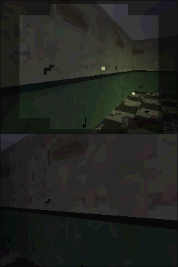

# Hushwell

[](LICENSE)
[](#build)
[](#build)
[](docs/QA.md)

[한국어](README-KO.md)

<p align="center"></p>

An original first-person 3D survival horror for the Nintendo DS. You are a night
radio operator. The last transmission of a missing survey team leads you to
Hushwell, a closed sanatorium in the mountains, built over an old well. Whatever
comes up out of the well hunts by sound. You have a flashlight, a recorder and a
flare pistol with very few flares.

The top screen is the first-person 3D view with almost no HUD; the bottom screen is
a hand-drawn map that fills in as you explore, a recorder for the tapes you find,
the flashlight battery and a radio-static meter whose needle swings when the creature
is near. Each scare is built on one DS hardware feature, and the same source builds
**65 feature demo ROMs** that each show one feature on its own.

- Languages: C (game, ARM9 + own ARM7 core), Python 3 (build-time tools)
- Toolchain: BlocksDS v1.25.0 (Docker image pinned by digest)
- Licence: Apache-2.0 — third-party notices in `THIRD_PARTY_NOTICES`, asset sources in `ASSETS.md`

## Build

Docker is all you need. `build.sh` builds an image from the pinned BlocksDS image
plus Python 3, and runs `make` inside it.

```sh
./build.sh                    # hushwell.nds (main build, EEPROM 64 KB save chip)
./build.sh SAVE=flash         # hushwell-save-flash.nds (FLASH 256 KB variant)
./build.sh SAVE=fram          # hushwell-save-fram.nds  (FRAM 32 KB variant)
./build.sh DEMO=3d-matrix     # hushwell-3d-matrix.nds  (one feature demo)
./build.sh demos              # all 65 feature demos
./build.sh -j8 release        # build/release/{rom,demos}: what a hushwell-vX.Y.Z tag ships
./build.sh clean
```

Assets are generated by code (`tools/mkassets.py`) at build time, so the repository
holds no binary assets. Build output (`build/`, `*.nds`) is never committed.

## Controls

| Input | Action | melonDS (macOS) |
|---|---|---|
| D-pad up/down | Walk forward / back | ↑ ↓ |
| D-pad left/right | Turn (touch drag turns instead when LOOK is set to TOUCH DRAG) | ← → |
| A | Examine, open doors, use radios (saves) | X |
| B (hold) | Run — faster, but the footsteps are loud | Z |
| Y | Flashlight on / off | A |
| X | Bottom screen: map ↔ recorder | S |
| L (hold) | Hush: crouch, slow, silent footsteps | Q |
| R (hold) + A | Aim and fire a flare (stuns the creature) | W, X |
| Start | Pause (Select: quit, R: advance one frame, X/Y/B: debug views) | Return |
| Select | Swap the screens | Backspace |
| Touch | Map: drop or lift memo pins · Recorder: pick a tape, PLAY / REVERSE / STOP · Dial lock: turn the digits | mouse |
| Close lid | Auto pause and sleep — when you open it, the creature has come closer | C |

QA shortcuts: on the title, Select picks the starting chapter. While paused, hold
L+R and press A to clear the chapter at once.

## How it plays

The creature wanders the halls. Every footstep is a sound it can hear: walking is
quiet, running carries far, wading through water is loud, hushing is silent. A lit
flashlight lets you see — and lets it see you. If it finds you it strikes, backs off
and comes again; three strikes and the dark takes you. A flare stuns it for a few
seconds. Save at the emergency radios; dying sends you back to the last radio.

Each chapter hides a key or two, a tape and a final key. Picking up the final key
starts the chase: the creature comes straight for you, the music changes, and you have
to reach the exit. Collect all five tapes and the well offers a second ending.

| Chapter | Place | Scare | Hardware at its centre |
|---|---|---|---|
| Prologue | Rainy mountain road | Static on the radio, a shape crossing the road in a lightning flash | HBlank-DMA rain layer, distance fog, streamed BGM, direct geometry port writes, W-buffer |
| 1 Lobby and ward | Narrow halls and wards | The dark outside the beam, a shadow crossing the end of the hall | Four lights (flashlight, emergency lamps, lightning, flares), WIN0/WIN1 vision mask, shadow polygon, Z-buffer, near-plane clipping, 4x4-compressed walls and floors, keyhole peek through an OBJ window |
| 2 Flooded hydrotherapy | Flooded baths and boiler room | Afterimages when it is close, footsteps ringing off the tiles | Translucent water, display-capture afterimage, HBlank ripple of the 3D layer, VCount mid-frame split, alpha-only fog, sound-capture reverb |
| 3 Records archive | Stacks and projection room | A damaged film, a voice heard only when the tape runs backwards | Main-memory display FIFO film, 16bpp bitmap OBJ photograph, BG/OBJ mosaic film grain, windowed vignette, reversed tape and touch dial lock |
| 4 Chapel and garden | Night garden, roofless chapel | Between midnight and four (RTC), a visitor that is only an outline | RTC, toon shading (stained-glass bands), edge marking, alpha-tested branches, W-buffer outdoors, rear-plane bitmap sky |
| 5 The well | Tunnels under the sanatorium | A chase on both screens, a screen that goes black | Dual-screen 3D through display capture (ahead / behind), polygon RAM overflow from a bug swarm, OBJ line limit, box-test hits, master brightness per engine, anti-aliasing, 16 channels |

Everything shared by every chapter: the engine-B map and recorder, ARM9↔ARM7 IPC,
touch, and saving at the emergency radios. The firmware user settings also play a
part: the voice on the radio calls you by your DS user name, a recording plays only
on your birthday, and the flashlight takes on your favourite colour.

### Screenshots

<table>
<tr><td></td><td></td><td></td></tr>
<tr><td align="center">Prologue: the road</td><td align="center">1 Lobby and ward</td><td align="center">2 Flooded hydrotherapy</td></tr>
<tr><td></td><td></td><td></td></tr>
<tr><td align="center">3 Records archive</td><td align="center">4 Chapel and garden</td><td align="center">5 The well</td></tr>
</table>

<sub>Captured from the built ROM in headless DeSmuME 0.9.12 (`tools/emu/`), not melonDS or real hardware. Top screen (3D) over bottom screen (map); in chapter 5 the chase puts 3D on both screens (ahead / behind). DeSmuME's default firmware colour is green, which tints the flashlight and the creature.</sub>

## Game flow

Boot logo (direct VRAM display) → content warning → title (attract-mode demo play
if left alone) → radio transmission → chapter → chapter clear (saved) → … → after
chapter 5, one of two endings with 3D on both screens, then the staff roll → record
saved. Death returns you to the last emergency radio (or the chapter start).

## Directories

```
arm7/source/        own ARM7 core: input, RTC, power (libnds), register-level sound engine
arm9/source/core/   system: IPC/FIFO, IRQ, timers, DMA, BIOS, hardware maths, input/replay,
                    save (direct SPI), NitroFS, cart DMA
arm9/source/gfx/    VRAM layouts, OAM, text BGs, effects, 3D (gl3d), models, billboards/shadows
arm9/source/game/   scenes, chapter loop (world.c), renderer (render.c), per-chapter hardware
                    (chfx.c), bottom-screen HUD (hud.c), endings
arm9/source/demo/   feature demo builds
common/cv_ipc.h     ARM9↔ARM7 message formats
tools/              mkassets.py (asset generation), cvtools/ (maps, images, audio, codecs)
docs/QA.md          melonDS QA record sheet and expected screen per demo
licenses/           third-party licence texts (also shipped in the ROM's NitroFS)
```

## Hardware features and where the code is

| Area | Feature | Used for | Code |
|---|---|---|---|
| System | ARM9/ARM7 split, IPCSYNC mount check, own FIFO messages | sound requests, input packets, WRAM handover | `common/cv_ipc.h`, `core/sys.c`, `arm7/source/*` |
| | Shared WRAM (WRAMCNT) | ARM7 streaming ring buffer, ARM9 decompression scratch while loading maps | `core/sys.c`, `game/world.c` |
| | Interrupts | VBlank loop, HBlank rain/ripple, VCount split (chapter 2), timers, DMA, IPC, keys (wake from pause sleep) | `core/irq.c`, `game/chfx.c` |
| | Four timers + cascade | play time, heartbeat tempo (timer IRQ), flashlight flicker (counter read), profiler | `core/timer.c`, `game/world.c` |
| | Every DMA start mode | map loads, OAM, HBlank rain/ripple, cart reads, display lists, film (main-memory display), fills | `core/dma.c`, `game/chfx.c` |
| | BIOS | LZ77 (VRAM and WRAM), CpuSet/FastSet, Div/Sqrt, IntrWait, Halt, GetCRC16 (saves) | `core/*`, `gfx/text.c` |
| | Hardware divide / square root | sound falloff, hearing and sight range, flashlight cone, camera | `core/cvmath.c`, `game/render.c` |
| 2D | Engines A and B, screen swap | 3D view / map and recorder, Select swaps | `game/chfx.c`, `game/hud.c` |
| | Text, affine, extended affine, bitmap, large bitmap | messages, rotating hand-drawn map, title logo, title illustration, the sanatorium plan (2d-bitmap demo) | `game/hud.c`, `game/scenes.c` |
| | Mosaic, windows, OBJ window, blending, master brightness | film grain, vision mask, keyhole, rain, fades and blackouts | `game/chfx.c` |
| | Sprites (normal, affine, bitmap, 1D/2D, priority, mosaic, line limit) | map arrow and pins, meter needle and recorder reels, photograph, bug swarm | `game/hud.c`, `game/render.c` |
| | Extended palettes (BG and OBJ) | radio illustrations, portrait colour variants (demos) | `game/scenes.c`, `demo/demo.c` |
| | VRAM banks A–I | one layout per scene (`VL_GAME`, `VL_CORE`, `VL_DUAL3D`, …) | `gfx/vram.c` |
| | Display capture, display modes | afterimage, dual-screen chase and endings, boot logo, projector film | `game/chfx.c`, `game/ending.c` |
| 3D | Geometry FIFO (DMA lists + direct port writes) | props and the creature as display lists, the grid world by port writes | `gfx/gl3d.c`, `game/render.c` |
| | Matrix stack, lights, clipping, 7 texture formats, polygon attributes, toon/highlight, edge marking, fog, AA/alpha test, Z/W buffer, rear-plane bitmap, tests, compositing, polygon limit | see the chapter table | `game/render.c`, `game/chfx.c` |
| Sound | 16 channels, PCM8/16/ADPCM, PSG square and noise, capture reverb, streaming | footsteps, the creature, static, tapes, music | `arm7/source/sound7.c`, `core/snd.c` |
| Cart and peripherals | NitroFS, save chip, firmware user settings, RTC, touch, power | maps and art, progress, name/birthday/colour, night visitor, map pins and dial, lid sleep | `core/*`, `game/*` |

## QA

- **Feature demo builds**: `./build.sh DEMO=<name>` — names are in the `Makefile`'s
  `DEMOS` and in `docs/QA.md`. A demo uses only its feature plus a text BG console.
- **Fixed checkpoint**: each demo completes its screen at frame 120 and writes values to
  main RAM at `0x0237F000` as `{u32 magic "CVER", u32 demo-name hash, u32 frame, u32 values[13]}`.
- **Input replay**: every chapter run records keys, touch, lid, the RTC hour, the seed and
  the state it started from (chapter, radio, health, flares, battery, keys, tapes, taken
  objects), and keeps the log on the save chip. X on the records screen replays the last run.
- **Randomness**: the creature's AI and staging randomness come only from the seed stored in
  the save (or the replay log), never from timers or the RTC. The flashlight flicker reads
  a timer but only changes the picture.
- **Demo play**: wait 20 seconds on the title and the built-in logs (`demo0–5.rpl`) walk
  through each chapter.
- **Dark-scene checks**: pause, then X = all lights on, Y = vision mask off, B = developer
  console on the bottom screen; settings have a brightness correction; R in pause advances
  one frame.

### Verification status (as of the session that created this game, 2026-11-10)

- With BlocksDS v1.25.0 (pinned digest) the main build and all 65 demos build without warnings.
- Automated smoke tests on headless DeSmuME 0.9.12 (py-desmume): boot → warning → title →
  radio → every chapter (walking, map, recorder, flashlight, flare), the creature hearing,
  hunting, striking and retreating, death → retry, QA chapter clear → dual-screen ending →
  credits → record saved, records/settings/sound test screens, attract-mode demo play, the
  chapter 5 dual-screen chase, the chapter 3 film and dial, the chapter 4 night visitor, the
  well ending, lid sleep, a recorded run matching its replay, and all 65 demos reaching
  their checkpoint. See `docs/QA.md`.
- Two clean builds give the same SHA-256 for `hushwell.nds` (reproducible build).
- **melonDS QA has not been done yet.** The design document's primary goal (finishing the
  game in melonDS) still has to be checked with the `docs/QA.md` sheet. DeSmuME doesn't
  report polygon RAM usage or the overflow flag, so the chapter 5 swarm and `3d-limits`
  need checking in melonDS.
- No testing on real hardware.

## Choices for the design document's open questions

| Question | Choice |
|---|---|
| Repository location and release timing | this repository (`hushwell/`); release by a `hushwell-vX.Y.Z` tag when the maintainer decides |
| Save chip for the main build | EEPROM 64 KB; FLASH and FRAM as variant builds |
| How assets are made | all generated by code (no CC0 collection) |
| Real-hardware QA | not yet — emulator smoke tests only |
| Language support | game text in English only (own 5x7 font); the firmware language is read and shown in settings |
| Microphone (the creature hears your breath) | not included (the ARM7 core has no microphone path yet) |
| Violence / gore level and warning text | no gore on screen (strikes are shown as a jolt, a sound and a narrowing view); boot warning about flashing lights, loud sounds and violence |

## Licence

- Hushwell source and generated assets: Apache License 2.0 (`LICENSE`, `NOTICE`, `ASSETS.md`).
  Every source file starts with `SPDX-License-Identifier: Apache-2.0`.
- Third-party code in the ROM: libnds (zlib), BlocksDS crts (MPL-2.0, parts zlib),
  picolibc (BSD-style), libgcc (GPL-3.0 + runtime exception). Notices are in
  `THIRD_PARTY_NOTICES`, the full texts in `licenses/`; the same files are shipped in the
  ROM's NitroFS `/licenses/` and can be read in game under **Credits → X (licence viewer)**.
- Hushwell runs its own ARM7 core, so DSWiFi, lwIP, Mbed TLS, Maxmod and LibXM7 are not included.
