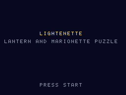
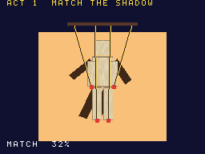
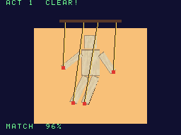
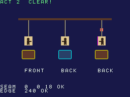

# Lightenette

[](LICENSE)
[](#빌드)
[](#빌드)

[English](README.md)

<p align="center">   </p>

닌텐도 DS용 오리지널 퍼즐 액션 게임입니다. 등불을 들고 터치스크린으로 마리오네트
인형극을 조종합니다. 동시에 ROM이 스스로 판정하도록 만들었습니다. 자기 화면을
캡처해 정해진 색의 픽셀 수를 세고, 에뮬레이터가 실기와 어긋난 적이 있는 항목의
통과/실패를 보고하므로 다른 에뮬레이터가 회귀 테스트로 쓸 수 있습니다.

**상태: 개발 중.** 타이틀 화면, 정확도 판정(타이틀 + Select), 1막 프로토타입(타이틀 + Start)까지
동작하고 2막은 테스트 메뉴(1막 클리어 뒤에도 이어짐)에서 열립니다. 나머지 막은 단계별로
추가합니다. 1막: 터치스크린의 슬라이더 4개를 끌어 종이 마리오네트의 팔다리를 위 화면의 그림자에
맞춥니다(실루엣 겹침 85% 이상). 2막: 인형을 고르고(좌우 또는 터치) L/R로 뒤돌려, 종이 인형 세 개가
모두 아래 화면이 요구하는 방향을 보게 합니다. 뒤돌기는 정점에 직접 쓴 역방향 텍스처 좌표로 카드를
뒤집고, 세 번째(꿰맨) 인형의 뒷면에는 재단선이 보일 수 있습니다.

- 언어: C(게임, ARM9 + 자체 ARM7 코어), Python 3(빌드 시 도구)
- 툴체인: BlocksDS v1.25.0 (digest로 고정한 Docker 이미지)
- 라이선스: Apache-2.0 — 서드파티 고지는 `THIRD_PARTY_NOTICES`, 에셋 출처는 `ASSETS.md`

## 빌드

Docker만 있으면 됩니다.

```sh
./build.sh                    # lightenette.nds
./build.sh SAVE=flash         # lightenette-save-flash.nds
./build.sh SAVE=fram          # lightenette-save-fram.nds
./build.sh -j8 release        # build/release/{rom,demos}: lightenette-vX.Y.Z 태그가 배포하는 것
./build.sh clean
```

깨끗한 빌드를 두 번 하면 SHA-256이 같습니다.

## 정확도 판정

타이틀 + Select는 테스트 메뉴(정확도 판정, 2막, 1·2막 리허설)를 엽니다. 판정(또는 `lightenette-acc-stage.nds` 데모 ROM)은 정지 장면을 돌려, melonDS가 실기와
다르다고 보고된 세 항목을 판정합니다: 역방향 텍스처 좌표([#2008](https://github.com/melonDS-emu/melonDS/issues/2008)),
밝기 효과와 함께 쓰는 반투명 OBJ([#2503](https://github.com/melonDS-emu/melonDS/issues/2503)), 엣지 마킹·라인 폴리곤([#2549](https://github.com/melonDS-emu/melonDS/issues/2549)).
값은 화면과 `0x0237F000`의 결과 블록(구조는 `arm9/source/judge/judge.h`)에 나옵니다. NitroFS 파일은 필요 없습니다.

## 리허설과 판정 스크립트

리허설은 ROM에 내장한 터치 스크립트로 1막을, 키 스크립트로 2막을 재생한 뒤 판정을 돌리고 결과 블록 하나를 남깁니다
(구조는 `arm9/source/game/rehearsal.h`). 펜 입력, 세이브 칩, NitroFS를 쓰지 않습니다. 테스트
메뉴에서 들어가거나, 곧바로 부팅하는 ROM을 빌드합니다: `./build.sh DEMO=rehearsal` →
`lightenette-rehearsal.nds`.

`expected.json`에 검사 항목마다 프레임, 기대값, 허용 오차, 출처, 부팅 경로, 실기 모델을
적습니다. `tools/judge.py`는 실행 로그를 읽어 판정하며 Python 3만 있으면 되고, 판정 대상
항목이 모두 OK이면 0을 반환합니다(1: NG 항목 있음, 2: 유효한 결과 블록 없음). 출처가
`unconfirmed`인 항목은 정보용이라 실행을 실패시키지 않습니다.

```sh
# melonDS 헤드리스 러너(GL 렌더러는 RENDERER=gl|compute), DeSmuME: RESULT_WORDS=32 tools/emu/emu.sh run …
tools/melonds/mds.sh run lightenette/lightenette-rehearsal.nds 480 out/mds/reh "" 479 > reh.log
python3 lightenette/tools/judge.py reh.log
```

출처: `GBATEK`(문서화된 동작), `report:<ref>`(제3자의 실기 보고), `hw:<모델>`(우리가 실기에서
측정), `rom`(ROM 자체의 결정적 로직), `unconfirmed`. 판정 스크립트는 두 하네스의 `RESULT` 줄과
결과 블록의 `PEEK` 덤프를 읽습니다.

## 구성

```
arm9/source/game/   장면
arm9/source/judge/  정확도 판정(캡처, 픽셀 세기, 결과 블록)
arm9/source/demo/   데모 ROM 진입점(acc-stage, rehearsal)
arm9/source/core/   시스템, 입력, DMA, 세이브, 사운드(corvane 계층)
arm9/source/gfx/    2D/3D 계층(corvane 계층)
arm7/               자체 ARM7 코어
tools/              에셋 생성기(Python 3, 표준 라이브러리만)
```
