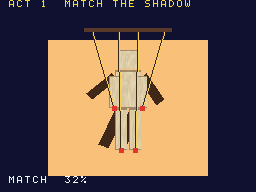
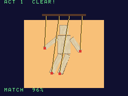

# Lightenette

[](LICENSE)
[](#build)
[](#build)

[한국어](README-KO.md)

<p align="center">  </p>

An original puzzle-action game for the Nintendo DS: you carry a lantern and work a
marionette show with the touch screen. It is also built to judge itself: the ROM
captures its own display, counts pixels of fixed colours and reports pass/fail for
cases where emulators have disagreed with hardware, so other emulators can use it as
a regression test.

**Status: work in progress.** The title screen, the accuracy judge (title + Select) and a
prototype of act 1 (title + Start) run; the other acts land stage by stage. Act 1: drag the
four sliders on the touch screen to swing the paper marionette's limbs until they cover the
shadow on the top screen (silhouette overlap 85% or more).

- Languages: C (game, ARM9 + own ARM7 core), Python 3 (build-time tools)
- Toolchain: BlocksDS v1.25.0 (Docker image pinned by digest)
- Licence: Apache-2.0 — third-party notices in `THIRD_PARTY_NOTICES`, asset sources in `ASSETS.md`

## Build

Docker is all you need.

```sh
./build.sh                    # lightenette.nds
./build.sh SAVE=flash         # lightenette-save-flash.nds
./build.sh SAVE=fram          # lightenette-save-fram.nds
./build.sh -j8 release        # build/release/{rom,demos}: what a lightenette-vX.Y.Z tag ships
./build.sh clean
```

Two clean builds give the same SHA-256.

## Accuracy judge

Title + Select (or the `lightenette-acc-stage.nds` demo ROM) runs a static scene and grades
three cases melonDS reported against hardware: reversed texture coordinates ([#2008](https://github.com/melonDS-emu/melonDS/issues/2008)),
a translucent OBJ over 3D with a brightness effect ([#2503](https://github.com/melonDS-emu/melonDS/issues/2503)) and
edge marking / line polygons ([#2549](https://github.com/melonDS-emu/melonDS/issues/2549)). The values are on screen and in the
result block at `0x0237F000` (layout in `arm9/source/judge/judge.h`). It needs no NitroFS file.

## Layout

```
arm9/source/game/   scenes
arm9/source/judge/  accuracy judge (capture, pixel counts, result block)
arm9/source/demo/   demo ROM entry (acc-stage)
arm9/source/core/   system, input, DMA, save, sound (corvane layers)
arm9/source/gfx/    2D/3D layers (corvane layers)
arm7/               own ARM7 core
tools/              asset generators (Python 3, stdlib only)
```
